# The assembly guide

*Generated 2026-10-21 by `pcs14 package`, from the build, the CAD's placements and its hardware list. Each picture is the CAD's drone built up to that step, the new parts in spearmint. Parts lists are in [parts.md](parts.md), the wiring in [wiring.md](wiring.md).*

Work on a clean bench with the pack nowhere near it until the pack's own step. The props stay off until the first tethered flight.

## 1. The frame

Build the Nazgul XL10's frame from iFlight's own instructions, the arms between the bottom plates. Leave the top plate off until the stack and the safety monitor are in: everything in the bay goes in from above.

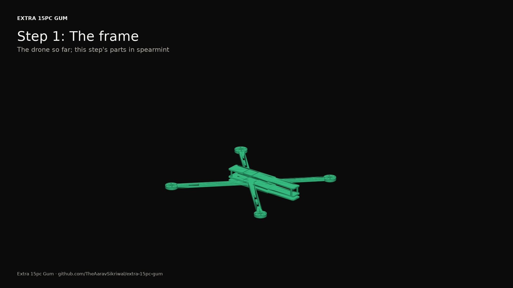

## 2. The motors

One motor on each arm, with the screws that come with it. A screw that's too long reaches the windings and shorts them, so check each one's length against the motor's mount before it goes in. Leave the motor leads long for now; they're cut to their routes in the wiring.

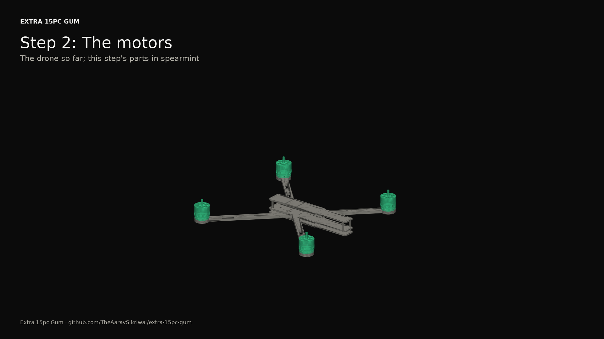

## 3. The stack

The ESC on the middle plate on its silicone grommets, then the nylon spacers, then the ARK FPV with its arrow pointing forward, the four M3 x 30 screws through all of it. The flight controller's top sits under the top plate.

What holds it:

- 4 x M3 x 30 screw, steel: the stack, through the plate, the ESC and the flight controller
- 4 x M3 lock nut, steel
- 4 x M3 x 6 spacer, nylon: between the ESC and the flight controller
- 8 x grommet: silicone soft mounts for the ESC's 4 mm holes, a guess from their size

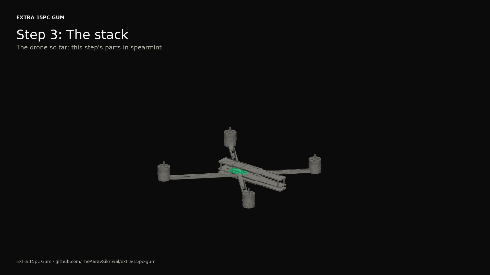

## 4. Power

The BEC goes in the bay behind the ESC, turned across. The two fuses are soldered inline later, in the wiring, off the frame's back edge beside the battery leads, end to end.

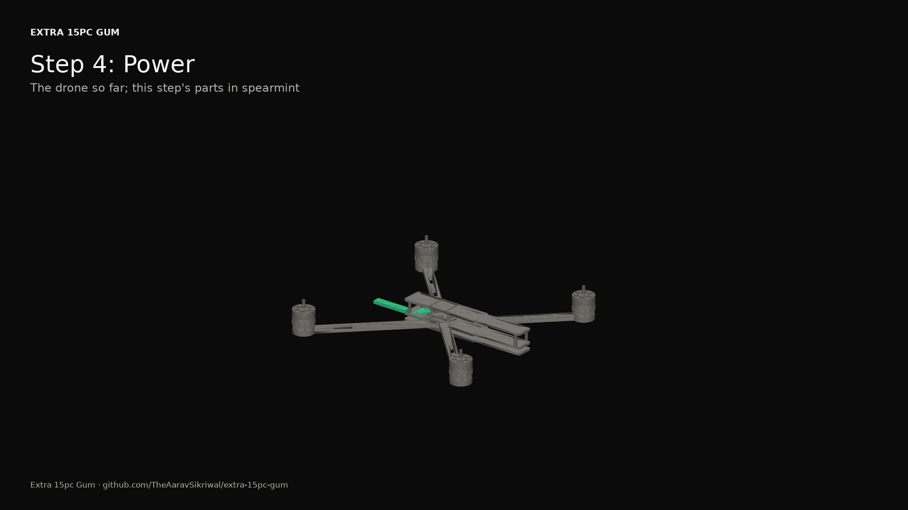

## 5. The safety monitor

The printed carrier in front of the stack, and the Teensy on it. The motor cut board sits on the Teensy, with the 3.3 V regulator on the cut board; the buffers go on the Teensy's front half and the BAT54C behind them. The monitor's own IMU sits ahead of the Teensy, on its own, so it never shares the flight controller's vibration mounts.

What holds it:

- 2 x M3 x 8 screw, nylon
- 2 x M3 nut, nylon

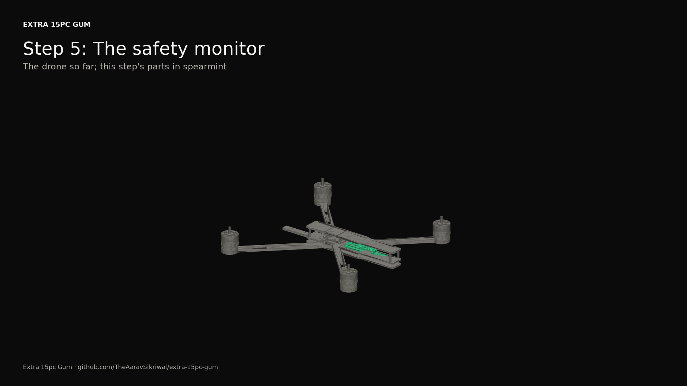

## 6. Sensors and radios

The receiver at the back of the bay, its ceramic antenna at the back. The lidar bracket under the nose of the bottom plate, and the TF-Luna on it by its two ears, looking straight down with nothing in its view. The Remote ID module on its mount at the front of the top plate, away from the GPS.

What holds it:

- 2 x M3 x 8 screw, nylon
- 2 x M3 nut, nylon
- 2 x M2 x 6 screw, nylon: by its two ears
- 2 x M2 nut, nylon
- 1 x patch: hook-and-loop under the Remote ID, a guess

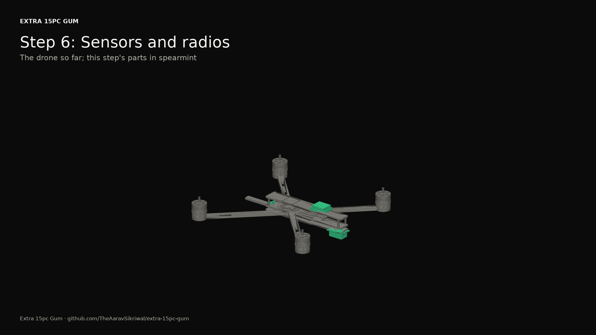

## 7. The module rail

Press the three brass inserts into the rail with a soldering iron, then fix the rail to the top plate. V's and P's sockets sink into the rail; C's sits off the bottom plate's back edge.

What holds it:

- 4 x M3 x 10 screw, nylon: the rail to the top plate
- 3 x insert: M3 brass heat-set inserts in the rail, for the modules' locks; 0.4 g is a typical 4 x 5.7 mm insert
- 4 x M3 nut, nylon

## 8. Legs and tray

The four TPU legs, two screws through each leg's flange and its arm, and the battery tray under the bottom plate.

What holds it:

- 8 x M3 x 12 screw, steel: two through each leg's flange and its arm
- 8 x M3 lock nut, steel
- 4 x M3 x 8 screw, steel: the tray to the bottom plate
- 4 x M3 lock nut, steel

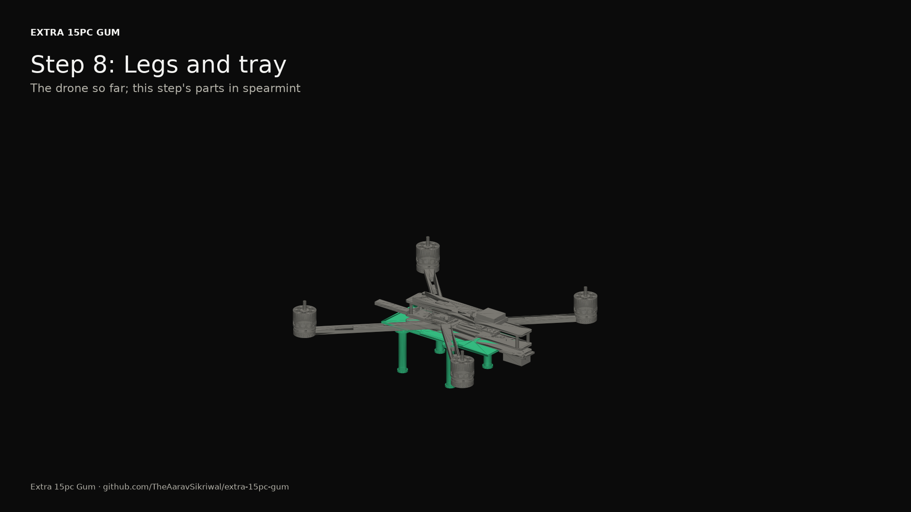

## 9. Base's wiring

Follow the wiring guide harness by harness, and make its meter checks before anything gets power. Then the top plate goes on.

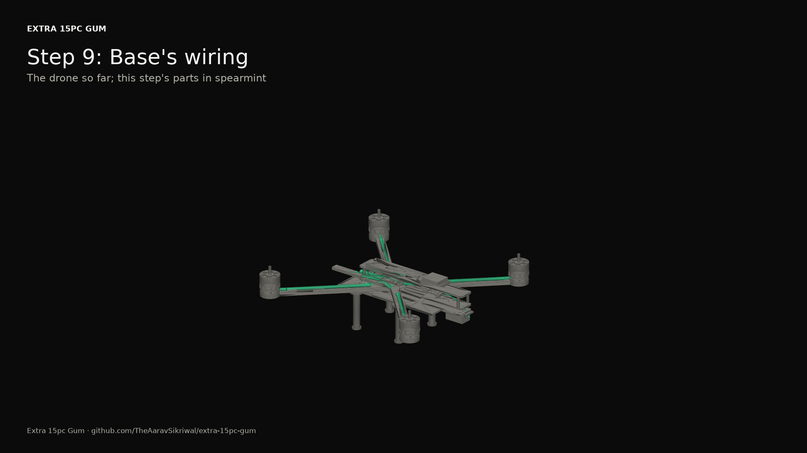

## 10. The pack

Build the 6S2P pack: 12 cells, two in parallel for each of six in series, joined with 10 by 0.3 mm nickel-plated copper strip (not nickel strip, which would run hot at 90 A), fish paper on every positive end, the balance lead to each junction and the 12 AWG leads to an XT60. Spot-weld the strip, never solder a cell. If you've never built a pack, buy one built to the same spec instead: a pack fire is the worst thing that can happen on this bench.

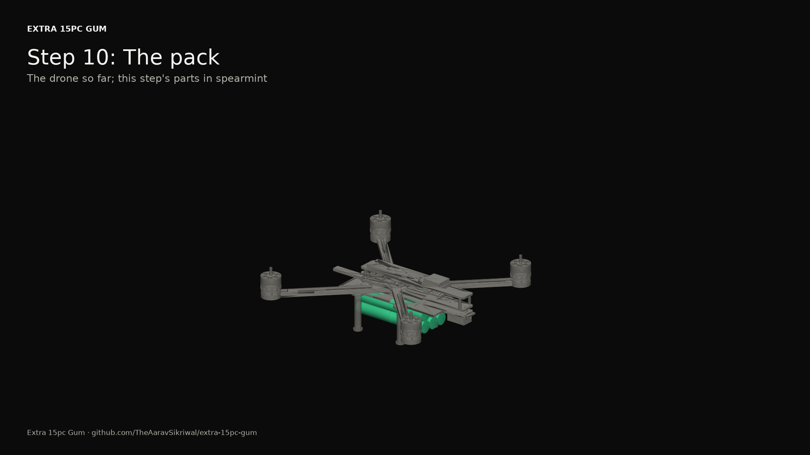

## 11. V: the GPS mast

The mast's carbon tube into its printed foot and cradle, and the ARK GPS on top with four pads of foam tape, its arrow forward. The mast keeps the GPS's compass away from the power wiring.

What holds it:

- 4 x tape: 15 x 15 mm pads of 1 mm acrylic foam tape (VHB-style, about 0.96 g per cubic cm), the GPS to its cradle

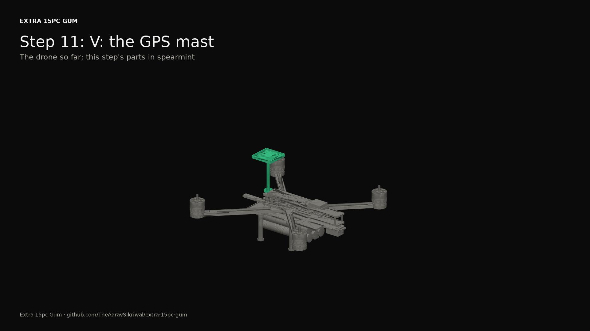

## 12. V: the camera

The camera bracket's tab to the top plate's nose, and the Camera Module 3 on it, looking forward and tipped 30 degrees down. The ribbon runs back to the Pi under the top plate's edge.

What holds it:

- 2 x M3 x 8 screw, nylon: the tab to the top plate's nose
- 2 x M3 nut, nylon
- 4 x M2 x 8 screw, nylon
- 4 x M2 nut, nylon

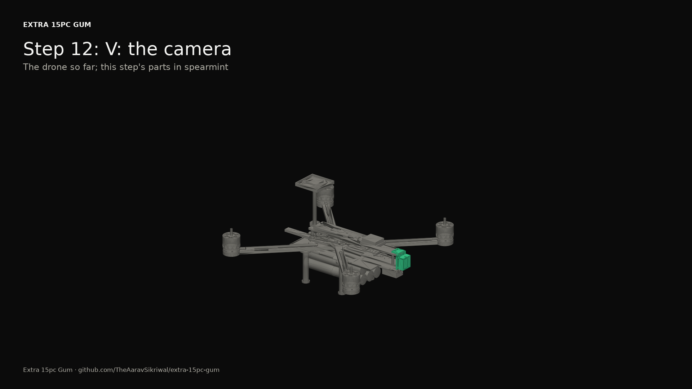

## 13. V: the Pi stack

The module plug through the housing's floor, then the Pi on 6 mm standoffs above it, the active cooler on the Pi, the HaLow HAT on 11 mm standoffs on a stacking header, and the antenna out the back of the housing, high and to the left. The housing slides onto the rail and locks with its thumb screw.

What holds it:

- 1 x M3 x 10 screw, steel: V's rail lock, a thumb screw into the rail's insert
- 4 x M2.5 x 6 standoff, nylon: raising the Pi 6 mm off the housing's floor for the module plug
- 4 x M2.5 x 6 screw, nylon
- 4 x M2.5 x 11 standoff, nylon: the usual height for a HAT on a Pi
- 4 x M2.5 x 6 screw, nylon

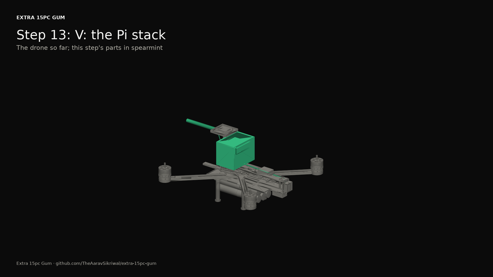

## 14. P: the parachute

The printed cradle on the rail with its two screws (two, for the opening shock), the module plug inside it, and the Harrier on the cradle's lip by the three 4-40 screws in its base. The CANnode straps to one side of the cradle, the chute switch, its regulator and the ideal-diode board to the other, inline on the servo's leads.

What holds it:

- 2 x M3 x 12 screw, steel: P's rail locks, two for the chute's opening shock
- 3 x 4-40 x 6.35 screw, steel: the three holes in the Harrier's base

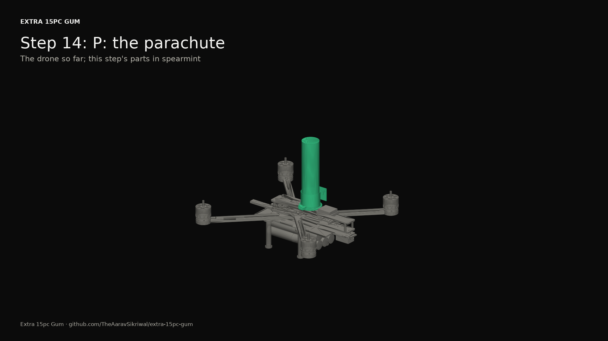

## 15. C: the claws

A placeholder: the claws aren't designed yet. The CANnode sits on top of them, behind the pack, and the module plug mates to C's socket from behind.

What holds it:

- 2 x M3 x 10 screw, steel: C's lock, through the claws' mount and the bottom plate
- 2 x M3 lock nut, steel

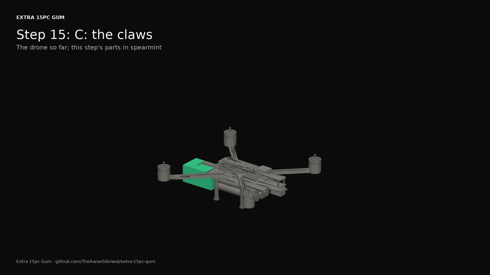

## 16. Props, last

Not until the bench checks pass and the first flight is tethered: props off for every test before that. Two turn each way; match each to its motor's direction in the firmware guide, and check every prop nut before every flight.

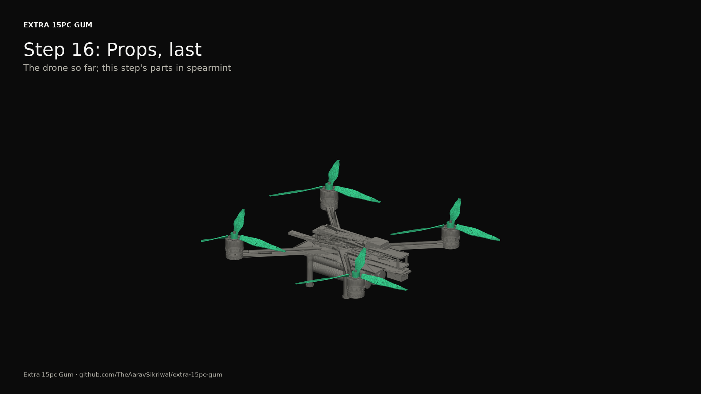
