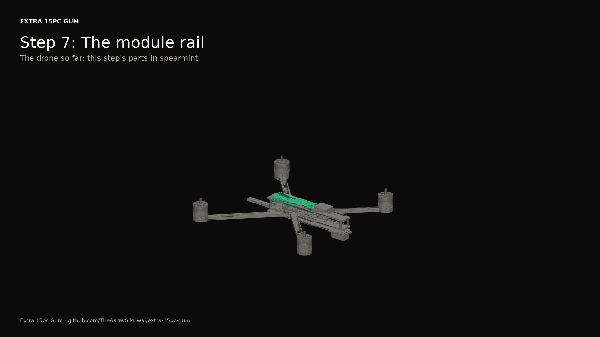

# 2026-10-21: The build package

*PC, Windows. Step 8: the [spec](../specs/2026-10-21-build-package.md), the [plan](../plans/2026-10-21-build-package.md) and the build. The package itself is in [docs/build](../build/README.md).*

Step 8 is where the simulated drone turns into instructions. The goal from the roadmap is blunt: someone could build it from the docs alone. Nothing gets bought by default, so this is the plan for a first real one, not a shopping trip.

All of it is generated. `pcs14 package` reads the catalog, the build, the connection list and the reports, and writes `docs/build/`: the parts list (as Markdown and a spreadsheet), the assembly guide with a render per step, the wiring guide harness by harness, the firmware guide, the test plans, the legal checklist and a README that walks them in order. Swap a part in the catalog and it changes everywhere at once.

## What it costs

Every bought part got a buy link, a price, the date it was checked, and a second choice, with what would change in the design if the second choice is used. Three research agents went through about forty parts, opening each page before reporting it. Where a price only came from a search listing (DigiKey's pages stop at a bot check), the note says so.

| Combination | Parts, wire and plugs | Not priced yet |
|---|---|---|
| base | $875 | 0 |
| V | $1,320 | 1 |
| P | $1,568 | 0 |
| mission | $2,013 | 1 |
| max | $2,171 | 2 |

Plus about $362 bought once: the transmitter, a charger, the pack's supplies and some tools. Most of P's extra is the parachute itself, at $508.

The research turned up more than prices:

- **Things are out of stock.** The P45B cells, the motors at EMAX USA, the props at GetFPV, the Harrier parachute (quote only), the HaLow card. Each has its fallback.
- **Some prices were wrong.** The frame is $142.99, not the $115.99 the catalog had, which I couldn't find anywhere. The Pi 5 4GB is $110 now, up from $60 at launch.
- **One chip is gone until 2027.** The chute switch's 74LVC1G157 is back ordered to October 2027. The closest in-stock part, TI's SN74LVC1G97 wired as a mux, selects the other way round, so its two data inputs swap in the connection list. That's a design change, so it's mine to approve.
- **The HaLow card is the biggest risk.** Heltec lists its HAT for the Pi 1 to 4 only, and nobody has reported the SPI card working on a Pi 5. The swap was already on my list.
- **Fruity Chutes publishes a deployment chart.** It puts the Harrier's canopy at 52.5 ft (16 m) at least for an upward deployment. Step 6's sim saved the drone from 10 m on a 1 s opening time I guessed. Their number is the one to trust until they answer.

One bug fell out of writing the parts list: it told me to buy 3.2 m of 18 AWG for the motor leads, which are the motors' own leads, cut to length. The connection list now marks a part's own lead, and the parts list skips it.

## The guides

The assembly guide is 16 steps in an order I chose: frame, motors, stack, power, the safety monitor, sensors and radios, the module rail, legs and tray, the wiring, the pack, then each module, and the props last. Each step's words come from where the CAD puts each part, and its screws come from the CAD's hardware list with that list's own notes. Each one has a render of the drone built up to that point, the new parts in spearmint.

The wiring guide lists every one of the 128 wires under its harness, with both ends, the gauge, the cut length and the meter checks to make before anything gets power.

The firmware guide puts PX4 first. The ARK FPV is in PX4's tree, and each combination's PX4 parameters come out of the flight sim as lines to paste into PX4's console. My firmware's image builds, but its register-level drivers have never run on a board, and the safety monitor's Teensy image isn't built at all: that needs PJRC's Teensy core, a download I haven't made. Until it exists, the kill switch works through the flight controller alone, and the guide says so.

The test plans are written like the sims' graders: each check says what passes. Every safety rule has a bench test, props off: the kill switch through both boards, the monitor dying without stopping the motors, a hung flight controller stopping them, the chute's motors-first order, an unapproved plan never flying. Every unproven item now carries the first thing to measure for it, written in its own report next to the claim, so the site's unproven page and the test plans say the same thing.

The legal checklist maps each rule to where it lives: the limits profile, a part, or me. I wrote the FAA and FCC links from what I know and didn't open them on the day, and the checklist says so.

## What's next

The structure side track's first pass ran alongside this ([its log](2026-10-21-structure-first-pass.md)). Then the site gets its last refresh, with a page for all of this.
