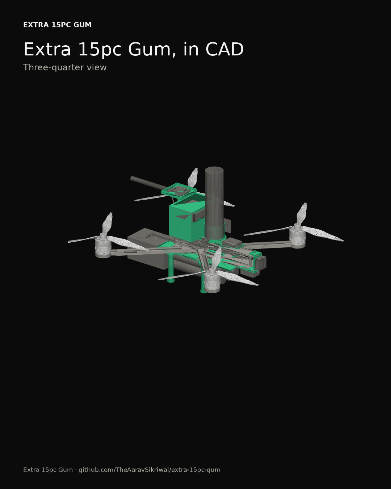
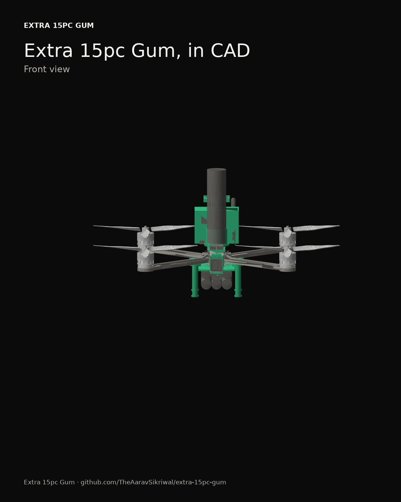
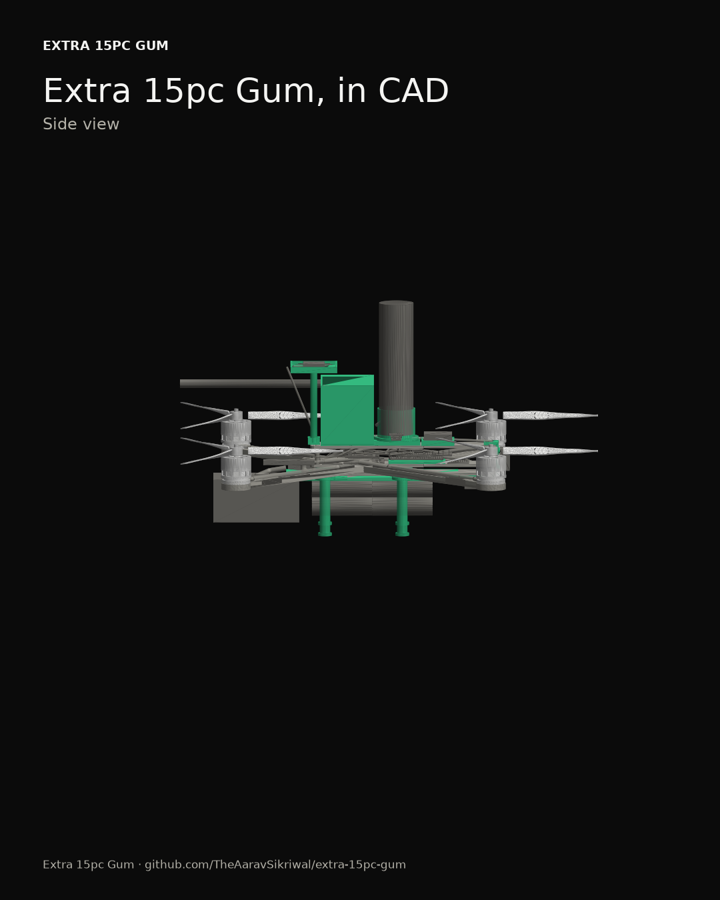
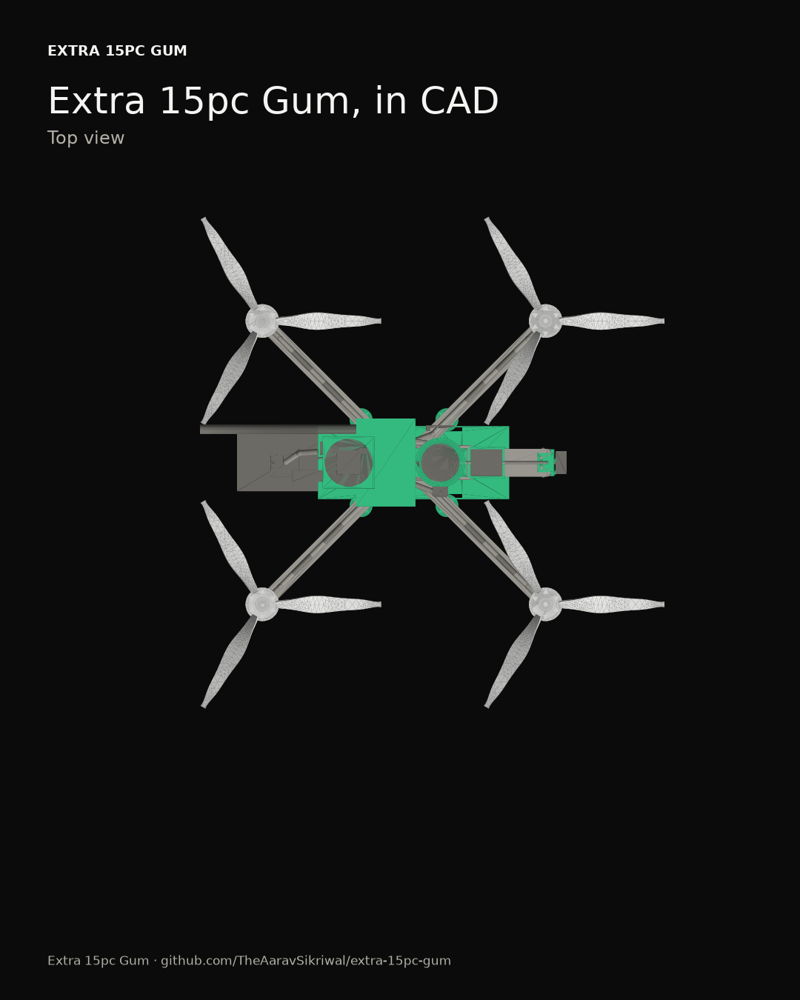
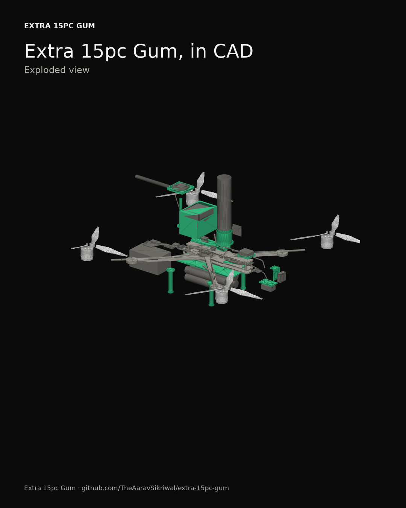

# The virtual drone (CAD)

*Generated on 2026-10-21 by pcs14 0.1.0, the CAD layer in `src/pcs14/cad/`. Every module combination gets built, its pack slid to where it balances best, and checked: collisions, prop clearance, the parachute's cone, the module rail, balance, and the makers' placement rules.*

## The verdict

**Pass.** All 8 combinations pass every check.

Built from E3 2814 850KV / 1050 3-blade / 6S2P Molicel INR-21700-P45B.

## Every module combination

| Setup | Modules | Weight | Pack at | Center of gravity (x, y, z) | Busiest motor | Verdict |
|---|---|---|---|---|---|---|
| base | none | 1860 g | -10 mm | 0.1, 0.0, -2.5 mm | +0.1% | pass |
| V | V | 2032 g | -5 mm | 0.1, 0.2, 4.3 mm | +0.3% | pass |
| P | P | 2036 g | -18 mm | -0.1, 0.1, 7.7 mm | +0.1% | pass |
| C | C | 2022 g | 13 mm | 0.2, 0.0, -4.4 mm | +0.2% | pass |
| mission | V+P | 2208 g | -13 mm | -0.0, 0.3, 13.2 mm | +0.2% | pass |
| V+C | V+C | 2194 g | 17 mm | -0.2, 0.2, 2.0 mm | +0.3% | pass |
| P+C | P+C | 2198 g | 5 mm | -0.0, 0.1, 5.2 mm | +0.0% | pass |
| max | V+P+C | 2370 g | 10 mm | 0.0, 0.2, 10.5 mm | +0.2% | pass |

The pack's position is along x from the motors' center; it slides to balance each combination. The busiest motor column says how much harder the busiest motor works than the average in a hover (the limit is +5%).

Every check, setup by setup:

base: pass

| Check | Result | Verdict |
|---|---|---|
| balance | with the pack at x = -10 mm, the center of gravity sits +0.1 mm along x and +0.0 mm along y, so the busiest motor works 0.1% harder | pass |
| collisions | nothing overlaps | pass |
| prop clearance | frame is 10.6 mm from prop 1's disk (needs 10) | pass |
| prop clearance | module-socket 2 is 47.8 mm from prop 1's disk (needs 10) | pass |
| prop clearance | ruko-r111 is 15.0 mm from prop 1's disk (needs 10) | pass |
| prop clearance | module rail is 30.0 mm from prop 1's disk (needs 10) | pass |
| prop clearance | remote id mount is 11.9 mm from prop 1's disk (needs 10) | pass |
| prop clearance | wire battery leads is 73.9 mm from prop 1's disk (needs 20) | pass |
| prop clearance | wire motor leads front left is 27.3 mm from prop 1's disk (needs 20) | pass |
| prop clearance | wire motor leads back left is 88.5 mm from prop 1's disk (needs 20) | pass |
| prop clearance | wire motor leads back right is 70.2 mm from prop 1's disk (needs 20) | pass |
| prop clearance | wire receiver is 63.3 mm from prop 1's disk (needs 20) | pass |
| prop clearance | wire lidar is 30.6 mm from prop 1's disk (needs 20) | pass |
| prop clearance | wire safety monitor is 48.2 mm from prop 1's disk (needs 20) | pass |
| prop clearance | wire module connector is 85.1 mm from prop 1's disk (needs 20) | pass |
| prop clearance | wire module power to P is 58.9 mm from prop 1's disk (needs 20) | pass |
| prop clearance | wire esc cable to switch is 53.9 mm from prop 1's disk (needs 20) | pass |
| prop clearance | wire dshot taps is 35.4 mm from prop 1's disk (needs 20) | pass |
| prop clearance | wire crsf tap is 28.3 mm from prop 1's disk (needs 20) | pass |
| prop clearance | wire teensy feed from fc is 57.9 mm from prop 1's disk (needs 20) | pass |
| prop clearance | wire teensy feed from bec is 54.1 mm from prop 1's disk (needs 20) | pass |
| prop clearance | wire cut supply is 43.8 mm from prop 1's disk (needs 20) | pass |
| prop clearance | wire chute lines is 52.7 mm from prop 1's disk (needs 20) | pass |
| prop clearance | wire module bus v to p is 58.0 mm from prop 1's disk (needs 20) | pass |
| prop clearance | wire module bus p to c is 58.0 mm from prop 1's disk (needs 20) | pass |
| prop clearance | wire esc cable from switch is 44.0 mm from prop 1's disk (needs 20) | pass |
| prop clearance | frame is 10.6 mm from prop 2's disk (needs 10) | pass |
| prop clearance | module-socket 2 is 47.8 mm from prop 2's disk (needs 10) | pass |
| prop clearance | ruko-r111 is 15.0 mm from prop 2's disk (needs 10) | pass |
| prop clearance | module rail is 30.0 mm from prop 2's disk (needs 10) | pass |
| prop clearance | remote id mount is 11.9 mm from prop 2's disk (needs 10) | pass |
| prop clearance | wire battery leads is 73.9 mm from prop 2's disk (needs 20) | pass |
| prop clearance | wire motor leads front right is 27.3 mm from prop 2's disk (needs 20) | pass |
| prop clearance | wire motor leads back left is 70.1 mm from prop 2's disk (needs 20) | pass |
| prop clearance | wire motor leads back right is 88.5 mm from prop 2's disk (needs 20) | pass |
| prop clearance | wire receiver is 73.3 mm from prop 2's disk (needs 20) | pass |
| prop clearance | wire lidar is 41.1 mm from prop 2's disk (needs 20) | pass |
| prop clearance | wire safety monitor is 36.3 mm from prop 2's disk (needs 20) | pass |
| prop clearance | wire module connector is 81.5 mm from prop 2's disk (needs 20) | pass |
| prop clearance | wire fc battery feed is 62.5 mm from prop 2's disk (needs 20) | pass |
| prop clearance | wire module power to P is 60.1 mm from prop 2's disk (needs 20) | pass |
| prop clearance | wire esc cable to switch is 43.3 mm from prop 2's disk (needs 20) | pass |
| prop clearance | wire dshot taps is 35.5 mm from prop 2's disk (needs 20) | pass |
| prop clearance | wire crsf tap is 41.0 mm from prop 2's disk (needs 20) | pass |
| prop clearance | wire teensy feed from fc is 53.8 mm from prop 2's disk (needs 20) | pass |
| prop clearance | wire teensy feed from bec is 56.2 mm from prop 2's disk (needs 20) | pass |
| prop clearance | wire cut supply is 43.6 mm from prop 2's disk (needs 20) | pass |
| prop clearance | wire chute lines is 53.3 mm from prop 2's disk (needs 20) | pass |
| prop clearance | wire module bus v to p is 53.0 mm from prop 2's disk (needs 20) | pass |
| prop clearance | wire module bus p to c is 53.0 mm from prop 2's disk (needs 20) | pass |
| prop clearance | wire esc cable from switch is 54.9 mm from prop 2's disk (needs 20) | pass |
| prop clearance | frame is 32.1 mm from prop 3's disk (needs 10) | pass |
| prop clearance | module-socket 1 is 68.9 mm from prop 3's disk (needs 10) | pass |
| prop clearance | module rail is 38.9 mm from prop 3's disk (needs 10) | pass |
| prop clearance | wire battery leads is 45.9 mm from prop 3's disk (needs 20) | pass |
| prop clearance | wire motor leads front left is 70.3 mm from prop 3's disk (needs 20) | pass |
| prop clearance | wire motor leads back left is 27.3 mm from prop 3's disk (needs 20) | pass |
| prop clearance | wire motor leads back right is 79.3 mm from prop 3's disk (needs 20) | pass |
| prop clearance | wire receiver is 56.9 mm from prop 3's disk (needs 20) | pass |
| prop clearance | wire safety monitor is 63.8 mm from prop 3's disk (needs 20) | pass |
| prop clearance | wire module connector is 71.3 mm from prop 3's disk (needs 20) | pass |
| prop clearance | wire module power to V is 47.9 mm from prop 3's disk (needs 20) | pass |
| prop clearance | wire module power to P is 48.0 mm from prop 3's disk (needs 20) | pass |
| prop clearance | wire crsf tap is 53.6 mm from prop 3's disk (needs 20) | pass |
| prop clearance | wire teensy feed from fc is 67.1 mm from prop 3's disk (needs 20) | pass |
| prop clearance | wire teensy feed from bec is 48.6 mm from prop 3's disk (needs 20) | pass |
| prop clearance | wire cut supply is 65.8 mm from prop 3's disk (needs 20) | pass |
| prop clearance | wire module bus v to p is 84.2 mm from prop 3's disk (needs 20) | pass |
| prop clearance | wire module bus p to c is 52.5 mm from prop 3's disk (needs 20) | pass |
| prop clearance | frame is 32.1 mm from prop 4's disk (needs 10) | pass |
| prop clearance | module-socket 1 is 68.9 mm from prop 4's disk (needs 10) | pass |
| prop clearance | module rail is 38.9 mm from prop 4's disk (needs 10) | pass |
| prop clearance | wire battery leads is 45.9 mm from prop 4's disk (needs 20) | pass |
| prop clearance | wire motor leads front right is 70.3 mm from prop 4's disk (needs 20) | pass |
| prop clearance | wire motor leads back left is 79.2 mm from prop 4's disk (needs 20) | pass |
| prop clearance | wire motor leads back right is 27.3 mm from prop 4's disk (needs 20) | pass |
| prop clearance | wire receiver is 57.0 mm from prop 4's disk (needs 20) | pass |
| prop clearance | wire safety monitor is 73.0 mm from prop 4's disk (needs 20) | pass |
| prop clearance | wire module connector is 64.9 mm from prop 4's disk (needs 20) | pass |
| prop clearance | wire battery taps is 40.0 mm from prop 4's disk (needs 20) | pass |
| prop clearance | wire fc battery feed is 34.0 mm from prop 4's disk (needs 20) | pass |
| prop clearance | wire module power to V is 70.7 mm from prop 4's disk (needs 20) | pass |
| prop clearance | wire module power to P is 70.8 mm from prop 4's disk (needs 20) | pass |
| prop clearance | wire crsf tap is 56.6 mm from prop 4's disk (needs 20) | pass |
| prop clearance | wire teensy feed from fc is 98.4 mm from prop 4's disk (needs 20) | pass |
| prop clearance | wire teensy feed from bec is 67.2 mm from prop 4's disk (needs 20) | pass |
| prop clearance | wire cut supply is 74.3 mm from prop 4's disk (needs 20) | pass |
| prop clearance | wire module bus v to p is 79.8 mm from prop 4's disk (needs 20) | pass |
| prop clearance | wire module bus p to c is 42.3 mm from prop 4's disk (needs 20) | pass |
| prop clearance | props 1 and 2 are 43.0 mm apart | pass |
| prop clearance | props 1 and 3 are 43.0 mm apart | pass |
| prop clearance | props 1 and 4 are 166.0 mm apart | pass |
| prop clearance | props 2 and 3 are 166.0 mm apart | pass |
| prop clearance | props 2 and 4 are 43.0 mm apart | pass |
| prop clearance | props 3 and 4 are 43.0 mm apart | pass |
| lidar view | the lidar sits 50 mm off the ground when landed, so it can't read the last 150 mm of a landing | pass |

V: pass

| Check | Result | Verdict |
|---|---|---|
| balance | with the pack at x = -5 mm, the center of gravity sits +0.1 mm along x and +0.2 mm along y, so the busiest motor works 0.3% harder | pass |
| collisions | nothing overlaps | pass |
| prop clearance | frame is 10.6 mm from prop 1's disk (needs 10) | pass |
| prop clearance | module-socket 2 is 47.8 mm from prop 1's disk (needs 10) | pass |
| prop clearance | ruko-r111 is 15.0 mm from prop 1's disk (needs 10) | pass |
| prop clearance | rpi-camera-module-3 is 16.4 mm from prop 1's disk (needs 10) | pass |
| prop clearance | rpi-5-4gb is 48.2 mm from prop 1's disk (needs 10) | pass |
| prop clearance | module rail is 30.0 mm from prop 1's disk (needs 10) | pass |
| prop clearance | remote id mount is 11.9 mm from prop 1's disk (needs 10) | pass |
| prop clearance | camera bracket is 11.0 mm from prop 1's disk (needs 10) | pass |
| prop clearance | v housing is 43.7 mm from prop 1's disk (needs 10) | pass |
| prop clearance | wire battery leads is 73.9 mm from prop 1's disk (needs 20) | pass |
| prop clearance | wire motor leads front left is 27.3 mm from prop 1's disk (needs 20) | pass |
| prop clearance | wire motor leads back left is 88.5 mm from prop 1's disk (needs 20) | pass |
| prop clearance | wire motor leads back right is 70.2 mm from prop 1's disk (needs 20) | pass |
| prop clearance | wire receiver is 63.3 mm from prop 1's disk (needs 20) | pass |
| prop clearance | wire gps is 84.5 mm from prop 1's disk (needs 20) | pass |
| prop clearance | wire lidar is 30.6 mm from prop 1's disk (needs 20) | pass |
| prop clearance | wire safety monitor is 48.2 mm from prop 1's disk (needs 20) | pass |
| prop clearance | wire module connector is 85.1 mm from prop 1's disk (needs 20) | pass |
| prop clearance | wire camera cable is 20.5 mm from prop 1's disk (needs 20) | pass |
| prop clearance | wire module power to P is 58.9 mm from prop 1's disk (needs 20) | pass |
| prop clearance | wire esc cable to switch is 53.9 mm from prop 1's disk (needs 20) | pass |
| prop clearance | wire dshot taps is 35.4 mm from prop 1's disk (needs 20) | pass |
| prop clearance | wire crsf tap is 28.3 mm from prop 1's disk (needs 20) | pass |
| prop clearance | wire teensy feed from fc is 57.9 mm from prop 1's disk (needs 20) | pass |
| prop clearance | wire teensy feed from bec is 54.1 mm from prop 1's disk (needs 20) | pass |
| prop clearance | wire cut supply is 43.8 mm from prop 1's disk (needs 20) | pass |
| prop clearance | wire chute lines is 52.7 mm from prop 1's disk (needs 20) | pass |
| prop clearance | wire module bus v to p is 58.0 mm from prop 1's disk (needs 20) | pass |
| prop clearance | wire module bus p to c is 58.0 mm from prop 1's disk (needs 20) | pass |
| prop clearance | wire esc cable from switch is 44.0 mm from prop 1's disk (needs 20) | pass |
| prop clearance | frame is 10.6 mm from prop 2's disk (needs 10) | pass |
| prop clearance | module-socket 2 is 47.8 mm from prop 2's disk (needs 10) | pass |
| prop clearance | ruko-r111 is 15.0 mm from prop 2's disk (needs 10) | pass |
| prop clearance | rpi-camera-module-3 is 16.4 mm from prop 2's disk (needs 10) | pass |
| prop clearance | rpi-5-4gb is 48.2 mm from prop 2's disk (needs 10) | pass |
| prop clearance | module rail is 30.0 mm from prop 2's disk (needs 10) | pass |
| prop clearance | remote id mount is 11.9 mm from prop 2's disk (needs 10) | pass |
| prop clearance | camera bracket is 11.0 mm from prop 2's disk (needs 10) | pass |
| prop clearance | v housing is 43.7 mm from prop 2's disk (needs 10) | pass |
| prop clearance | wire battery leads is 73.9 mm from prop 2's disk (needs 20) | pass |
| prop clearance | wire motor leads front right is 27.3 mm from prop 2's disk (needs 20) | pass |
| prop clearance | wire motor leads back left is 70.1 mm from prop 2's disk (needs 20) | pass |
| prop clearance | wire motor leads back right is 88.5 mm from prop 2's disk (needs 20) | pass |
| prop clearance | wire receiver is 73.3 mm from prop 2's disk (needs 20) | pass |
| prop clearance | wire gps is 81.2 mm from prop 2's disk (needs 20) | pass |
| prop clearance | wire lidar is 41.1 mm from prop 2's disk (needs 20) | pass |
| prop clearance | wire safety monitor is 36.3 mm from prop 2's disk (needs 20) | pass |
| prop clearance | wire module connector is 81.5 mm from prop 2's disk (needs 20) | pass |
| prop clearance | wire camera cable is 20.5 mm from prop 2's disk (needs 20) | pass |
| prop clearance | wire fc battery feed is 62.5 mm from prop 2's disk (needs 20) | pass |
| prop clearance | wire module power to P is 60.1 mm from prop 2's disk (needs 20) | pass |
| prop clearance | wire esc cable to switch is 43.3 mm from prop 2's disk (needs 20) | pass |
| prop clearance | wire dshot taps is 35.5 mm from prop 2's disk (needs 20) | pass |
| prop clearance | wire crsf tap is 41.0 mm from prop 2's disk (needs 20) | pass |
| prop clearance | wire teensy feed from fc is 53.8 mm from prop 2's disk (needs 20) | pass |
| prop clearance | wire teensy feed from bec is 56.2 mm from prop 2's disk (needs 20) | pass |
| prop clearance | wire cut supply is 43.6 mm from prop 2's disk (needs 20) | pass |
| prop clearance | wire chute lines is 53.3 mm from prop 2's disk (needs 20) | pass |
| prop clearance | wire module bus v to p is 53.0 mm from prop 2's disk (needs 20) | pass |
| prop clearance | wire module bus p to c is 53.0 mm from prop 2's disk (needs 20) | pass |
| prop clearance | wire esc cable from switch is 54.9 mm from prop 2's disk (needs 20) | pass |
| prop clearance | frame is 32.1 mm from prop 3's disk (needs 10) | pass |
| prop clearance | module-socket 1 is 68.9 mm from prop 3's disk (needs 10) | pass |
| prop clearance | module-plug@V is 68.9 mm from prop 3's disk (needs 10) | pass |
| prop clearance | rpi-5-4gb is 19.7 mm from prop 3's disk (needs 10) | pass |
| prop clearance | module rail is 38.9 mm from prop 3's disk (needs 10) | pass |
| prop clearance | gps mast is 37.3 mm from prop 3's disk (needs 10) | pass |
| prop clearance | v housing is 15.1 mm from prop 3's disk (needs 10) | pass |
| prop clearance | wire battery leads is 45.9 mm from prop 3's disk (needs 20) | pass |
| prop clearance | wire motor leads front left is 70.3 mm from prop 3's disk (needs 20) | pass |
| prop clearance | wire motor leads back left is 27.3 mm from prop 3's disk (needs 20) | pass |
| prop clearance | wire motor leads back right is 79.3 mm from prop 3's disk (needs 20) | pass |
| prop clearance | wire receiver is 56.9 mm from prop 3's disk (needs 20) | pass |
| prop clearance | wire gps is 39.7 mm from prop 3's disk (needs 20) | pass |
| prop clearance | wire safety monitor is 63.8 mm from prop 3's disk (needs 20) | pass |
| prop clearance | wire module connector is 71.3 mm from prop 3's disk (needs 20) | pass |
| prop clearance | wire camera cable is 78.3 mm from prop 3's disk (needs 20) | pass |
| prop clearance | wire module power to V is 47.9 mm from prop 3's disk (needs 20) | pass |
| prop clearance | wire module power to P is 48.0 mm from prop 3's disk (needs 20) | pass |
| prop clearance | wire crsf tap is 53.6 mm from prop 3's disk (needs 20) | pass |
| prop clearance | wire teensy feed from fc is 67.1 mm from prop 3's disk (needs 20) | pass |
| prop clearance | wire teensy feed from bec is 48.6 mm from prop 3's disk (needs 20) | pass |
| prop clearance | wire cut supply is 65.8 mm from prop 3's disk (needs 20) | pass |
| prop clearance | wire module bus v to p is 84.2 mm from prop 3's disk (needs 20) | pass |
| prop clearance | wire module bus p to c is 52.5 mm from prop 3's disk (needs 20) | pass |
| prop clearance | frame is 32.1 mm from prop 4's disk (needs 10) | pass |
| prop clearance | module-socket 1 is 68.9 mm from prop 4's disk (needs 10) | pass |
| prop clearance | module-plug@V is 68.9 mm from prop 4's disk (needs 10) | pass |
| prop clearance | rpi-5-4gb is 19.7 mm from prop 4's disk (needs 10) | pass |
| prop clearance | module rail is 38.9 mm from prop 4's disk (needs 10) | pass |
| prop clearance | gps mast is 37.3 mm from prop 4's disk (needs 10) | pass |
| prop clearance | v housing is 15.1 mm from prop 4's disk (needs 10) | pass |
| prop clearance | wire battery leads is 45.9 mm from prop 4's disk (needs 20) | pass |
| prop clearance | wire motor leads front right is 70.3 mm from prop 4's disk (needs 20) | pass |
| prop clearance | wire motor leads back left is 79.2 mm from prop 4's disk (needs 20) | pass |
| prop clearance | wire motor leads back right is 27.3 mm from prop 4's disk (needs 20) | pass |
| prop clearance | wire receiver is 57.0 mm from prop 4's disk (needs 20) | pass |
| prop clearance | wire gps is 48.1 mm from prop 4's disk (needs 20) | pass |
| prop clearance | wire safety monitor is 73.0 mm from prop 4's disk (needs 20) | pass |
| prop clearance | wire module connector is 64.9 mm from prop 4's disk (needs 20) | pass |
| prop clearance | wire camera cable is 78.3 mm from prop 4's disk (needs 20) | pass |
| prop clearance | wire battery taps is 40.0 mm from prop 4's disk (needs 20) | pass |
| prop clearance | wire fc battery feed is 34.0 mm from prop 4's disk (needs 20) | pass |
| prop clearance | wire module power to V is 70.7 mm from prop 4's disk (needs 20) | pass |
| prop clearance | wire module power to P is 70.8 mm from prop 4's disk (needs 20) | pass |
| prop clearance | wire crsf tap is 56.6 mm from prop 4's disk (needs 20) | pass |
| prop clearance | wire teensy feed from fc is 98.4 mm from prop 4's disk (needs 20) | pass |
| prop clearance | wire teensy feed from bec is 67.2 mm from prop 4's disk (needs 20) | pass |
| prop clearance | wire cut supply is 74.3 mm from prop 4's disk (needs 20) | pass |
| prop clearance | wire module bus v to p is 79.8 mm from prop 4's disk (needs 20) | pass |
| prop clearance | wire module bus p to c is 42.3 mm from prop 4's disk (needs 20) | pass |
| prop clearance | props 1 and 2 are 43.0 mm apart | pass |
| prop clearance | props 1 and 3 are 43.0 mm apart | pass |
| prop clearance | props 1 and 4 are 166.0 mm apart | pass |
| prop clearance | props 2 and 3 are 166.0 mm apart | pass |
| prop clearance | props 2 and 4 are 43.0 mm apart | pass |
| prop clearance | props 3 and 4 are 43.0 mm apart | pass |
| module rail | v housing spans x = -50 to 12 mm, on a rail from -50 to 66 | pass |
| compass distance | the compass is 106 mm from wire battery leads (Matek asks for 100) | pass |
| remote id distance | the Remote ID module is 129 mm from the GPS | pass |
| lidar view | the lidar sits 50 mm off the ground when landed, so it can't read the last 150 mm of a landing | pass |

P: pass

| Check | Result | Verdict |
|---|---|---|
| balance | with the pack at x = -18 mm, the center of gravity sits -0.1 mm along x and +0.1 mm along y, so the busiest motor works 0.1% harder | pass |
| collisions | nothing overlaps | pass |
| prop clearance | frame is 10.6 mm from prop 1's disk (needs 10) | pass |
| prop clearance | module-socket 2 is 47.8 mm from prop 1's disk (needs 10) | pass |
| prop clearance | ruko-r111 is 15.0 mm from prop 1's disk (needs 10) | pass |
| prop clearance | fruity-chutes-harrier-40-42 is 38.1 mm from prop 1's disk (needs 10) | pass |
| prop clearance | module-plug@P is 47.7 mm from prop 1's disk (needs 10) | pass |
| prop clearance | ark-cannode@P is 18.2 mm from prop 1's disk (needs 10) | pass |
| prop clearance | module rail is 30.0 mm from prop 1's disk (needs 10) | pass |
| prop clearance | remote id mount is 11.9 mm from prop 1's disk (needs 10) | pass |
| prop clearance | p holder is 32.0 mm from prop 1's disk (needs 10) | pass |
| prop clearance | wire battery leads is 73.9 mm from prop 1's disk (needs 20) | pass |
| prop clearance | wire motor leads front left is 27.3 mm from prop 1's disk (needs 20) | pass |
| prop clearance | wire motor leads back left is 88.5 mm from prop 1's disk (needs 20) | pass |
| prop clearance | wire motor leads back right is 70.2 mm from prop 1's disk (needs 20) | pass |
| prop clearance | wire receiver is 63.3 mm from prop 1's disk (needs 20) | pass |
| prop clearance | wire lidar is 30.6 mm from prop 1's disk (needs 20) | pass |
| prop clearance | wire safety monitor is 48.2 mm from prop 1's disk (needs 20) | pass |
| prop clearance | wire module connector is 85.1 mm from prop 1's disk (needs 20) | pass |
| prop clearance | wire chute servo is 70.9 mm from prop 1's disk (needs 20) | pass |
| prop clearance | wire module power to P is 58.9 mm from prop 1's disk (needs 20) | pass |
| prop clearance | wire esc cable to switch is 53.9 mm from prop 1's disk (needs 20) | pass |
| prop clearance | wire dshot taps is 35.4 mm from prop 1's disk (needs 20) | pass |
| prop clearance | wire crsf tap is 28.3 mm from prop 1's disk (needs 20) | pass |
| prop clearance | wire teensy feed from fc is 57.9 mm from prop 1's disk (needs 20) | pass |
| prop clearance | wire teensy feed from bec is 54.1 mm from prop 1's disk (needs 20) | pass |
| prop clearance | wire cut supply is 43.8 mm from prop 1's disk (needs 20) | pass |
| prop clearance | wire chute lines is 52.7 mm from prop 1's disk (needs 20) | pass |
| prop clearance | wire module bus v to p is 58.0 mm from prop 1's disk (needs 20) | pass |
| prop clearance | wire module bus p to c is 58.0 mm from prop 1's disk (needs 20) | pass |
| prop clearance | wire esc cable from switch is 44.0 mm from prop 1's disk (needs 20) | pass |
| prop clearance | frame is 10.6 mm from prop 2's disk (needs 10) | pass |
| prop clearance | module-socket 2 is 47.8 mm from prop 2's disk (needs 10) | pass |
| prop clearance | ruko-r111 is 15.0 mm from prop 2's disk (needs 10) | pass |
| prop clearance | fruity-chutes-harrier-40-42 is 38.1 mm from prop 2's disk (needs 10) | pass |
| prop clearance | module-plug@P is 47.7 mm from prop 2's disk (needs 10) | pass |
| prop clearance | p-chute-switch is 27.2 mm from prop 2's disk (needs 10) | pass |
| prop clearance | pololu-d36v6f3@P is 26.1 mm from prop 2's disk (needs 10) | pass |
| prop clearance | adafruit-lm66200 is 25.7 mm from prop 2's disk (needs 10) | pass |
| prop clearance | module rail is 30.0 mm from prop 2's disk (needs 10) | pass |
| prop clearance | remote id mount is 11.9 mm from prop 2's disk (needs 10) | pass |
| prop clearance | p holder is 32.0 mm from prop 2's disk (needs 10) | pass |
| prop clearance | wire battery leads is 73.9 mm from prop 2's disk (needs 20) | pass |
| prop clearance | wire motor leads front right is 27.3 mm from prop 2's disk (needs 20) | pass |
| prop clearance | wire motor leads back left is 70.1 mm from prop 2's disk (needs 20) | pass |
| prop clearance | wire motor leads back right is 88.5 mm from prop 2's disk (needs 20) | pass |
| prop clearance | wire receiver is 73.3 mm from prop 2's disk (needs 20) | pass |
| prop clearance | wire lidar is 41.1 mm from prop 2's disk (needs 20) | pass |
| prop clearance | wire safety monitor is 36.3 mm from prop 2's disk (needs 20) | pass |
| prop clearance | wire module connector is 81.5 mm from prop 2's disk (needs 20) | pass |
| prop clearance | wire chute servo is 42.5 mm from prop 2's disk (needs 20) | pass |
| prop clearance | wire fc battery feed is 62.5 mm from prop 2's disk (needs 20) | pass |
| prop clearance | wire module power to P is 60.1 mm from prop 2's disk (needs 20) | pass |
| prop clearance | wire esc cable to switch is 43.3 mm from prop 2's disk (needs 20) | pass |
| prop clearance | wire dshot taps is 35.5 mm from prop 2's disk (needs 20) | pass |
| prop clearance | wire crsf tap is 41.0 mm from prop 2's disk (needs 20) | pass |
| prop clearance | wire teensy feed from fc is 53.8 mm from prop 2's disk (needs 20) | pass |
| prop clearance | wire teensy feed from bec is 56.2 mm from prop 2's disk (needs 20) | pass |
| prop clearance | wire cut supply is 43.6 mm from prop 2's disk (needs 20) | pass |
| prop clearance | wire chute lines is 53.3 mm from prop 2's disk (needs 20) | pass |
| prop clearance | wire module bus v to p is 53.0 mm from prop 2's disk (needs 20) | pass |
| prop clearance | wire module bus p to c is 53.0 mm from prop 2's disk (needs 20) | pass |
| prop clearance | wire esc cable from switch is 54.9 mm from prop 2's disk (needs 20) | pass |
| prop clearance | frame is 32.1 mm from prop 3's disk (needs 10) | pass |
| prop clearance | module-socket 1 is 68.9 mm from prop 3's disk (needs 10) | pass |
| prop clearance | module rail is 38.9 mm from prop 3's disk (needs 10) | pass |
| prop clearance | wire battery leads is 45.9 mm from prop 3's disk (needs 20) | pass |
| prop clearance | wire motor leads front left is 70.3 mm from prop 3's disk (needs 20) | pass |
| prop clearance | wire motor leads back left is 27.3 mm from prop 3's disk (needs 20) | pass |
| prop clearance | wire motor leads back right is 79.3 mm from prop 3's disk (needs 20) | pass |
| prop clearance | wire receiver is 56.9 mm from prop 3's disk (needs 20) | pass |
| prop clearance | wire safety monitor is 63.8 mm from prop 3's disk (needs 20) | pass |
| prop clearance | wire module connector is 71.3 mm from prop 3's disk (needs 20) | pass |
| prop clearance | wire module power to V is 47.9 mm from prop 3's disk (needs 20) | pass |
| prop clearance | wire module power to P is 48.0 mm from prop 3's disk (needs 20) | pass |
| prop clearance | wire crsf tap is 53.6 mm from prop 3's disk (needs 20) | pass |
| prop clearance | wire teensy feed from fc is 67.1 mm from prop 3's disk (needs 20) | pass |
| prop clearance | wire teensy feed from bec is 48.6 mm from prop 3's disk (needs 20) | pass |
| prop clearance | wire cut supply is 65.8 mm from prop 3's disk (needs 20) | pass |
| prop clearance | wire module bus v to p is 84.2 mm from prop 3's disk (needs 20) | pass |
| prop clearance | wire module bus p to c is 52.5 mm from prop 3's disk (needs 20) | pass |
| prop clearance | frame is 32.1 mm from prop 4's disk (needs 10) | pass |
| prop clearance | module-socket 1 is 68.9 mm from prop 4's disk (needs 10) | pass |
| prop clearance | module rail is 38.9 mm from prop 4's disk (needs 10) | pass |
| prop clearance | wire battery leads is 45.9 mm from prop 4's disk (needs 20) | pass |
| prop clearance | wire motor leads front right is 70.3 mm from prop 4's disk (needs 20) | pass |
| prop clearance | wire motor leads back left is 79.2 mm from prop 4's disk (needs 20) | pass |
| prop clearance | wire motor leads back right is 27.3 mm from prop 4's disk (needs 20) | pass |
| prop clearance | wire receiver is 57.0 mm from prop 4's disk (needs 20) | pass |
| prop clearance | wire safety monitor is 73.0 mm from prop 4's disk (needs 20) | pass |
| prop clearance | wire module connector is 64.9 mm from prop 4's disk (needs 20) | pass |
| prop clearance | wire battery taps is 40.0 mm from prop 4's disk (needs 20) | pass |
| prop clearance | wire fc battery feed is 34.0 mm from prop 4's disk (needs 20) | pass |
| prop clearance | wire module power to V is 70.7 mm from prop 4's disk (needs 20) | pass |
| prop clearance | wire module power to P is 70.8 mm from prop 4's disk (needs 20) | pass |
| prop clearance | wire crsf tap is 56.6 mm from prop 4's disk (needs 20) | pass |
| prop clearance | wire teensy feed from fc is 98.4 mm from prop 4's disk (needs 20) | pass |
| prop clearance | wire teensy feed from bec is 67.2 mm from prop 4's disk (needs 20) | pass |
| prop clearance | wire cut supply is 74.3 mm from prop 4's disk (needs 20) | pass |
| prop clearance | wire module bus v to p is 79.8 mm from prop 4's disk (needs 20) | pass |
| prop clearance | wire module bus p to c is 42.3 mm from prop 4's disk (needs 20) | pass |
| prop clearance | props 1 and 2 are 43.0 mm apart | pass |
| prop clearance | props 1 and 3 are 43.0 mm apart | pass |
| prop clearance | props 1 and 4 are 166.0 mm apart | pass |
| prop clearance | props 2 and 3 are 166.0 mm apart | pass |
| prop clearance | props 2 and 4 are 43.0 mm apart | pass |
| prop clearance | props 3 and 4 are 43.0 mm apart | pass |
| parachute cone | nothing in the chute's way | pass |
| module rail | p holder spans x = 12 to 64 mm, on a rail from -50 to 66 | pass |
| lidar view | the lidar sits 50 mm off the ground when landed, so it can't read the last 150 mm of a landing | pass |

C: pass

| Check | Result | Verdict |
|---|---|---|
| balance | with the pack at x = 13 mm, the center of gravity sits +0.2 mm along x and +0.0 mm along y, so the busiest motor works 0.2% harder | pass |
| collisions | nothing overlaps | pass |
| prop clearance | frame is 10.6 mm from prop 1's disk (needs 10) | pass |
| prop clearance | module-socket 2 is 47.8 mm from prop 1's disk (needs 10) | pass |
| prop clearance | ruko-r111 is 15.0 mm from prop 1's disk (needs 10) | pass |
| prop clearance | module rail is 30.0 mm from prop 1's disk (needs 10) | pass |
| prop clearance | remote id mount is 11.9 mm from prop 1's disk (needs 10) | pass |
| prop clearance | wire battery leads is 73.9 mm from prop 1's disk (needs 20) | pass |
| prop clearance | wire motor leads front left is 27.3 mm from prop 1's disk (needs 20) | pass |
| prop clearance | wire motor leads back left is 88.5 mm from prop 1's disk (needs 20) | pass |
| prop clearance | wire motor leads back right is 70.2 mm from prop 1's disk (needs 20) | pass |
| prop clearance | wire receiver is 63.3 mm from prop 1's disk (needs 20) | pass |
| prop clearance | wire lidar is 30.6 mm from prop 1's disk (needs 20) | pass |
| prop clearance | wire safety monitor is 48.2 mm from prop 1's disk (needs 20) | pass |
| prop clearance | wire module connector is 85.1 mm from prop 1's disk (needs 20) | pass |
| prop clearance | wire module power to P is 58.9 mm from prop 1's disk (needs 20) | pass |
| prop clearance | wire esc cable to switch is 53.9 mm from prop 1's disk (needs 20) | pass |
| prop clearance | wire dshot taps is 35.4 mm from prop 1's disk (needs 20) | pass |
| prop clearance | wire crsf tap is 28.3 mm from prop 1's disk (needs 20) | pass |
| prop clearance | wire teensy feed from fc is 57.9 mm from prop 1's disk (needs 20) | pass |
| prop clearance | wire teensy feed from bec is 54.1 mm from prop 1's disk (needs 20) | pass |
| prop clearance | wire cut supply is 43.8 mm from prop 1's disk (needs 20) | pass |
| prop clearance | wire chute lines is 52.7 mm from prop 1's disk (needs 20) | pass |
| prop clearance | wire module bus v to p is 58.0 mm from prop 1's disk (needs 20) | pass |
| prop clearance | wire module bus p to c is 58.0 mm from prop 1's disk (needs 20) | pass |
| prop clearance | wire esc cable from switch is 44.0 mm from prop 1's disk (needs 20) | pass |
| prop clearance | frame is 10.6 mm from prop 2's disk (needs 10) | pass |
| prop clearance | module-socket 2 is 47.8 mm from prop 2's disk (needs 10) | pass |
| prop clearance | ruko-r111 is 15.0 mm from prop 2's disk (needs 10) | pass |
| prop clearance | module rail is 30.0 mm from prop 2's disk (needs 10) | pass |
| prop clearance | remote id mount is 11.9 mm from prop 2's disk (needs 10) | pass |
| prop clearance | wire battery leads is 73.9 mm from prop 2's disk (needs 20) | pass |
| prop clearance | wire motor leads front right is 27.3 mm from prop 2's disk (needs 20) | pass |
| prop clearance | wire motor leads back left is 70.1 mm from prop 2's disk (needs 20) | pass |
| prop clearance | wire motor leads back right is 88.5 mm from prop 2's disk (needs 20) | pass |
| prop clearance | wire receiver is 73.3 mm from prop 2's disk (needs 20) | pass |
| prop clearance | wire lidar is 41.1 mm from prop 2's disk (needs 20) | pass |
| prop clearance | wire safety monitor is 36.3 mm from prop 2's disk (needs 20) | pass |
| prop clearance | wire module connector is 81.5 mm from prop 2's disk (needs 20) | pass |
| prop clearance | wire fc battery feed is 62.5 mm from prop 2's disk (needs 20) | pass |
| prop clearance | wire module power to P is 60.1 mm from prop 2's disk (needs 20) | pass |
| prop clearance | wire esc cable to switch is 43.3 mm from prop 2's disk (needs 20) | pass |
| prop clearance | wire dshot taps is 35.5 mm from prop 2's disk (needs 20) | pass |
| prop clearance | wire crsf tap is 41.0 mm from prop 2's disk (needs 20) | pass |
| prop clearance | wire teensy feed from fc is 53.8 mm from prop 2's disk (needs 20) | pass |
| prop clearance | wire teensy feed from bec is 56.2 mm from prop 2's disk (needs 20) | pass |
| prop clearance | wire cut supply is 43.6 mm from prop 2's disk (needs 20) | pass |
| prop clearance | wire chute lines is 53.3 mm from prop 2's disk (needs 20) | pass |
| prop clearance | wire module bus v to p is 53.0 mm from prop 2's disk (needs 20) | pass |
| prop clearance | wire module bus p to c is 53.0 mm from prop 2's disk (needs 20) | pass |
| prop clearance | wire esc cable from switch is 54.9 mm from prop 2's disk (needs 20) | pass |
| prop clearance | frame is 32.1 mm from prop 3's disk (needs 10) | pass |
| prop clearance | module-socket 1 is 68.9 mm from prop 3's disk (needs 10) | pass |
| prop clearance | module rail is 38.9 mm from prop 3's disk (needs 10) | pass |
| prop clearance | wire battery leads is 45.9 mm from prop 3's disk (needs 20) | pass |
| prop clearance | wire motor leads front left is 70.3 mm from prop 3's disk (needs 20) | pass |
| prop clearance | wire motor leads back left is 27.3 mm from prop 3's disk (needs 20) | pass |
| prop clearance | wire motor leads back right is 79.3 mm from prop 3's disk (needs 20) | pass |
| prop clearance | wire receiver is 56.9 mm from prop 3's disk (needs 20) | pass |
| prop clearance | wire safety monitor is 63.8 mm from prop 3's disk (needs 20) | pass |
| prop clearance | wire module connector is 71.3 mm from prop 3's disk (needs 20) | pass |
| prop clearance | wire module power to V is 47.9 mm from prop 3's disk (needs 20) | pass |
| prop clearance | wire module power to P is 48.0 mm from prop 3's disk (needs 20) | pass |
| prop clearance | wire crsf tap is 53.6 mm from prop 3's disk (needs 20) | pass |
| prop clearance | wire teensy feed from fc is 67.1 mm from prop 3's disk (needs 20) | pass |
| prop clearance | wire teensy feed from bec is 48.6 mm from prop 3's disk (needs 20) | pass |
| prop clearance | wire cut supply is 65.8 mm from prop 3's disk (needs 20) | pass |
| prop clearance | wire module bus v to p is 84.2 mm from prop 3's disk (needs 20) | pass |
| prop clearance | wire module bus p to c is 52.5 mm from prop 3's disk (needs 20) | pass |
| prop clearance | frame is 32.1 mm from prop 4's disk (needs 10) | pass |
| prop clearance | module-socket 1 is 68.9 mm from prop 4's disk (needs 10) | pass |
| prop clearance | module rail is 38.9 mm from prop 4's disk (needs 10) | pass |
| prop clearance | wire battery leads is 45.9 mm from prop 4's disk (needs 20) | pass |
| prop clearance | wire motor leads front right is 70.3 mm from prop 4's disk (needs 20) | pass |
| prop clearance | wire motor leads back left is 79.2 mm from prop 4's disk (needs 20) | pass |
| prop clearance | wire motor leads back right is 27.3 mm from prop 4's disk (needs 20) | pass |
| prop clearance | wire receiver is 57.0 mm from prop 4's disk (needs 20) | pass |
| prop clearance | wire safety monitor is 73.0 mm from prop 4's disk (needs 20) | pass |
| prop clearance | wire module connector is 64.9 mm from prop 4's disk (needs 20) | pass |
| prop clearance | wire battery taps is 40.0 mm from prop 4's disk (needs 20) | pass |
| prop clearance | wire fc battery feed is 34.0 mm from prop 4's disk (needs 20) | pass |
| prop clearance | wire module power to V is 70.7 mm from prop 4's disk (needs 20) | pass |
| prop clearance | wire module power to P is 70.8 mm from prop 4's disk (needs 20) | pass |
| prop clearance | wire crsf tap is 56.6 mm from prop 4's disk (needs 20) | pass |
| prop clearance | wire teensy feed from fc is 98.4 mm from prop 4's disk (needs 20) | pass |
| prop clearance | wire teensy feed from bec is 67.2 mm from prop 4's disk (needs 20) | pass |
| prop clearance | wire cut supply is 74.3 mm from prop 4's disk (needs 20) | pass |
| prop clearance | wire module bus v to p is 79.8 mm from prop 4's disk (needs 20) | pass |
| prop clearance | wire module bus p to c is 42.3 mm from prop 4's disk (needs 20) | pass |
| prop clearance | props 1 and 2 are 43.0 mm apart | pass |
| prop clearance | props 1 and 3 are 43.0 mm apart | pass |
| prop clearance | props 1 and 4 are 166.0 mm apart | pass |
| prop clearance | props 2 and 3 are 166.0 mm apart | pass |
| prop clearance | props 2 and 4 are 43.0 mm apart | pass |
| prop clearance | props 3 and 4 are 43.0 mm apart | pass |
| lidar view | the lidar sits 50 mm off the ground when landed, so it can't read the last 150 mm of a landing | pass |

mission: pass

| Check | Result | Verdict |
|---|---|---|
| balance | with the pack at x = -13 mm, the center of gravity sits -0.0 mm along x and +0.3 mm along y, so the busiest motor works 0.2% harder | pass |
| collisions | nothing overlaps | pass |
| prop clearance | frame is 10.6 mm from prop 1's disk (needs 10) | pass |
| prop clearance | module-socket 2 is 47.8 mm from prop 1's disk (needs 10) | pass |
| prop clearance | ruko-r111 is 15.0 mm from prop 1's disk (needs 10) | pass |
| prop clearance | rpi-camera-module-3 is 16.4 mm from prop 1's disk (needs 10) | pass |
| prop clearance | rpi-5-4gb is 48.2 mm from prop 1's disk (needs 10) | pass |
| prop clearance | fruity-chutes-harrier-40-42 is 38.1 mm from prop 1's disk (needs 10) | pass |
| prop clearance | module-plug@P is 47.7 mm from prop 1's disk (needs 10) | pass |
| prop clearance | ark-cannode@P is 18.2 mm from prop 1's disk (needs 10) | pass |
| prop clearance | module rail is 30.0 mm from prop 1's disk (needs 10) | pass |
| prop clearance | remote id mount is 11.9 mm from prop 1's disk (needs 10) | pass |
| prop clearance | camera bracket is 11.0 mm from prop 1's disk (needs 10) | pass |
| prop clearance | v housing is 43.7 mm from prop 1's disk (needs 10) | pass |
| prop clearance | p holder is 32.0 mm from prop 1's disk (needs 10) | pass |
| prop clearance | wire battery leads is 73.9 mm from prop 1's disk (needs 20) | pass |
| prop clearance | wire motor leads front left is 27.3 mm from prop 1's disk (needs 20) | pass |
| prop clearance | wire motor leads back left is 88.5 mm from prop 1's disk (needs 20) | pass |
| prop clearance | wire motor leads back right is 70.2 mm from prop 1's disk (needs 20) | pass |
| prop clearance | wire receiver is 63.3 mm from prop 1's disk (needs 20) | pass |
| prop clearance | wire gps is 84.5 mm from prop 1's disk (needs 20) | pass |
| prop clearance | wire lidar is 30.6 mm from prop 1's disk (needs 20) | pass |
| prop clearance | wire safety monitor is 48.2 mm from prop 1's disk (needs 20) | pass |
| prop clearance | wire module connector is 85.1 mm from prop 1's disk (needs 20) | pass |
| prop clearance | wire camera cable is 20.5 mm from prop 1's disk (needs 20) | pass |
| prop clearance | wire chute servo is 70.9 mm from prop 1's disk (needs 20) | pass |
| prop clearance | wire module power to P is 58.9 mm from prop 1's disk (needs 20) | pass |
| prop clearance | wire esc cable to switch is 53.9 mm from prop 1's disk (needs 20) | pass |
| prop clearance | wire dshot taps is 35.4 mm from prop 1's disk (needs 20) | pass |
| prop clearance | wire crsf tap is 28.3 mm from prop 1's disk (needs 20) | pass |
| prop clearance | wire teensy feed from fc is 57.9 mm from prop 1's disk (needs 20) | pass |
| prop clearance | wire teensy feed from bec is 54.1 mm from prop 1's disk (needs 20) | pass |
| prop clearance | wire cut supply is 43.8 mm from prop 1's disk (needs 20) | pass |
| prop clearance | wire chute lines is 52.7 mm from prop 1's disk (needs 20) | pass |
| prop clearance | wire module bus v to p is 58.0 mm from prop 1's disk (needs 20) | pass |
| prop clearance | wire module bus p to c is 58.0 mm from prop 1's disk (needs 20) | pass |
| prop clearance | wire esc cable from switch is 44.0 mm from prop 1's disk (needs 20) | pass |
| prop clearance | frame is 10.6 mm from prop 2's disk (needs 10) | pass |
| prop clearance | module-socket 2 is 47.8 mm from prop 2's disk (needs 10) | pass |
| prop clearance | ruko-r111 is 15.0 mm from prop 2's disk (needs 10) | pass |
| prop clearance | rpi-camera-module-3 is 16.4 mm from prop 2's disk (needs 10) | pass |
| prop clearance | rpi-5-4gb is 48.2 mm from prop 2's disk (needs 10) | pass |
| prop clearance | fruity-chutes-harrier-40-42 is 38.1 mm from prop 2's disk (needs 10) | pass |
| prop clearance | module-plug@P is 47.7 mm from prop 2's disk (needs 10) | pass |
| prop clearance | p-chute-switch is 27.2 mm from prop 2's disk (needs 10) | pass |
| prop clearance | pololu-d36v6f3@P is 26.1 mm from prop 2's disk (needs 10) | pass |
| prop clearance | adafruit-lm66200 is 25.7 mm from prop 2's disk (needs 10) | pass |
| prop clearance | module rail is 30.0 mm from prop 2's disk (needs 10) | pass |
| prop clearance | remote id mount is 11.9 mm from prop 2's disk (needs 10) | pass |
| prop clearance | camera bracket is 11.0 mm from prop 2's disk (needs 10) | pass |
| prop clearance | v housing is 43.7 mm from prop 2's disk (needs 10) | pass |
| prop clearance | p holder is 32.0 mm from prop 2's disk (needs 10) | pass |
| prop clearance | wire battery leads is 73.9 mm from prop 2's disk (needs 20) | pass |
| prop clearance | wire motor leads front right is 27.3 mm from prop 2's disk (needs 20) | pass |
| prop clearance | wire motor leads back left is 70.1 mm from prop 2's disk (needs 20) | pass |
| prop clearance | wire motor leads back right is 88.5 mm from prop 2's disk (needs 20) | pass |
| prop clearance | wire receiver is 73.3 mm from prop 2's disk (needs 20) | pass |
| prop clearance | wire gps is 81.2 mm from prop 2's disk (needs 20) | pass |
| prop clearance | wire lidar is 41.1 mm from prop 2's disk (needs 20) | pass |
| prop clearance | wire safety monitor is 36.3 mm from prop 2's disk (needs 20) | pass |
| prop clearance | wire module connector is 81.5 mm from prop 2's disk (needs 20) | pass |
| prop clearance | wire camera cable is 20.5 mm from prop 2's disk (needs 20) | pass |
| prop clearance | wire chute servo is 42.5 mm from prop 2's disk (needs 20) | pass |
| prop clearance | wire fc battery feed is 62.5 mm from prop 2's disk (needs 20) | pass |
| prop clearance | wire module power to P is 60.1 mm from prop 2's disk (needs 20) | pass |
| prop clearance | wire esc cable to switch is 43.3 mm from prop 2's disk (needs 20) | pass |
| prop clearance | wire dshot taps is 35.5 mm from prop 2's disk (needs 20) | pass |
| prop clearance | wire crsf tap is 41.0 mm from prop 2's disk (needs 20) | pass |
| prop clearance | wire teensy feed from fc is 53.8 mm from prop 2's disk (needs 20) | pass |
| prop clearance | wire teensy feed from bec is 56.2 mm from prop 2's disk (needs 20) | pass |
| prop clearance | wire cut supply is 43.6 mm from prop 2's disk (needs 20) | pass |
| prop clearance | wire chute lines is 53.3 mm from prop 2's disk (needs 20) | pass |
| prop clearance | wire module bus v to p is 53.0 mm from prop 2's disk (needs 20) | pass |
| prop clearance | wire module bus p to c is 53.0 mm from prop 2's disk (needs 20) | pass |
| prop clearance | wire esc cable from switch is 54.9 mm from prop 2's disk (needs 20) | pass |
| prop clearance | frame is 32.1 mm from prop 3's disk (needs 10) | pass |
| prop clearance | module-socket 1 is 68.9 mm from prop 3's disk (needs 10) | pass |
| prop clearance | module-plug@V is 68.9 mm from prop 3's disk (needs 10) | pass |
| prop clearance | rpi-5-4gb is 19.7 mm from prop 3's disk (needs 10) | pass |
| prop clearance | module rail is 38.9 mm from prop 3's disk (needs 10) | pass |
| prop clearance | gps mast is 37.3 mm from prop 3's disk (needs 10) | pass |
| prop clearance | v housing is 15.1 mm from prop 3's disk (needs 10) | pass |
| prop clearance | wire battery leads is 45.9 mm from prop 3's disk (needs 20) | pass |
| prop clearance | wire motor leads front left is 70.3 mm from prop 3's disk (needs 20) | pass |
| prop clearance | wire motor leads back left is 27.3 mm from prop 3's disk (needs 20) | pass |
| prop clearance | wire motor leads back right is 79.3 mm from prop 3's disk (needs 20) | pass |
| prop clearance | wire receiver is 56.9 mm from prop 3's disk (needs 20) | pass |
| prop clearance | wire gps is 39.7 mm from prop 3's disk (needs 20) | pass |
| prop clearance | wire safety monitor is 63.8 mm from prop 3's disk (needs 20) | pass |
| prop clearance | wire module connector is 71.3 mm from prop 3's disk (needs 20) | pass |
| prop clearance | wire camera cable is 78.3 mm from prop 3's disk (needs 20) | pass |
| prop clearance | wire module power to V is 47.9 mm from prop 3's disk (needs 20) | pass |
| prop clearance | wire module power to P is 48.0 mm from prop 3's disk (needs 20) | pass |
| prop clearance | wire crsf tap is 53.6 mm from prop 3's disk (needs 20) | pass |
| prop clearance | wire teensy feed from fc is 67.1 mm from prop 3's disk (needs 20) | pass |
| prop clearance | wire teensy feed from bec is 48.6 mm from prop 3's disk (needs 20) | pass |
| prop clearance | wire cut supply is 65.8 mm from prop 3's disk (needs 20) | pass |
| prop clearance | wire module bus v to p is 84.2 mm from prop 3's disk (needs 20) | pass |
| prop clearance | wire module bus p to c is 52.5 mm from prop 3's disk (needs 20) | pass |
| prop clearance | frame is 32.1 mm from prop 4's disk (needs 10) | pass |
| prop clearance | module-socket 1 is 68.9 mm from prop 4's disk (needs 10) | pass |
| prop clearance | module-plug@V is 68.9 mm from prop 4's disk (needs 10) | pass |
| prop clearance | rpi-5-4gb is 19.7 mm from prop 4's disk (needs 10) | pass |
| prop clearance | module rail is 38.9 mm from prop 4's disk (needs 10) | pass |
| prop clearance | gps mast is 37.3 mm from prop 4's disk (needs 10) | pass |
| prop clearance | v housing is 15.1 mm from prop 4's disk (needs 10) | pass |
| prop clearance | wire battery leads is 45.9 mm from prop 4's disk (needs 20) | pass |
| prop clearance | wire motor leads front right is 70.3 mm from prop 4's disk (needs 20) | pass |
| prop clearance | wire motor leads back left is 79.2 mm from prop 4's disk (needs 20) | pass |
| prop clearance | wire motor leads back right is 27.3 mm from prop 4's disk (needs 20) | pass |
| prop clearance | wire receiver is 57.0 mm from prop 4's disk (needs 20) | pass |
| prop clearance | wire gps is 48.1 mm from prop 4's disk (needs 20) | pass |
| prop clearance | wire safety monitor is 73.0 mm from prop 4's disk (needs 20) | pass |
| prop clearance | wire module connector is 64.9 mm from prop 4's disk (needs 20) | pass |
| prop clearance | wire camera cable is 78.3 mm from prop 4's disk (needs 20) | pass |
| prop clearance | wire battery taps is 40.0 mm from prop 4's disk (needs 20) | pass |
| prop clearance | wire fc battery feed is 34.0 mm from prop 4's disk (needs 20) | pass |
| prop clearance | wire module power to V is 70.7 mm from prop 4's disk (needs 20) | pass |
| prop clearance | wire module power to P is 70.8 mm from prop 4's disk (needs 20) | pass |
| prop clearance | wire crsf tap is 56.6 mm from prop 4's disk (needs 20) | pass |
| prop clearance | wire teensy feed from fc is 98.4 mm from prop 4's disk (needs 20) | pass |
| prop clearance | wire teensy feed from bec is 67.2 mm from prop 4's disk (needs 20) | pass |
| prop clearance | wire cut supply is 74.3 mm from prop 4's disk (needs 20) | pass |
| prop clearance | wire module bus v to p is 79.8 mm from prop 4's disk (needs 20) | pass |
| prop clearance | wire module bus p to c is 42.3 mm from prop 4's disk (needs 20) | pass |
| prop clearance | props 1 and 2 are 43.0 mm apart | pass |
| prop clearance | props 1 and 3 are 43.0 mm apart | pass |
| prop clearance | props 1 and 4 are 166.0 mm apart | pass |
| prop clearance | props 2 and 3 are 166.0 mm apart | pass |
| prop clearance | props 2 and 4 are 43.0 mm apart | pass |
| prop clearance | props 3 and 4 are 43.0 mm apart | pass |
| parachute cone | nothing in the chute's way | pass |
| module rail | v housing spans x = -50 to 12 mm, on a rail from -50 to 66 | pass |
| module rail | p holder spans x = 12 to 64 mm, on a rail from -50 to 66 | pass |
| compass distance | the compass is 106 mm from wire battery leads (Matek asks for 100) | pass |
| remote id distance | the Remote ID module is 129 mm from the GPS | pass |
| lidar view | the lidar sits 50 mm off the ground when landed, so it can't read the last 150 mm of a landing | pass |

V+C: pass

| Check | Result | Verdict |
|---|---|---|
| balance | with the pack at x = 17 mm, the center of gravity sits -0.2 mm along x and +0.2 mm along y, so the busiest motor works 0.3% harder | pass |
| collisions | nothing overlaps | pass |
| prop clearance | frame is 10.6 mm from prop 1's disk (needs 10) | pass |
| prop clearance | module-socket 2 is 47.8 mm from prop 1's disk (needs 10) | pass |
| prop clearance | ruko-r111 is 15.0 mm from prop 1's disk (needs 10) | pass |
| prop clearance | rpi-camera-module-3 is 16.4 mm from prop 1's disk (needs 10) | pass |
| prop clearance | rpi-5-4gb is 48.2 mm from prop 1's disk (needs 10) | pass |
| prop clearance | module rail is 30.0 mm from prop 1's disk (needs 10) | pass |
| prop clearance | remote id mount is 11.9 mm from prop 1's disk (needs 10) | pass |
| prop clearance | camera bracket is 11.0 mm from prop 1's disk (needs 10) | pass |
| prop clearance | v housing is 43.7 mm from prop 1's disk (needs 10) | pass |
| prop clearance | wire battery leads is 73.9 mm from prop 1's disk (needs 20) | pass |
| prop clearance | wire motor leads front left is 27.3 mm from prop 1's disk (needs 20) | pass |
| prop clearance | wire motor leads back left is 88.5 mm from prop 1's disk (needs 20) | pass |
| prop clearance | wire motor leads back right is 70.2 mm from prop 1's disk (needs 20) | pass |
| prop clearance | wire receiver is 63.3 mm from prop 1's disk (needs 20) | pass |
| prop clearance | wire gps is 84.5 mm from prop 1's disk (needs 20) | pass |
| prop clearance | wire lidar is 30.6 mm from prop 1's disk (needs 20) | pass |
| prop clearance | wire safety monitor is 48.2 mm from prop 1's disk (needs 20) | pass |
| prop clearance | wire module connector is 85.1 mm from prop 1's disk (needs 20) | pass |
| prop clearance | wire camera cable is 20.5 mm from prop 1's disk (needs 20) | pass |
| prop clearance | wire module power to P is 58.9 mm from prop 1's disk (needs 20) | pass |
| prop clearance | wire esc cable to switch is 53.9 mm from prop 1's disk (needs 20) | pass |
| prop clearance | wire dshot taps is 35.4 mm from prop 1's disk (needs 20) | pass |
| prop clearance | wire crsf tap is 28.3 mm from prop 1's disk (needs 20) | pass |
| prop clearance | wire teensy feed from fc is 57.9 mm from prop 1's disk (needs 20) | pass |
| prop clearance | wire teensy feed from bec is 54.1 mm from prop 1's disk (needs 20) | pass |
| prop clearance | wire cut supply is 43.8 mm from prop 1's disk (needs 20) | pass |
| prop clearance | wire chute lines is 52.7 mm from prop 1's disk (needs 20) | pass |
| prop clearance | wire module bus v to p is 58.0 mm from prop 1's disk (needs 20) | pass |
| prop clearance | wire module bus p to c is 58.0 mm from prop 1's disk (needs 20) | pass |
| prop clearance | wire esc cable from switch is 44.0 mm from prop 1's disk (needs 20) | pass |
| prop clearance | frame is 10.6 mm from prop 2's disk (needs 10) | pass |
| prop clearance | module-socket 2 is 47.8 mm from prop 2's disk (needs 10) | pass |
| prop clearance | ruko-r111 is 15.0 mm from prop 2's disk (needs 10) | pass |
| prop clearance | rpi-camera-module-3 is 16.4 mm from prop 2's disk (needs 10) | pass |
| prop clearance | rpi-5-4gb is 48.2 mm from prop 2's disk (needs 10) | pass |
| prop clearance | module rail is 30.0 mm from prop 2's disk (needs 10) | pass |
| prop clearance | remote id mount is 11.9 mm from prop 2's disk (needs 10) | pass |
| prop clearance | camera bracket is 11.0 mm from prop 2's disk (needs 10) | pass |
| prop clearance | v housing is 43.7 mm from prop 2's disk (needs 10) | pass |
| prop clearance | wire battery leads is 73.9 mm from prop 2's disk (needs 20) | pass |
| prop clearance | wire motor leads front right is 27.3 mm from prop 2's disk (needs 20) | pass |
| prop clearance | wire motor leads back left is 70.1 mm from prop 2's disk (needs 20) | pass |
| prop clearance | wire motor leads back right is 88.5 mm from prop 2's disk (needs 20) | pass |
| prop clearance | wire receiver is 73.3 mm from prop 2's disk (needs 20) | pass |
| prop clearance | wire gps is 81.2 mm from prop 2's disk (needs 20) | pass |
| prop clearance | wire lidar is 41.1 mm from prop 2's disk (needs 20) | pass |
| prop clearance | wire safety monitor is 36.3 mm from prop 2's disk (needs 20) | pass |
| prop clearance | wire module connector is 81.5 mm from prop 2's disk (needs 20) | pass |
| prop clearance | wire camera cable is 20.5 mm from prop 2's disk (needs 20) | pass |
| prop clearance | wire fc battery feed is 62.5 mm from prop 2's disk (needs 20) | pass |
| prop clearance | wire module power to P is 60.1 mm from prop 2's disk (needs 20) | pass |
| prop clearance | wire esc cable to switch is 43.3 mm from prop 2's disk (needs 20) | pass |
| prop clearance | wire dshot taps is 35.5 mm from prop 2's disk (needs 20) | pass |
| prop clearance | wire crsf tap is 41.0 mm from prop 2's disk (needs 20) | pass |
| prop clearance | wire teensy feed from fc is 53.8 mm from prop 2's disk (needs 20) | pass |
| prop clearance | wire teensy feed from bec is 56.2 mm from prop 2's disk (needs 20) | pass |
| prop clearance | wire cut supply is 43.6 mm from prop 2's disk (needs 20) | pass |
| prop clearance | wire chute lines is 53.3 mm from prop 2's disk (needs 20) | pass |
| prop clearance | wire module bus v to p is 53.0 mm from prop 2's disk (needs 20) | pass |
| prop clearance | wire module bus p to c is 53.0 mm from prop 2's disk (needs 20) | pass |
| prop clearance | wire esc cable from switch is 54.9 mm from prop 2's disk (needs 20) | pass |
| prop clearance | frame is 32.1 mm from prop 3's disk (needs 10) | pass |
| prop clearance | module-socket 1 is 68.9 mm from prop 3's disk (needs 10) | pass |
| prop clearance | module-plug@V is 68.9 mm from prop 3's disk (needs 10) | pass |
| prop clearance | rpi-5-4gb is 19.7 mm from prop 3's disk (needs 10) | pass |
| prop clearance | module rail is 38.9 mm from prop 3's disk (needs 10) | pass |
| prop clearance | gps mast is 37.3 mm from prop 3's disk (needs 10) | pass |
| prop clearance | v housing is 15.1 mm from prop 3's disk (needs 10) | pass |
| prop clearance | wire battery leads is 45.9 mm from prop 3's disk (needs 20) | pass |
| prop clearance | wire motor leads front left is 70.3 mm from prop 3's disk (needs 20) | pass |
| prop clearance | wire motor leads back left is 27.3 mm from prop 3's disk (needs 20) | pass |
| prop clearance | wire motor leads back right is 79.3 mm from prop 3's disk (needs 20) | pass |
| prop clearance | wire receiver is 56.9 mm from prop 3's disk (needs 20) | pass |
| prop clearance | wire gps is 39.7 mm from prop 3's disk (needs 20) | pass |
| prop clearance | wire safety monitor is 63.8 mm from prop 3's disk (needs 20) | pass |
| prop clearance | wire module connector is 71.3 mm from prop 3's disk (needs 20) | pass |
| prop clearance | wire camera cable is 78.3 mm from prop 3's disk (needs 20) | pass |
| prop clearance | wire module power to V is 47.9 mm from prop 3's disk (needs 20) | pass |
| prop clearance | wire module power to P is 48.0 mm from prop 3's disk (needs 20) | pass |
| prop clearance | wire crsf tap is 53.6 mm from prop 3's disk (needs 20) | pass |
| prop clearance | wire teensy feed from fc is 67.1 mm from prop 3's disk (needs 20) | pass |
| prop clearance | wire teensy feed from bec is 48.6 mm from prop 3's disk (needs 20) | pass |
| prop clearance | wire cut supply is 65.8 mm from prop 3's disk (needs 20) | pass |
| prop clearance | wire module bus v to p is 84.2 mm from prop 3's disk (needs 20) | pass |
| prop clearance | wire module bus p to c is 52.5 mm from prop 3's disk (needs 20) | pass |
| prop clearance | frame is 32.1 mm from prop 4's disk (needs 10) | pass |
| prop clearance | module-socket 1 is 68.9 mm from prop 4's disk (needs 10) | pass |
| prop clearance | module-plug@V is 68.9 mm from prop 4's disk (needs 10) | pass |
| prop clearance | rpi-5-4gb is 19.7 mm from prop 4's disk (needs 10) | pass |
| prop clearance | module rail is 38.9 mm from prop 4's disk (needs 10) | pass |
| prop clearance | gps mast is 37.3 mm from prop 4's disk (needs 10) | pass |
| prop clearance | v housing is 15.1 mm from prop 4's disk (needs 10) | pass |
| prop clearance | wire battery leads is 45.9 mm from prop 4's disk (needs 20) | pass |
| prop clearance | wire motor leads front right is 70.3 mm from prop 4's disk (needs 20) | pass |
| prop clearance | wire motor leads back left is 79.2 mm from prop 4's disk (needs 20) | pass |
| prop clearance | wire motor leads back right is 27.3 mm from prop 4's disk (needs 20) | pass |
| prop clearance | wire receiver is 57.0 mm from prop 4's disk (needs 20) | pass |
| prop clearance | wire gps is 48.1 mm from prop 4's disk (needs 20) | pass |
| prop clearance | wire safety monitor is 73.0 mm from prop 4's disk (needs 20) | pass |
| prop clearance | wire module connector is 64.9 mm from prop 4's disk (needs 20) | pass |
| prop clearance | wire camera cable is 78.3 mm from prop 4's disk (needs 20) | pass |
| prop clearance | wire battery taps is 40.0 mm from prop 4's disk (needs 20) | pass |
| prop clearance | wire fc battery feed is 34.0 mm from prop 4's disk (needs 20) | pass |
| prop clearance | wire module power to V is 70.7 mm from prop 4's disk (needs 20) | pass |
| prop clearance | wire module power to P is 70.8 mm from prop 4's disk (needs 20) | pass |
| prop clearance | wire crsf tap is 56.6 mm from prop 4's disk (needs 20) | pass |
| prop clearance | wire teensy feed from fc is 98.4 mm from prop 4's disk (needs 20) | pass |
| prop clearance | wire teensy feed from bec is 67.2 mm from prop 4's disk (needs 20) | pass |
| prop clearance | wire cut supply is 74.3 mm from prop 4's disk (needs 20) | pass |
| prop clearance | wire module bus v to p is 79.8 mm from prop 4's disk (needs 20) | pass |
| prop clearance | wire module bus p to c is 42.3 mm from prop 4's disk (needs 20) | pass |
| prop clearance | props 1 and 2 are 43.0 mm apart | pass |
| prop clearance | props 1 and 3 are 43.0 mm apart | pass |
| prop clearance | props 1 and 4 are 166.0 mm apart | pass |
| prop clearance | props 2 and 3 are 166.0 mm apart | pass |
| prop clearance | props 2 and 4 are 43.0 mm apart | pass |
| prop clearance | props 3 and 4 are 43.0 mm apart | pass |
| module rail | v housing spans x = -50 to 12 mm, on a rail from -50 to 66 | pass |
| compass distance | the compass is 106 mm from wire battery leads (Matek asks for 100) | pass |
| remote id distance | the Remote ID module is 129 mm from the GPS | pass |
| lidar view | the lidar sits 50 mm off the ground when landed, so it can't read the last 150 mm of a landing | pass |

P+C: pass

| Check | Result | Verdict |
|---|---|---|
| balance | with the pack at x = 5 mm, the center of gravity sits -0.0 mm along x and +0.1 mm along y, so the busiest motor works 0.0% harder | pass |
| collisions | nothing overlaps | pass |
| prop clearance | frame is 10.6 mm from prop 1's disk (needs 10) | pass |
| prop clearance | module-socket 2 is 47.8 mm from prop 1's disk (needs 10) | pass |
| prop clearance | ruko-r111 is 15.0 mm from prop 1's disk (needs 10) | pass |
| prop clearance | fruity-chutes-harrier-40-42 is 38.1 mm from prop 1's disk (needs 10) | pass |
| prop clearance | module-plug@P is 47.7 mm from prop 1's disk (needs 10) | pass |
| prop clearance | ark-cannode@P is 18.2 mm from prop 1's disk (needs 10) | pass |
| prop clearance | module rail is 30.0 mm from prop 1's disk (needs 10) | pass |
| prop clearance | remote id mount is 11.9 mm from prop 1's disk (needs 10) | pass |
| prop clearance | p holder is 32.0 mm from prop 1's disk (needs 10) | pass |
| prop clearance | wire battery leads is 73.9 mm from prop 1's disk (needs 20) | pass |
| prop clearance | wire motor leads front left is 27.3 mm from prop 1's disk (needs 20) | pass |
| prop clearance | wire motor leads back left is 88.5 mm from prop 1's disk (needs 20) | pass |
| prop clearance | wire motor leads back right is 70.2 mm from prop 1's disk (needs 20) | pass |
| prop clearance | wire receiver is 63.3 mm from prop 1's disk (needs 20) | pass |
| prop clearance | wire lidar is 30.6 mm from prop 1's disk (needs 20) | pass |
| prop clearance | wire safety monitor is 48.2 mm from prop 1's disk (needs 20) | pass |
| prop clearance | wire module connector is 85.1 mm from prop 1's disk (needs 20) | pass |
| prop clearance | wire chute servo is 70.9 mm from prop 1's disk (needs 20) | pass |
| prop clearance | wire module power to P is 58.9 mm from prop 1's disk (needs 20) | pass |
| prop clearance | wire esc cable to switch is 53.9 mm from prop 1's disk (needs 20) | pass |
| prop clearance | wire dshot taps is 35.4 mm from prop 1's disk (needs 20) | pass |
| prop clearance | wire crsf tap is 28.3 mm from prop 1's disk (needs 20) | pass |
| prop clearance | wire teensy feed from fc is 57.9 mm from prop 1's disk (needs 20) | pass |
| prop clearance | wire teensy feed from bec is 54.1 mm from prop 1's disk (needs 20) | pass |
| prop clearance | wire cut supply is 43.8 mm from prop 1's disk (needs 20) | pass |
| prop clearance | wire chute lines is 52.7 mm from prop 1's disk (needs 20) | pass |
| prop clearance | wire module bus v to p is 58.0 mm from prop 1's disk (needs 20) | pass |
| prop clearance | wire module bus p to c is 58.0 mm from prop 1's disk (needs 20) | pass |
| prop clearance | wire esc cable from switch is 44.0 mm from prop 1's disk (needs 20) | pass |
| prop clearance | frame is 10.6 mm from prop 2's disk (needs 10) | pass |
| prop clearance | module-socket 2 is 47.8 mm from prop 2's disk (needs 10) | pass |
| prop clearance | ruko-r111 is 15.0 mm from prop 2's disk (needs 10) | pass |
| prop clearance | fruity-chutes-harrier-40-42 is 38.1 mm from prop 2's disk (needs 10) | pass |
| prop clearance | module-plug@P is 47.7 mm from prop 2's disk (needs 10) | pass |
| prop clearance | p-chute-switch is 27.2 mm from prop 2's disk (needs 10) | pass |
| prop clearance | pololu-d36v6f3@P is 26.1 mm from prop 2's disk (needs 10) | pass |
| prop clearance | adafruit-lm66200 is 25.7 mm from prop 2's disk (needs 10) | pass |
| prop clearance | module rail is 30.0 mm from prop 2's disk (needs 10) | pass |
| prop clearance | remote id mount is 11.9 mm from prop 2's disk (needs 10) | pass |
| prop clearance | p holder is 32.0 mm from prop 2's disk (needs 10) | pass |
| prop clearance | wire battery leads is 73.9 mm from prop 2's disk (needs 20) | pass |
| prop clearance | wire motor leads front right is 27.3 mm from prop 2's disk (needs 20) | pass |
| prop clearance | wire motor leads back left is 70.1 mm from prop 2's disk (needs 20) | pass |
| prop clearance | wire motor leads back right is 88.5 mm from prop 2's disk (needs 20) | pass |
| prop clearance | wire receiver is 73.3 mm from prop 2's disk (needs 20) | pass |
| prop clearance | wire lidar is 41.1 mm from prop 2's disk (needs 20) | pass |
| prop clearance | wire safety monitor is 36.3 mm from prop 2's disk (needs 20) | pass |
| prop clearance | wire module connector is 81.5 mm from prop 2's disk (needs 20) | pass |
| prop clearance | wire chute servo is 42.5 mm from prop 2's disk (needs 20) | pass |
| prop clearance | wire fc battery feed is 62.5 mm from prop 2's disk (needs 20) | pass |
| prop clearance | wire module power to P is 60.1 mm from prop 2's disk (needs 20) | pass |
| prop clearance | wire esc cable to switch is 43.3 mm from prop 2's disk (needs 20) | pass |
| prop clearance | wire dshot taps is 35.5 mm from prop 2's disk (needs 20) | pass |
| prop clearance | wire crsf tap is 41.0 mm from prop 2's disk (needs 20) | pass |
| prop clearance | wire teensy feed from fc is 53.8 mm from prop 2's disk (needs 20) | pass |
| prop clearance | wire teensy feed from bec is 56.2 mm from prop 2's disk (needs 20) | pass |
| prop clearance | wire cut supply is 43.6 mm from prop 2's disk (needs 20) | pass |
| prop clearance | wire chute lines is 53.3 mm from prop 2's disk (needs 20) | pass |
| prop clearance | wire module bus v to p is 53.0 mm from prop 2's disk (needs 20) | pass |
| prop clearance | wire module bus p to c is 53.0 mm from prop 2's disk (needs 20) | pass |
| prop clearance | wire esc cable from switch is 54.9 mm from prop 2's disk (needs 20) | pass |
| prop clearance | frame is 32.1 mm from prop 3's disk (needs 10) | pass |
| prop clearance | module-socket 1 is 68.9 mm from prop 3's disk (needs 10) | pass |
| prop clearance | module rail is 38.9 mm from prop 3's disk (needs 10) | pass |
| prop clearance | wire battery leads is 45.9 mm from prop 3's disk (needs 20) | pass |
| prop clearance | wire motor leads front left is 70.3 mm from prop 3's disk (needs 20) | pass |
| prop clearance | wire motor leads back left is 27.3 mm from prop 3's disk (needs 20) | pass |
| prop clearance | wire motor leads back right is 79.3 mm from prop 3's disk (needs 20) | pass |
| prop clearance | wire receiver is 56.9 mm from prop 3's disk (needs 20) | pass |
| prop clearance | wire safety monitor is 63.8 mm from prop 3's disk (needs 20) | pass |
| prop clearance | wire module connector is 71.3 mm from prop 3's disk (needs 20) | pass |
| prop clearance | wire module power to V is 47.9 mm from prop 3's disk (needs 20) | pass |
| prop clearance | wire module power to P is 48.0 mm from prop 3's disk (needs 20) | pass |
| prop clearance | wire crsf tap is 53.6 mm from prop 3's disk (needs 20) | pass |
| prop clearance | wire teensy feed from fc is 67.1 mm from prop 3's disk (needs 20) | pass |
| prop clearance | wire teensy feed from bec is 48.6 mm from prop 3's disk (needs 20) | pass |
| prop clearance | wire cut supply is 65.8 mm from prop 3's disk (needs 20) | pass |
| prop clearance | wire module bus v to p is 84.2 mm from prop 3's disk (needs 20) | pass |
| prop clearance | wire module bus p to c is 52.5 mm from prop 3's disk (needs 20) | pass |
| prop clearance | frame is 32.1 mm from prop 4's disk (needs 10) | pass |
| prop clearance | module-socket 1 is 68.9 mm from prop 4's disk (needs 10) | pass |
| prop clearance | module rail is 38.9 mm from prop 4's disk (needs 10) | pass |
| prop clearance | wire battery leads is 45.9 mm from prop 4's disk (needs 20) | pass |
| prop clearance | wire motor leads front right is 70.3 mm from prop 4's disk (needs 20) | pass |
| prop clearance | wire motor leads back left is 79.2 mm from prop 4's disk (needs 20) | pass |
| prop clearance | wire motor leads back right is 27.3 mm from prop 4's disk (needs 20) | pass |
| prop clearance | wire receiver is 57.0 mm from prop 4's disk (needs 20) | pass |
| prop clearance | wire safety monitor is 73.0 mm from prop 4's disk (needs 20) | pass |
| prop clearance | wire module connector is 64.9 mm from prop 4's disk (needs 20) | pass |
| prop clearance | wire battery taps is 40.0 mm from prop 4's disk (needs 20) | pass |
| prop clearance | wire fc battery feed is 34.0 mm from prop 4's disk (needs 20) | pass |
| prop clearance | wire module power to V is 70.7 mm from prop 4's disk (needs 20) | pass |
| prop clearance | wire module power to P is 70.8 mm from prop 4's disk (needs 20) | pass |
| prop clearance | wire crsf tap is 56.6 mm from prop 4's disk (needs 20) | pass |
| prop clearance | wire teensy feed from fc is 98.4 mm from prop 4's disk (needs 20) | pass |
| prop clearance | wire teensy feed from bec is 67.2 mm from prop 4's disk (needs 20) | pass |
| prop clearance | wire cut supply is 74.3 mm from prop 4's disk (needs 20) | pass |
| prop clearance | wire module bus v to p is 79.8 mm from prop 4's disk (needs 20) | pass |
| prop clearance | wire module bus p to c is 42.3 mm from prop 4's disk (needs 20) | pass |
| prop clearance | props 1 and 2 are 43.0 mm apart | pass |
| prop clearance | props 1 and 3 are 43.0 mm apart | pass |
| prop clearance | props 1 and 4 are 166.0 mm apart | pass |
| prop clearance | props 2 and 3 are 166.0 mm apart | pass |
| prop clearance | props 2 and 4 are 43.0 mm apart | pass |
| prop clearance | props 3 and 4 are 43.0 mm apart | pass |
| parachute cone | nothing in the chute's way | pass |
| module rail | p holder spans x = 12 to 64 mm, on a rail from -50 to 66 | pass |
| lidar view | the lidar sits 50 mm off the ground when landed, so it can't read the last 150 mm of a landing | pass |

max: pass

| Check | Result | Verdict |
|---|---|---|
| balance | with the pack at x = 10 mm, the center of gravity sits +0.0 mm along x and +0.2 mm along y, so the busiest motor works 0.2% harder | pass |
| collisions | nothing overlaps | pass |
| prop clearance | frame is 10.6 mm from prop 1's disk (needs 10) | pass |
| prop clearance | module-socket 2 is 47.8 mm from prop 1's disk (needs 10) | pass |
| prop clearance | ruko-r111 is 15.0 mm from prop 1's disk (needs 10) | pass |
| prop clearance | rpi-camera-module-3 is 16.4 mm from prop 1's disk (needs 10) | pass |
| prop clearance | rpi-5-4gb is 48.2 mm from prop 1's disk (needs 10) | pass |
| prop clearance | fruity-chutes-harrier-40-42 is 38.1 mm from prop 1's disk (needs 10) | pass |
| prop clearance | module-plug@P is 47.7 mm from prop 1's disk (needs 10) | pass |
| prop clearance | ark-cannode@P is 18.2 mm from prop 1's disk (needs 10) | pass |
| prop clearance | module rail is 30.0 mm from prop 1's disk (needs 10) | pass |
| prop clearance | remote id mount is 11.9 mm from prop 1's disk (needs 10) | pass |
| prop clearance | camera bracket is 11.0 mm from prop 1's disk (needs 10) | pass |
| prop clearance | v housing is 43.7 mm from prop 1's disk (needs 10) | pass |
| prop clearance | p holder is 32.0 mm from prop 1's disk (needs 10) | pass |
| prop clearance | wire battery leads is 73.9 mm from prop 1's disk (needs 20) | pass |
| prop clearance | wire motor leads front left is 27.3 mm from prop 1's disk (needs 20) | pass |
| prop clearance | wire motor leads back left is 88.5 mm from prop 1's disk (needs 20) | pass |
| prop clearance | wire motor leads back right is 70.2 mm from prop 1's disk (needs 20) | pass |
| prop clearance | wire receiver is 63.3 mm from prop 1's disk (needs 20) | pass |
| prop clearance | wire gps is 84.5 mm from prop 1's disk (needs 20) | pass |
| prop clearance | wire lidar is 30.6 mm from prop 1's disk (needs 20) | pass |
| prop clearance | wire safety monitor is 48.2 mm from prop 1's disk (needs 20) | pass |
| prop clearance | wire module connector is 85.1 mm from prop 1's disk (needs 20) | pass |
| prop clearance | wire camera cable is 20.5 mm from prop 1's disk (needs 20) | pass |
| prop clearance | wire chute servo is 70.9 mm from prop 1's disk (needs 20) | pass |
| prop clearance | wire module power to P is 58.9 mm from prop 1's disk (needs 20) | pass |
| prop clearance | wire esc cable to switch is 53.9 mm from prop 1's disk (needs 20) | pass |
| prop clearance | wire dshot taps is 35.4 mm from prop 1's disk (needs 20) | pass |
| prop clearance | wire crsf tap is 28.3 mm from prop 1's disk (needs 20) | pass |
| prop clearance | wire teensy feed from fc is 57.9 mm from prop 1's disk (needs 20) | pass |
| prop clearance | wire teensy feed from bec is 54.1 mm from prop 1's disk (needs 20) | pass |
| prop clearance | wire cut supply is 43.8 mm from prop 1's disk (needs 20) | pass |
| prop clearance | wire chute lines is 52.7 mm from prop 1's disk (needs 20) | pass |
| prop clearance | wire module bus v to p is 58.0 mm from prop 1's disk (needs 20) | pass |
| prop clearance | wire module bus p to c is 58.0 mm from prop 1's disk (needs 20) | pass |
| prop clearance | wire esc cable from switch is 44.0 mm from prop 1's disk (needs 20) | pass |
| prop clearance | frame is 10.6 mm from prop 2's disk (needs 10) | pass |
| prop clearance | module-socket 2 is 47.8 mm from prop 2's disk (needs 10) | pass |
| prop clearance | ruko-r111 is 15.0 mm from prop 2's disk (needs 10) | pass |
| prop clearance | rpi-camera-module-3 is 16.4 mm from prop 2's disk (needs 10) | pass |
| prop clearance | rpi-5-4gb is 48.2 mm from prop 2's disk (needs 10) | pass |
| prop clearance | fruity-chutes-harrier-40-42 is 38.1 mm from prop 2's disk (needs 10) | pass |
| prop clearance | module-plug@P is 47.7 mm from prop 2's disk (needs 10) | pass |
| prop clearance | p-chute-switch is 27.2 mm from prop 2's disk (needs 10) | pass |
| prop clearance | pololu-d36v6f3@P is 26.1 mm from prop 2's disk (needs 10) | pass |
| prop clearance | adafruit-lm66200 is 25.7 mm from prop 2's disk (needs 10) | pass |
| prop clearance | module rail is 30.0 mm from prop 2's disk (needs 10) | pass |
| prop clearance | remote id mount is 11.9 mm from prop 2's disk (needs 10) | pass |
| prop clearance | camera bracket is 11.0 mm from prop 2's disk (needs 10) | pass |
| prop clearance | v housing is 43.7 mm from prop 2's disk (needs 10) | pass |
| prop clearance | p holder is 32.0 mm from prop 2's disk (needs 10) | pass |
| prop clearance | wire battery leads is 73.9 mm from prop 2's disk (needs 20) | pass |
| prop clearance | wire motor leads front right is 27.3 mm from prop 2's disk (needs 20) | pass |
| prop clearance | wire motor leads back left is 70.1 mm from prop 2's disk (needs 20) | pass |
| prop clearance | wire motor leads back right is 88.5 mm from prop 2's disk (needs 20) | pass |
| prop clearance | wire receiver is 73.3 mm from prop 2's disk (needs 20) | pass |
| prop clearance | wire gps is 81.2 mm from prop 2's disk (needs 20) | pass |
| prop clearance | wire lidar is 41.1 mm from prop 2's disk (needs 20) | pass |
| prop clearance | wire safety monitor is 36.3 mm from prop 2's disk (needs 20) | pass |
| prop clearance | wire module connector is 81.5 mm from prop 2's disk (needs 20) | pass |
| prop clearance | wire camera cable is 20.5 mm from prop 2's disk (needs 20) | pass |
| prop clearance | wire chute servo is 42.5 mm from prop 2's disk (needs 20) | pass |
| prop clearance | wire fc battery feed is 62.5 mm from prop 2's disk (needs 20) | pass |
| prop clearance | wire module power to P is 60.1 mm from prop 2's disk (needs 20) | pass |
| prop clearance | wire esc cable to switch is 43.3 mm from prop 2's disk (needs 20) | pass |
| prop clearance | wire dshot taps is 35.5 mm from prop 2's disk (needs 20) | pass |
| prop clearance | wire crsf tap is 41.0 mm from prop 2's disk (needs 20) | pass |
| prop clearance | wire teensy feed from fc is 53.8 mm from prop 2's disk (needs 20) | pass |
| prop clearance | wire teensy feed from bec is 56.2 mm from prop 2's disk (needs 20) | pass |
| prop clearance | wire cut supply is 43.6 mm from prop 2's disk (needs 20) | pass |
| prop clearance | wire chute lines is 53.3 mm from prop 2's disk (needs 20) | pass |
| prop clearance | wire module bus v to p is 53.0 mm from prop 2's disk (needs 20) | pass |
| prop clearance | wire module bus p to c is 53.0 mm from prop 2's disk (needs 20) | pass |
| prop clearance | wire esc cable from switch is 54.9 mm from prop 2's disk (needs 20) | pass |
| prop clearance | frame is 32.1 mm from prop 3's disk (needs 10) | pass |
| prop clearance | module-socket 1 is 68.9 mm from prop 3's disk (needs 10) | pass |
| prop clearance | module-plug@V is 68.9 mm from prop 3's disk (needs 10) | pass |
| prop clearance | rpi-5-4gb is 19.7 mm from prop 3's disk (needs 10) | pass |
| prop clearance | module rail is 38.9 mm from prop 3's disk (needs 10) | pass |
| prop clearance | gps mast is 37.3 mm from prop 3's disk (needs 10) | pass |
| prop clearance | v housing is 15.1 mm from prop 3's disk (needs 10) | pass |
| prop clearance | wire battery leads is 45.9 mm from prop 3's disk (needs 20) | pass |
| prop clearance | wire motor leads front left is 70.3 mm from prop 3's disk (needs 20) | pass |
| prop clearance | wire motor leads back left is 27.3 mm from prop 3's disk (needs 20) | pass |
| prop clearance | wire motor leads back right is 79.3 mm from prop 3's disk (needs 20) | pass |
| prop clearance | wire receiver is 56.9 mm from prop 3's disk (needs 20) | pass |
| prop clearance | wire gps is 39.7 mm from prop 3's disk (needs 20) | pass |
| prop clearance | wire safety monitor is 63.8 mm from prop 3's disk (needs 20) | pass |
| prop clearance | wire module connector is 71.3 mm from prop 3's disk (needs 20) | pass |
| prop clearance | wire camera cable is 78.3 mm from prop 3's disk (needs 20) | pass |
| prop clearance | wire module power to V is 47.9 mm from prop 3's disk (needs 20) | pass |
| prop clearance | wire module power to P is 48.0 mm from prop 3's disk (needs 20) | pass |
| prop clearance | wire crsf tap is 53.6 mm from prop 3's disk (needs 20) | pass |
| prop clearance | wire teensy feed from fc is 67.1 mm from prop 3's disk (needs 20) | pass |
| prop clearance | wire teensy feed from bec is 48.6 mm from prop 3's disk (needs 20) | pass |
| prop clearance | wire cut supply is 65.8 mm from prop 3's disk (needs 20) | pass |
| prop clearance | wire module bus v to p is 84.2 mm from prop 3's disk (needs 20) | pass |
| prop clearance | wire module bus p to c is 52.5 mm from prop 3's disk (needs 20) | pass |
| prop clearance | frame is 32.1 mm from prop 4's disk (needs 10) | pass |
| prop clearance | module-socket 1 is 68.9 mm from prop 4's disk (needs 10) | pass |
| prop clearance | module-plug@V is 68.9 mm from prop 4's disk (needs 10) | pass |
| prop clearance | rpi-5-4gb is 19.7 mm from prop 4's disk (needs 10) | pass |
| prop clearance | module rail is 38.9 mm from prop 4's disk (needs 10) | pass |
| prop clearance | gps mast is 37.3 mm from prop 4's disk (needs 10) | pass |
| prop clearance | v housing is 15.1 mm from prop 4's disk (needs 10) | pass |
| prop clearance | wire battery leads is 45.9 mm from prop 4's disk (needs 20) | pass |
| prop clearance | wire motor leads front right is 70.3 mm from prop 4's disk (needs 20) | pass |
| prop clearance | wire motor leads back left is 79.2 mm from prop 4's disk (needs 20) | pass |
| prop clearance | wire motor leads back right is 27.3 mm from prop 4's disk (needs 20) | pass |
| prop clearance | wire receiver is 57.0 mm from prop 4's disk (needs 20) | pass |
| prop clearance | wire gps is 48.1 mm from prop 4's disk (needs 20) | pass |
| prop clearance | wire safety monitor is 73.0 mm from prop 4's disk (needs 20) | pass |
| prop clearance | wire module connector is 64.9 mm from prop 4's disk (needs 20) | pass |
| prop clearance | wire camera cable is 78.3 mm from prop 4's disk (needs 20) | pass |
| prop clearance | wire battery taps is 40.0 mm from prop 4's disk (needs 20) | pass |
| prop clearance | wire fc battery feed is 34.0 mm from prop 4's disk (needs 20) | pass |
| prop clearance | wire module power to V is 70.7 mm from prop 4's disk (needs 20) | pass |
| prop clearance | wire module power to P is 70.8 mm from prop 4's disk (needs 20) | pass |
| prop clearance | wire crsf tap is 56.6 mm from prop 4's disk (needs 20) | pass |
| prop clearance | wire teensy feed from fc is 98.4 mm from prop 4's disk (needs 20) | pass |
| prop clearance | wire teensy feed from bec is 67.2 mm from prop 4's disk (needs 20) | pass |
| prop clearance | wire cut supply is 74.3 mm from prop 4's disk (needs 20) | pass |
| prop clearance | wire module bus v to p is 79.8 mm from prop 4's disk (needs 20) | pass |
| prop clearance | wire module bus p to c is 42.3 mm from prop 4's disk (needs 20) | pass |
| prop clearance | props 1 and 2 are 43.0 mm apart | pass |
| prop clearance | props 1 and 3 are 43.0 mm apart | pass |
| prop clearance | props 1 and 4 are 166.0 mm apart | pass |
| prop clearance | props 2 and 3 are 166.0 mm apart | pass |
| prop clearance | props 2 and 4 are 43.0 mm apart | pass |
| prop clearance | props 3 and 4 are 43.0 mm apart | pass |
| parachute cone | nothing in the chute's way | pass |
| module rail | v housing spans x = -50 to 12 mm, on a rail from -50 to 66 | pass |
| module rail | p holder spans x = 12 to 64 mm, on a rail from -50 to 66 | pass |
| compass distance | the compass is 106 mm from wire battery leads (Matek asks for 100) | pass |
| remote id distance | the Remote ID module is 129 mm from the GPS | pass |
| lidar view | the lidar sits 50 mm off the ground when landed, so it can't read the last 150 mm of a landing | pass |

## Mass properties

Each part's weight spread over its solid, with the pack at its trim. Inertia is about the center of gravity.

| Setup | Weight | Ixx | Iyy | Izz |
|---|---|---|---|---|
| base | 1860 g | 12.9 g m² | 15.4 g m² | 25.8 g m² |
| V | 2032 g | 14.2 g m² | 17.2 g m² | 26.5 g m² |
| P | 2036 g | 15.6 g m² | 18.6 g m² | 26.3 g m² |
| C | 2022 g | 13.0 g m² | 18.2 g m² | 28.5 g m² |
| mission | 2208 g | 16.6 g m² | 20.0 g m² | 26.9 g m² |
| V+C | 2194 g | 14.4 g m² | 20.2 g m² | 29.4 g m² |
| P+C | 2198 g | 15.8 g m² | 21.1 g m² | 28.7 g m² |
| max | 2370 g | 16.9 g m² | 22.8 g m² | 29.5 g m² |

## My printed parts

Weighed from their geometry and material, next to what the catalog says for each one's entry (pcs14 cad --update-catalog writes the CAD's numbers in).

| Part | Material | Weight | Its catalog entry |
|---|---|---|---|
| leg front left | tpu | 6.6 g | 26.3 g for all 4, from the CAD (landing-legs) |
| leg front right | tpu | 6.6 g | 26.3 g for all 4, from the CAD (landing-legs) |
| leg back left | tpu | 6.6 g | 26.3 g for all 4, from the CAD (landing-legs) |
| leg back right | tpu | 6.6 g | 26.3 g for all 4, from the CAD (landing-legs) |
| battery tray | petg_cf | 29.3 g | 29.3 g, from the CAD (battery-tray) |
| module rail | petg_cf | 11.5 g | 11.5 g, from the CAD (module-mount) |
| gps mast | tpu | 3.9 g | 11.6 g for all 2, from the CAD (gps-mast) |
| gps cradle | tpu | 7.7 g | 11.6 g for all 2, from the CAD (gps-mast) |
| lidar bracket | petg_cf | 2.4 g | 2.4 g, from the CAD (lidar-bracket) |
| remote id mount | tpu | 1.4 g | 1.4 g, from the CAD (remote-id-mount) |
| safety monitor carrier | petg_cf | 2.8 g | 2.8 g, from the CAD (safety-monitor-carrier) |
| camera bracket | petg_cf | 2.4 g | 2.4 g, from the CAD (camera-bracket) |
| v housing | petg_cf | 39.9 g | 39.9 g, from the CAD (v-housing) |
| p holder | petg_cf | 8.4 g | 8.4 g, from the CAD (p-mount) |

Together they weigh 136 g.

## Wires

Each route's length. The wires in them, their gauges and their weight come from the electrical connection list (docs/reports/electrical).

| Wire | Length |
|---|---|
| battery leads | 168 mm |
| motor leads front left | 206 mm |
| motor leads front right | 205 mm |
| motor leads back left | 228 mm |
| motor leads back right | 228 mm |
| receiver | 76 mm |
| gps | 159 mm |
| lidar | 162 mm |
| safety monitor | 104 mm |
| bec feed | 22 mm |
| module connector | 26 mm |
| camera cable | 179 mm |
| chute servo | 49 mm |
| battery taps | 65 mm |
| fc battery feed | 98 mm |
| module power to V | 45 mm |
| module power to P | 84 mm |
| module power to C | 26 mm |
| esc cable to switch | 52 mm |
| dshot taps | 77 mm |
| crsf tap | 159 mm |
| teensy feed from fc | 68 mm |
| teensy feed from bec | 111 mm |
| cut supply | 97 mm |
| chute lines | 21 mm |
| module bus v to p | 43 mm |
| module bus p to c | 130 mm |
| claws | 38 mm |
| esc cable from switch | 46 mm |

## Hardware

The screws, nuts and spacers, counted from the CAD's holes and weighed from their standard sizes. Each one's weight sits on the part it holds.

| Holds | What | How many | Material | Each | All of them |
|---|---|---|---|---|---|
| landing-legs | M3 x 12 screw | 8 | steel | 1.03 g | 8.3 g |
| landing-legs | M3 lock nut | 8 | steel | 0.60 g | 4.8 g |
| battery-tray | M3 x 8 screw | 4 | steel | 0.86 g | 3.4 g |
| battery-tray | M3 lock nut | 4 | steel | 0.60 g | 2.4 g |
| holybro-tekko32-f4-50a | M3 x 30 screw | 4 | steel | 1.83 g | 7.3 g |
| holybro-tekko32-f4-50a | M3 lock nut | 4 | steel | 0.60 g | 2.4 g |
| holybro-tekko32-f4-50a | M3 x 6 spacer | 4 | nylon | 0.14 g | 0.6 g |
| holybro-tekko32-f4-50a | grommet | 8 |  | 0.15 g | 1.2 g |
| module-mount | M3 x 10 screw | 4 | nylon | 0.14 g | 0.5 g |
| module-mount | insert | 3 |  | 0.40 g | 1.2 g |
| v-housing | M3 x 10 screw | 1 | steel | 0.95 g | 0.9 g |
| p-mount | M3 x 12 screw | 2 | steel | 1.03 g | 2.1 g |
| ark-gps | tape | 4 |  | 0.22 g | 0.9 g |
| claws-placeholder | M3 x 10 screw | 2 | steel | 0.95 g | 1.9 g |
| claws-placeholder | M3 lock nut | 2 | steel | 0.60 g | 1.2 g |
| module-mount | M3 nut | 4 | nylon | 0.05 g | 0.2 g |
| lidar-bracket | M3 x 8 screw | 2 | nylon | 0.12 g | 0.2 g |
| lidar-bracket | M3 nut | 2 | nylon | 0.05 g | 0.1 g |
| benewake-tf-luna | M2 x 6 screw | 2 | nylon | 0.04 g | 0.1 g |
| benewake-tf-luna | M2 nut | 2 | nylon | 0.02 g | 0.0 g |
| safety-monitor-carrier | M3 x 8 screw | 2 | nylon | 0.12 g | 0.2 g |
| safety-monitor-carrier | M3 nut | 2 | nylon | 0.05 g | 0.1 g |
| ruko-r111 | patch | 1 |  | 0.50 g | 0.5 g |
| camera-bracket | M3 x 8 screw | 2 | nylon | 0.12 g | 0.2 g |
| camera-bracket | M3 nut | 2 | nylon | 0.05 g | 0.1 g |
| rpi-camera-module-3 | M2 x 8 screw | 4 | nylon | 0.05 g | 0.2 g |
| rpi-camera-module-3 | M2 nut | 4 | nylon | 0.02 g | 0.1 g |
| rpi-5-4gb | M2.5 x 6 standoff | 4 | nylon | 0.14 g | 0.6 g |
| rpi-5-4gb | M2.5 x 6 screw | 4 | nylon | 0.07 g | 0.3 g |
| heltec-ht-hc01p | M2.5 x 11 standoff | 4 | nylon | 0.24 g | 0.9 g |
| heltec-ht-hc01p | M2.5 x 6 screw | 4 | nylon | 0.07 g | 0.3 g |
| fruity-chutes-harrier-40-42 | 4-40 x 6.35 screw | 3 | steel | 0.56 g | 1.7 g |

Together they weigh 45 g.

## What's estimated

- emax-e3-2814-850kv: bell_length_mm. Emax doesn't publish how the 45.5 mm splits between the body and the shaft. 31 mm for the base and bell, leaving 14.5 mm of shaft, is a typical split for a 2814, to be checked against Emax's side photos
- gemfan-1050x3: hub_diameter_mm, hub_thickness_mm, blade_width_mm. Gemfan publishes only the size, bore and weight. The 9 mm hub and 22 mm blade width come from a retailer's spec block (rotorvillage.ca), which looks copied from Gemfan. The hub diameter isn't published anywhere; 15 mm is a guess for a 10-inch tri-blade
- holybro-tekko32-f4-50a: thickness_mm, top_mm, bottom_mm. Holybro gives 6 mm overall; the split between the board and its parts, and the hole pattern sitting centered along the 48 mm length, come from Holybro's stack STEP, measured roughly
- iflight-nazgul-xl10-v6: arm_width_mm, motor_pad_mm, body_front_mm, body_back_mm, body_width_mm, nose_from_mm, nose_width_mm. Not published, so traced from iFlight's top-down product render (https://cdn.iflight.com/store/product/Drone-Frame/XL10-V6/XL10-V6-B3.png) with the 420 mm diagonal between motors as the scale. The motors came out 295.5 x 298.9 mm apart against iFlight's 297 x 297, so the scale is good to about 1%. Arms 15 mm wide (15.1 to 16.4 along their length); body plates 36 mm wide, narrowing to 29 mm from about 70 mm ahead of the center, reaching 154 mm ahead of the motors' center and 62 mm behind, not counting the camera cage and the XT60 mount. The motor pads weren't measured; 34 mm is a guess that just carries a 35 mm motor
- ark-fpv: thickness_mm, top_mm, bottom_mm. The 8 mm height is split as a 1.6 mm board, 5 mm of parts on top and 1.4 mm below. ARK doesn't give the hole size either; its own RIG5 build uses M3 screws, so the holes are taken as 3.2 mm
- pjrc-teensy-41: bottom_mm. The microSD socket's height underneath isn't given; 1.5 mm is a guess
- cjmcu-5018: height_mm. The board and the chip, without header pins
- rpi-camera-module-3: bottom_mm. The 11.3 mm overall depth minus the lens stack and the board
- rpi-5-4gb: thickness_mm, top_mm, bottom_mm. The drawing doesn't give the board thickness or the USB and Ethernet stack's height; these are typical for a Raspberry Pi
- heltec-ht-hc01p: length_mm, width_mm, thickness_mm, top_mm, bottom_mm. The HAT looks HAT-sized in Heltec's photos, so it's drawn as the standard Raspberry Pi HAT (65 x 56.5 mm, holes on 58 x 49 mm), with the card lying on it and a 40-pin header underneath. Heltec only lists Pi 1 to 4 for the HAT
- halow-antenna-915: diameter_mm, length_mm. Physics, not a datasheet: half the wavelength at 915 MHz. A real antenna will be close to this, and it needs a spot clear of the props and the carbon
- ark-cannode: height_mm. The taller of the two published heights
- claws-placeholder: length_mm, width_mm, height_mm. A box roughly the size of a small claw with its servos

## Existing CAD models

Checked for every part before modeling it. They stay in a local cache that never gets committed, and get compared with my parts by size and hole spacing.

| Part | Found | Terms | Compared with mine |
|---|---|---|---|
| emax-e3-2814-850kv | none |  |  |
| gemfan-1050x3 | none |  |  |
| holybro-tekko32-f4-50a | official | No license on the download page; holybro.com's terms forbid reproducing it without written permission. Fine to download and use locally, not to commit. | not downloaded |
| iflight-nazgul-xl10-v6 | unofficial | Unknown: the site blocked automated access, so its license couldn't be read | not downloaded |
| molicel-p45b | none |  |  |
| ark-fpv | official | No license file in the folder, so all rights reserved by default. Cache only | not downloaded |
| radiomaster-rp2-v2 | none |  |  |
| benewake-tf-luna | none |  |  |
| pjrc-teensy-41 | unofficial | Its author, Zack Kummer, says in the PJRC forum it can be included with credit | not downloaded |
| adafruit-lsm6dsox | none |  |  |
| cjmcu-5018 | none |  |  |
| safety-monitor-buffers | none |  |  |
| bat54c-on-adapter | none |  |  |
| pololu-d36v6f3 | official | Pololu's resources page states no license or terms, so cache only | not downloaded |
| ruko-r111 | none |  |  |
| base-wiring | none |  |  |
| module-mount | none |  |  |
| matek-bec12s-pro | none |  |  |
| module-socket | none |  |  |
| branch-fuses | none |  |  |
| landing-legs | none |  |  |
| battery-tray | none |  |  |
| lidar-bracket | none |  |  |
| remote-id-mount | none |  |  |
| safety-monitor-carrier | none |  |  |
| base-hardware | none |  |  |
| ark-gps | official | BSD-3-Clause (the folder's LICENSE file) | not downloaded |
| gps-mast | none |  |  |
| rpi-camera-module-3 | official | No license file; Raspberry Pi's site terms reserve all rights. | mine 11.3 x 23.9 x 25.0 mm, theirs 10.2 x 23.9 x 25.0 mm; holes line up |
| rpi-5-4gb | official | MIT license, in the zip: it can be shared, with the copyright notice. It's 77 MB unzipped, so it stays in the local cache | in the cache, but 77 MB is too big to compare on every run |
| rpi-active-cooler | none |  |  |
| heltec-ht-hc01p | none |  |  |
| v-housing | none |  |  |
| rpi-camera-cable-standard-mini | none |  |  |
| halow-antenna-915 | none |  |  |
| camera-bracket | none |  |  |
| module-plug | none |  |  |
| v-wiring | none |  |  |
| v-hardware | none |  |  |
| fruity-chutes-harrier-40-42 | none |  |  |
| p-mount | none |  |  |
| ark-cannode | official | BSD-3-Clause (the folder's LICENSE file) | not downloaded |
| p-chute-switch | none |  |  |
| adafruit-lm66200 | none |  |  |
| p-wiring | none |  |  |
| p-hardware | none |  |  |
| claws-placeholder | none |  |  |
| c-wiring | none |  |  |
| c-hardware | none |  |  |

## Files

Generated on every run, and not committed (they're build outputs):

- `outputs/cad/drone.step`
- `outputs/cad/drone-gazebo.stl`
- `outputs/cad/drone-cfd.stl`
- `outputs/cad/drone.glb`
- `outputs/cad/print/leg-front-left.3mf`
- `outputs/cad/print/leg-front-right.3mf`
- `outputs/cad/print/leg-back-left.3mf`
- `outputs/cad/print/leg-back-right.3mf`
- `outputs/cad/print/battery-tray.3mf`
- `outputs/cad/print/module-rail.3mf`
- `outputs/cad/print/gps-mast.3mf`
- `outputs/cad/print/gps-cradle.3mf`
- `outputs/cad/print/lidar-bracket.3mf`
- `outputs/cad/print/remote-id-mount.3mf`
- `outputs/cad/print/safety-monitor-carrier.3mf`
- `outputs/cad/print/camera-bracket.3mf`
- `outputs/cad/print/v-housing.3mf`
- `outputs/cad/print/p-holder.3mf`

## Views

   
