# The wiring (electrical)

*Generated on 2026-10-19 by pcs14 0.1.0, the electrical layer in `src/pcs14/electrical/`. One connection list, `design/electrical.yaml`, holds every board, connector and wire. Everything here comes from it, checked in every module combination and flight case.*

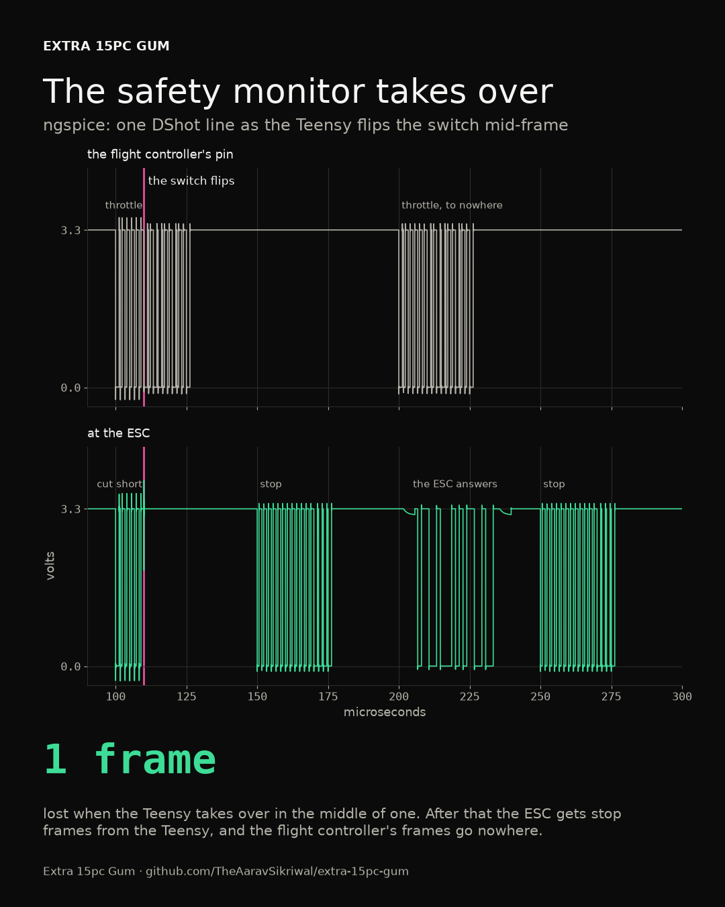

## The verdict

**Fail.** 3 of 438 checks miss.

| Check | Where | In | What it found | Rests on |
|---|---|---|---|---|
| load voltage | pi.GPIO.5V | V, cruise | 5.183 to 5.187 V across the cases, inside 4.75 to 5.15 V (4.63 to 5.25 V, less the margin) | rpi-5-4gb: draws[GPIO.5V] |
| connector burst | pack.XT60.+ | max, burst | 90 A for 10 s ends 94 K over the air (heating with a 98 s time constant) | amass-xt60: rating.contact_mass_g |
| connector burst | pack.XT60.- | P, burst | 90 A for 10 s ends 94 K over the air (heating with a 98 s time constant) | amass-xt60: rating.contact_mass_g |

Built from E3 2814 850KV / 1050 3-blade / 6S2P Molicel INR-21700-P45B. The connection list has 33 boards, 128 wires and 27 safety paths.
It passes every rule in all 8 module combinations: every pin exists, one driver per line, no supplies tied together, no pin over its voltage, every board powered and grounded, two CAN terminators, and every safety path there.

## The flight cases

Each combination gets four. Hover and cruise use the pessimistic power model at the reserve, where the pack is lowest and the current highest. The burst is full throttle at the reserve, which the firmware caps. The worst case is a hover with every 5 V part at its worst: servos stalled, the Pi flat out. These are the battery's currents.

| Setup | Hover | Cruise | Burst | The pack in the burst |
|---|---|---|---|---|
| base | 14.8 A | 10.9 A | 90.0 A | 16.1 V |
| V | 17.4 A | 13.4 A | 90.0 A | 16.1 V |
| P | 17.0 A | 12.8 A | 90.0 A | 16.1 V |
| C | 20.1 A | 15.4 A | 90.0 A | 16.1 V |
| mission | 22.2 A | 17.4 A | 90.0 A | 16.1 V |
| V+C | 22.8 A | 18.0 A | 90.0 A | 16.1 V |
| P+C | 22.3 A | 17.4 A | 90.0 A | 16.1 V |
| max | 25.1 A | 20.0 A | 90.0 A | 16.1 V |

## Every check

Every rating gets 80% at most, steady. Heat is checked in 40 °C air, steady and through the 10 s burst, against each insulation's or connector's limit less 20 °C. A check that rests on an estimate says so in the verdict and in "What it rests on".

| Check | How many | Passed | Tightest |
|---|---|---|---|
| connector current | 51 | 51 | lead.XT60.+, max, hover: 25.07 A through one amass-xt60 contact, rated 35 A |
| supply, typical | 13 | 13 | bec.5V, max, hover: 2.57 A against 80% of its 5 A |
| supply, worst | 13 | 13 | bec.5V, max, worst: 5.93 A against its 9 A peak rating |
| load voltage | 25 | 24 | pi.GPIO.5V, V, cruise: 5.183 to 5.187 V across the cases, inside 4.75 to 5.15 V (4.63 to 5.25 V, less the margin) |
| main path drop | 1 | 1 | pack to esc.BAT.VBAT, base, burst: 342 mV lost out and back at 90 A, against 2% of the pack's nominal 21.6 V |
| fuse holds | 2 | 2 | fuses.F1, max, hover: 0.81 A steady, so it needs 1.01 A; it's a 3 A fuse |
| fuse protects its wire | 2 | 2 | fuses.F2, on a short: it lets through 9 A2s; fuses.F2.B to fc.POWER_AUX.VBAT (26 AWG) takes 115 A2s to go from 40 to 80 C |
| wire current | 54 | 54 | lead.XT60.+ to esc.BAT.VBAT, max, hover: 25.07 A in 12 AWG silicone, which carries 66.7 A to its 200 C limit in 40 C air |
| wire temperature | 54 | 54 | lead.XT60.+ to esc.BAT.VBAT, max, hover: 64 C at 25.07 A in 12 AWG silicone, good to 200 C |
| wire burst | 14 | 14 | lead.XT60.+ to esc.BAT.VBAT, max, burst: 90.0 A for 10 s from 64 C ends at 83 C in 12 AWG silicone |
| connector temperature | 8 | 8 | pack.XT60.+, max, hover: 25.1 A rises 44 K over the 40 C air; Amass rates 85 K at 35 A |
| connector burst | 2 | 0 | pack.XT60.+, max, burst: 90 A for 10 s ends 94 K over the air (heating with a 98 s time constant) |
| ESC current | 1 | 1 | holybro-tekko32-f4-50a, max, hover: 6.0 A a motor, against 80% of its 50 A |
| ESC burst | 1 | 1 | holybro-tekko32-f4-50a, base, burst: 22.4 A a motor at the cap, against its 60 A burst |
| motor current | 1 | 1 | emax-e3-2814-850kv, base, burst: 22.4 A at the cap, against its 58.4 A peak |
| backup: load voltage | 132 | 132 | chute.servo.V+, max, bec.5V off: 4.921 to 4.921 V across the cases, inside 4.90 to 5.90 V (4.8 to 6 V, less the margin) |
| backup: supply | 64 | 64 | fc.5V, max, bec.5V off: 1.59 A with bec.5V off, against its 2 A |

Every check, one by one:

connector current: 51 checked

| What | In | Found | Verdict |
|---|---|---|---|
| lead.XT60.+ | max, hover | 25.07 A through one amass-xt60 contact, rated 35 A | pass |
| pack.XT60.+ | max, hover | 25.07 A through one amass-xt60 contact, rated 35 A | pass |
| lead.XT60.- | max, hover | 25.07 A through one amass-xt60 contact, rated 35 A | pass |
| pack.XT60.- | max, hover | 25.07 A through one amass-xt60 contact, rated 35 A | pass |
| fc.POWER_AUX.VBAT | max, hover | 0.26 A through one jst-gh contact, rated 1 A | pass |
| fc.CAN.5V | max, hover | 0.19 A through one jst-gh contact, rated 1 A | pass |
| sockets.FC_CAN.5V | max, hover | 0.19 A through one jst-gh contact, rated 1 A | pass |
| sockets.V_SIGNAL.CAN_5V | max, hover | 0.19 A through one jst-gh contact, rated 1 A | pass |
| fc.POWER_AUX.GND | base, hover | 0.15 A through one jst-gh contact, rated 1 A | pass |
| fc.VTX.GND | P, cruise | 0.11 A through one jst-gh contact, rated 1 A | pass |
| gps.CAN1.5V | V, hover | 0.11 A through one jst-gh contact, rated 1 A | pass |
| vplug.SIGNAL.CAN_5V | V, hover | 0.11 A through one jst-gh contact, rated 1 A | pass |
| gps.CAN1.GND | V, hover | 0.11 A through one jst-gh contact, rated 1 A | pass |
| vplug.SIGNAL.GND | V, hover | 0.11 A through one jst-gh contact, rated 1 A | pass |
| esc.FC.GND | base, hover | 0.10 A through one jst-sh contact, rated 1 A | pass |
| fc.ESC.GND | base, hover | 0.10 A through one jst-gh contact, rated 1 A | pass |
| sockets.V_POWER.GND | max, cruise | 2.05 A through one amass-xt30 contact, rated 20 A | pass |
| vplug.POWER.5V | max, hover | 2.02 A through one amass-xt30 contact, rated 20 A | pass |
| sockets.V_POWER.5V | max, hover | 2.02 A through one amass-xt30 contact, rated 20 A | pass |
| vplug.POWER.GND | max, hover | 2.02 A through one amass-xt30 contact, rated 20 A | pass |
| sockets.C_POWER.GND | max, hover | 1.67 A through one amass-xt30 contact, rated 20 A | pass |
| sockets.V_SIGNAL.GND | V, hover | 0.08 A through one jst-gh contact, rated 1 A | pass |
| sockets.P_SIGNAL.CAN_5V | P+C, hover | 0.08 A through one jst-gh contact, rated 1 A | pass |
| fc.RC.5V | base, hover | 0.08 A through one jst-gh contact, rated 1 A | pass |
| fc.RC.GND | C, hover | 0.08 A through one jst-gh contact, rated 1 A | pass |
| fc.GPS.5V | base, hover | 0.07 A through one jst-gh contact, rated 1 A | pass |
| lidar.J1.5V | base, hover | 0.07 A through one jst-gh contact, rated 1 A | pass |
| fc.GPS.GND | V+C, hover | 0.07 A through one jst-gh contact, rated 1 A | pass |
| lidar.J1.GND | V+C, hover | 0.07 A through one jst-gh contact, rated 1 A | pass |
| pi.FAN.5V | max, hover | 0.06 A through one jst-sh contact, rated 1 A | pass |
| pi.FAN.GND | V, hover | 0.06 A through one jst-sh contact, rated 1 A | pass |
| fc.CAN.GND | base, hover | 0.05 A through one jst-gh contact, rated 1 A | pass |
| p_node.CAN1.5V | P+C, hover | 0.04 A through one jst-gh contact, rated 1 A | pass |
| pplug.SIGNAL.CAN_5V | P+C, hover | 0.04 A through one jst-gh contact, rated 1 A | pass |
| p_node.CAN1.GND | max, hover | 0.04 A through one jst-gh contact, rated 1 A | pass |
| pplug.SIGNAL.GND | max, hover | 0.04 A through one jst-gh contact, rated 1 A | pass |
| c_node.CAN1.GND | C, hover | 0.04 A through one jst-gh contact, rated 1 A | pass |
| cplug.SIGNAL.GND | C, hover | 0.04 A through one jst-gh contact, rated 1 A | pass |
| sockets.C_SIGNAL.CAN_5V | V+C, cruise | 0.04 A through one jst-gh contact, rated 1 A | pass |
| c_node.CAN1.5V | V+C, cruise | 0.04 A through one jst-gh contact, rated 1 A | pass |
| cplug.SIGNAL.CAN_5V | V+C, cruise | 0.04 A through one jst-gh contact, rated 1 A | pass |
| sockets.C_POWER.5V | max, hover | 0.40 A through one amass-xt30 contact, rated 20 A | pass |
| sockets.C_SIGNAL.GND | C, cruise | 0.02 A through one jst-gh contact, rated 1 A | pass |
| sockets.P_POWER.GND | max, hover | 0.30 A through one amass-xt30 contact, rated 20 A | pass |
| cplug.POWER.GND | P+C, hover | 0.20 A through one amass-xt30 contact, rated 20 A | pass |
| cplug.POWER.5V | C, hover | 0.20 A through one amass-xt30 contact, rated 20 A | pass |
| sockets.P_SIGNAL.GND | mission, hover | 0.00 A through one jst-gh contact, rated 1 A | pass |
| sockets.P_POWER.5V | max, hover | 0.04 A through one amass-xt30 contact, rated 20 A | pass |
| pplug.POWER.5V | max, hover | 0.04 A through one amass-xt30 contact, rated 20 A | pass |
| pplug.POWER.GND | P, cruise | 0.04 A through one amass-xt30 contact, rated 20 A | pass |
| sockets.FC_CAN.GND | V, hover | 0.00 A through one jst-gh contact, rated 1 A | pass |

supply, typical: 13 checked

| What | In | Found | Verdict |
|---|---|---|---|
| bec.5V | max, hover | 2.57 A against 80% of its 5 A | pass |
| pi.CAM3V3 | V, hover | 0.25 A against 80% of its 0.5 A | pass |
| fc.5V | max, cruise | 0.84 A against 80% of its 2 A | pass |
| teensy.3V3 | base, hover | 0.11 A against 80% of its 0.35 A | pass |
| pi.FAN5V | V, hover | 0.06 A against 80% of its 0.6 A | pass |
| cut_3v3.3V3 | base, hover | 0.00 A against 80% of its 0.6 A | pass |
| p_3v3.3V3 | P, hover | 0.00 A against 80% of its 0.6 A | pass |
| c_node.5V_OUT | V+C, cruise | 0.00 A against 80% of its 0.5 A | pass |
| p_node.5V_OUT | P, hover | 0.00 A against 80% of its 0.5 A | pass |
| c_node.CAN_THROUGH | V+C, cruise | 0.00 A against 80% of its 1 A | pass |
| gps.CAN_THROUGH | max, cruise | 0.00 A against 80% of its 1 A | pass |
| p_node.CAN_THROUGH | mission, hover | 0.00 A against 80% of its 1 A | pass |
| fc.12V | base, hover | 0.00 A against 80% of its 2 A | pass |

supply, worst: 13 checked

| What | In | Found | Verdict |
|---|---|---|---|
| bec.5V | max, worst | 5.93 A against its 9 A peak rating | pass |
| pi.CAM3V3 | V, worst | 0.30 A against its 0.5 A continuous rating | pass |
| fc.5V | max, worst | 1.02 A against its 2 A continuous rating | pass |
| teensy.3V3 | base, worst | 0.12 A against its 0.35 A continuous rating | pass |
| pi.FAN5V | V, worst | 0.18 A against its 0.6 A continuous rating | pass |
| cut_3v3.3V3 | base, worst | 0.00 A against its 0.6 A continuous rating | pass |
| p_3v3.3V3 | P, worst | 0.00 A against its 0.6 A continuous rating | pass |
| p_node.5V_OUT | P+C, worst | 0.00 A against its 0.5 A continuous rating | pass |
| c_node.5V_OUT | P+C, worst | 0.00 A against its 0.5 A continuous rating | pass |
| c_node.CAN_THROUGH | P+C, worst | 0.00 A against its 1 A continuous rating | pass |
| p_node.CAN_THROUGH | P, worst | 0.00 A against its 1 A continuous rating | pass |
| fc.12V | base, worst | 0.00 A against its 2 A continuous rating | pass |
| gps.CAN_THROUGH | V, worst | 0.00 A against its 1 A continuous rating | pass |

load voltage: 25 checked, 1 miss

| What | In | Found | Verdict |
|---|---|---|---|
| pi.GPIO.5V | V, cruise | 5.183 to 5.187 V across the cases, inside 4.75 to 5.15 V (4.63 to 5.25 V, less the margin) | fail |
| gps.CAN1.5V | max, worst | 4.978 to 4.987 V across the cases, inside 4.85 to 5.15 V (4.75 to 5.25 V, less the margin) | pass |
| c_node.CAN1.5V | max, worst | 4.980 to 4.997 V across the cases, inside 4.85 to 5.15 V (4.75 to 5.25 V, less the margin) | pass |
| p_node.CAN1.5V | max, worst | 4.985 to 4.998 V across the cases, inside 4.85 to 5.15 V (4.75 to 5.25 V, less the margin) | pass |
| camera.CSI.3V3 | V+C, worst | 3.299 to 3.299 V across the cases, inside 3.20 to 3.40 V (3.1 to 3.5 V, less the margin) | pass |
| chute.servo.V+ | max, worst | 5.164 to 5.196 V across the cases, inside 4.90 to 5.90 V (4.8 to 6 V, less the margin) | pass |
| claws.servo1.V+ | max, worst | 5.187 to 5.198 V across the cases, inside 4.90 to 5.90 V (4.8 to 6 V, less the margin) | pass |
| claws.servo2.V+ | max, worst | 5.187 to 5.198 V across the cases, inside 4.90 to 5.90 V (4.8 to 6 V, less the margin) | pass |
| imu.J1.VIN | V, worst | 3.300 to 3.300 V across the cases, inside 3.10 to 5.40 V (3 to 5.5 V, less the margin) | pass |
| rx.pads.5V | max, worst | 4.999 to 4.999 V across the cases, inside 4.60 to 5.40 V (4.5 to 5.5 V, less the margin) | pass |
| fan.FAN.5V | max, worst | 5.176 to 5.185 V across the cases, inside 4.60 to 5.40 V (4.5 to 5.5 V, less the margin) | pass |
| halow.HAT.5V | max, worst | 5.183 to 5.187 V across the cases, inside 4.60 to 5.40 V (4.5 to 5.5 V, less the margin) | pass |
| cut_3v3.J1.VIN | max, worst | 5.000 to 5.000 V across the cases, inside 4.10 to 49.90 V (4 to 50 V, less the margin) | pass |
| p_3v3.J1.VIN | max, worst | 5.168 to 5.197 V across the cases, inside 4.10 to 49.90 V (4 to 50 V, less the margin) | pass |
| esc.BAT.VBAT | base, burst | 15.708 to 19.566 V across the cases, inside 12.10 to 25.10 V (12 to 25.2 V, less the margin) | pass |
| lidar.J1.5V | max, worst | 4.993 to 4.997 V across the cases, inside 3.80 to 5.10 V (3.7 to 5.2 V, less the margin) | pass |
| bec.pads.IN | max, burst | 15.672 to 19.565 V across the cases, inside 9.10 to 54.90 V (9 to 55 V, less the margin) | pass |
| cut.J1.VCC | V, worst | 3.300 to 3.300 V across the cases, inside 1.75 to 3.50 V (1.65 to 3.6 V, less the margin) | pass |
| taps.B6.VCC | V, worst | 3.300 to 3.300 V across the cases, inside 1.75 to 5.40 V (1.65 to 5.5 V, less the margin) | pass |
| taps.B5.VCC | V, worst | 3.300 to 3.300 V across the cases, inside 1.75 to 5.40 V (1.65 to 5.5 V, less the margin) | pass |
| taps.B4.VCC | V, worst | 3.300 to 3.300 V across the cases, inside 1.75 to 5.40 V (1.65 to 5.5 V, less the margin) | pass |
| taps.B3.VCC | V, worst | 3.300 to 3.300 V across the cases, inside 1.75 to 5.40 V (1.65 to 5.5 V, less the margin) | pass |
| taps.B2.VCC | V, worst | 3.300 to 3.300 V across the cases, inside 1.75 to 5.40 V (1.65 to 5.5 V, less the margin) | pass |
| taps.B1.VCC | V, worst | 3.300 to 3.300 V across the cases, inside 1.75 to 5.40 V (1.65 to 5.5 V, less the margin) | pass |
| p_switch.U1.VCC | max, worst | 3.300 to 3.300 V across the cases, inside 1.75 to 5.40 V (1.65 to 5.5 V, less the margin) | pass |

main path drop: 1 checked

| What | In | Found | Verdict |
|---|---|---|---|
| pack to esc.BAT.VBAT | base, burst | 342 mV lost out and back at 90 A, against 2% of the pack's nominal 21.6 V | pass |

fuse holds: 2 checked

| What | In | Found | Verdict |
|---|---|---|---|
| fuses.F1 | max, hover | 0.81 A steady, so it needs 1.01 A; it's a 3 A fuse | pass |
| fuses.F2 | max, hover | 0.26 A steady, so it needs 0.33 A; it's a 2 A fuse | pass |

fuse protects its wire: 2 checked

| What | In | Found | Verdict |
|---|---|---|---|
| fuses.F2 | on a short | it lets through 9 A2s; fuses.F2.B to fc.POWER_AUX.VBAT (26 AWG) takes 115 A2s to go from 40 to 80 C | pass |
| fuses.F1 | on a short | it lets through 20 A2s; fuses.F1.B to bec.pads.IN (20 AWG) takes 6266 A2s to go from 40 to 200 C | pass |

wire current: 54 checked

| What | In | Found | Verdict |
|---|---|---|---|
| lead.XT60.+ to esc.BAT.VBAT | max, hover | 25.07 A in 12 AWG silicone, which carries 66.7 A to its 200 C limit in 40 C air | pass |
| lead.XT60.- to esc.BAT.GND | max, hover | 25.07 A in 12 AWG silicone, which carries 66.7 A to its 200 C limit in 40 C air | pass |
| esc.MOTORS.M1A to m1.leads.A | max, hover | 6.04 A in 18 AWG silicone, which carries 27.7 A to its 200 C limit in 40 C air | pass |
| esc.MOTORS.M1B to m1.leads.B | max, hover | 6.04 A in 18 AWG silicone, which carries 27.7 A to its 200 C limit in 40 C air | pass |
| esc.MOTORS.M1C to m1.leads.C | max, hover | 6.04 A in 18 AWG silicone, which carries 27.7 A to its 200 C limit in 40 C air | pass |
| esc.MOTORS.M2A to m2.leads.A | max, hover | 6.04 A in 18 AWG silicone, which carries 27.7 A to its 200 C limit in 40 C air | pass |
| esc.MOTORS.M2B to m2.leads.B | max, hover | 6.04 A in 18 AWG silicone, which carries 27.7 A to its 200 C limit in 40 C air | pass |
| esc.MOTORS.M2C to m2.leads.C | max, hover | 6.04 A in 18 AWG silicone, which carries 27.7 A to its 200 C limit in 40 C air | pass |
| esc.MOTORS.M3A to m3.leads.A | max, hover | 6.04 A in 18 AWG silicone, which carries 27.7 A to its 200 C limit in 40 C air | pass |
| esc.MOTORS.M3B to m3.leads.B | max, hover | 6.04 A in 18 AWG silicone, which carries 27.7 A to its 200 C limit in 40 C air | pass |
| esc.MOTORS.M3C to m3.leads.C | max, hover | 6.04 A in 18 AWG silicone, which carries 27.7 A to its 200 C limit in 40 C air | pass |
| esc.MOTORS.M4A to m4.leads.A | max, hover | 6.04 A in 18 AWG silicone, which carries 27.7 A to its 200 C limit in 40 C air | pass |
| esc.MOTORS.M4B to m4.leads.B | max, hover | 6.04 A in 18 AWG silicone, which carries 27.7 A to its 200 C limit in 40 C air | pass |
| esc.MOTORS.M4C to m4.leads.C | max, hover | 6.04 A in 18 AWG silicone, which carries 27.7 A to its 200 C limit in 40 C air | pass |
| vplug.POWER.5V to pi.GPIO.5V | max, hover | 2.02 A in 20 AWG silicone, which carries 21.2 A to its 200 C limit in 40 C air | pass |
| vplug.POWER.GND to pi.GPIO.GND | max, hover | 2.02 A in 20 AWG silicone, which carries 21.2 A to its 200 C limit in 40 C air | pass |
| bec.pads.OUT to sockets.V_POWER.5V | max, hover | 2.02 A in 18 AWG silicone, which carries 27.7 A to its 200 C limit in 40 C air | pass |
| fuses.F2.B to fc.POWER_AUX.VBAT | max, hover | 0.26 A in 26 AWG PVC, which carries 3.7 A to its 80 C limit in 40 C air | pass |
| bec.pads.G2 to sockets.C_POWER.GND | max, hover | 1.67 A in 18 AWG silicone, which carries 27.7 A to its 200 C limit in 40 C air | pass |
| sockets.FC_CAN.5V to sockets.V_SIGNAL.CAN_5V | max, hover | 0.19 A in 26 AWG PVC, which carries 3.7 A to its 80 C limit in 40 C air | pass |
| esc.BAT.GND to bec.pads.G | max, hover | 0.89 A in 20 AWG silicone, which carries 21.2 A to its 200 C limit in 40 C air | pass |
| esc.BAT.GND to fc.POWER_AUX.GND | base, hover | 0.15 A in 26 AWG PVC, which carries 3.7 A to its 80 C limit in 40 C air | pass |
| esc.BAT.VBAT to fuses.F1.A | max, hover | 0.81 A in 20 AWG silicone, which carries 21.2 A to its 200 C limit in 40 C air | pass |
| fuses.F1.B to bec.pads.IN | max, hover | 0.81 A in 20 AWG silicone, which carries 21.2 A to its 200 C limit in 40 C air | pass |
| esc.FC.GND to fc.ESC.GND | base, hover | 0.10 A in 28 AWG PVC, which carries 2.9 A to its 80 C limit in 40 C air | pass |
| fc.VTX.GND to teensy.pins.GND | P, cruise | 0.11 A in 26 AWG PVC, which carries 3.7 A to its 80 C limit in 40 C air | pass |
| teensy_feed.D1.K to teensy.pins.VIN | max, cruise | 0.11 A in 26 AWG PVC, which carries 3.7 A to its 80 C limit in 40 C air | pass |
| bec.pads.OUT to teensy_feed.D1.A2 | max, cruise | 0.11 A in 26 AWG PVC, which carries 3.7 A to its 80 C limit in 40 C air | pass |
| vplug.SIGNAL.CAN_5V to gps.CAN1.5V | V, hover | 0.11 A in 26 AWG PVC, which carries 3.7 A to its 80 C limit in 40 C air | pass |
| vplug.SIGNAL.GND to gps.CAN1.GND | V, hover | 0.11 A in 26 AWG PVC, which carries 3.7 A to its 80 C limit in 40 C air | pass |
| bec.pads.G2 to sockets.V_POWER.GND | max, hover | 0.67 A in 18 AWG silicone, which carries 27.7 A to its 200 C limit in 40 C air | pass |
| sockets.V_SIGNAL.CAN_5V to sockets.P_SIGNAL.CAN_5V | P+C, hover | 0.08 A in 26 AWG PVC, which carries 3.7 A to its 80 C limit in 40 C air | pass |
| fc.RC.5V to rx.pads.5V | max, hover | 0.08 A in 26 AWG PVC, which carries 3.7 A to its 80 C limit in 40 C air | pass |
| fc.RC.GND to rx.pads.GND | P+C, cruise | 0.08 A in 26 AWG PVC, which carries 3.7 A to its 80 C limit in 40 C air | pass |
| fc.GPS.5V to lidar.J1.5V | max, hover | 0.07 A in 26 AWG PVC, which carries 3.7 A to its 80 C limit in 40 C air | pass |
| fc.GPS.GND to lidar.J1.GND | V+C, hover | 0.07 A in 26 AWG PVC, which carries 3.7 A to its 80 C limit in 40 C air | pass |
| esc.BAT.VBAT to fuses.F2.A | max, hover | 0.26 A in 22 AWG silicone, which carries 16.0 A to its 200 C limit in 40 C air | pass |
| bec.pads.OUT to sockets.C_POWER.5V | P+C, cruise | 0.40 A in 18 AWG silicone, which carries 27.7 A to its 200 C limit in 40 C air | pass |
| bec.pads.G2 to sockets.P_POWER.GND | max, hover | 0.30 A in 18 AWG silicone, which carries 27.7 A to its 200 C limit in 40 C air | pass |
| pplug.SIGNAL.CAN_5V to p_node.CAN1.5V | P+C, hover | 0.04 A in 26 AWG PVC, which carries 3.7 A to its 80 C limit in 40 C air | pass |
| pplug.SIGNAL.GND to p_node.CAN1.GND | max, hover | 0.04 A in 26 AWG PVC, which carries 3.7 A to its 80 C limit in 40 C air | pass |
| cplug.SIGNAL.GND to c_node.CAN1.GND | C, hover | 0.04 A in 26 AWG PVC, which carries 3.7 A to its 80 C limit in 40 C air | pass |
| sockets.P_SIGNAL.CAN_5V to sockets.C_SIGNAL.CAN_5V | V+C, cruise | 0.04 A in 26 AWG PVC, which carries 3.7 A to its 80 C limit in 40 C air | pass |
| cplug.SIGNAL.CAN_5V to c_node.CAN1.5V | V+C, cruise | 0.04 A in 26 AWG PVC, which carries 3.7 A to its 80 C limit in 40 C air | pass |
| cplug.POWER.GND to claws.servo1.GND | P+C, hover | 0.20 A in 20 AWG silicone, which carries 21.2 A to its 200 C limit in 40 C air | pass |
| cplug.POWER.5V to claws.servo1.V+ | max, cruise | 0.20 A in 20 AWG silicone, which carries 21.2 A to its 200 C limit in 40 C air | pass |
| cplug.POWER.5V to claws.servo2.V+ | max, cruise | 0.20 A in 20 AWG silicone, which carries 21.2 A to its 200 C limit in 40 C air | pass |
| cplug.POWER.GND to claws.servo2.GND | P+C, hover | 0.20 A in 20 AWG silicone, which carries 21.2 A to its 200 C limit in 40 C air | pass |
| teensy.pins.3V3 to imu.J1.VIN | max, cruise | 0.01 A in 28 AWG PVC, which carries 2.9 A to its 80 C limit in 40 C air | pass |
| teensy.pins.GND to imu.J1.GND | max, hover | 0.01 A in 28 AWG PVC, which carries 2.9 A to its 80 C limit in 40 C air | pass |
| pplug.POWER.5V to p_diodes.pads.VIN1 | max, cruise | 0.04 A in 22 AWG silicone, which carries 16.0 A to its 200 C limit in 40 C air | pass |
| pplug.POWER.GND to chute.servo.GND | P+C, cruise | 0.04 A in 22 AWG silicone, which carries 16.0 A to its 200 C limit in 40 C air | pass |
| p_diodes.pads.VOUT to chute.servo.V+ | max, hover | 0.04 A in 22 AWG silicone, which carries 16.0 A to its 200 C limit in 40 C air | pass |
| bec.pads.OUT to sockets.P_POWER.5V | max, cruise | 0.04 A in 18 AWG silicone, which carries 27.7 A to its 200 C limit in 40 C air | pass |

wire temperature: 54 checked

| What | In | Found | Verdict |
|---|---|---|---|
| lead.XT60.+ to esc.BAT.VBAT | max, hover | 64 C at 25.07 A in 12 AWG silicone, good to 200 C | pass |
| lead.XT60.- to esc.BAT.GND | max, hover | 64 C at 25.07 A in 12 AWG silicone, good to 200 C | pass |
| esc.MOTORS.M1A to m1.leads.A | max, hover | 49 C at 6.04 A in 18 AWG silicone, good to 200 C | pass |
| esc.MOTORS.M1B to m1.leads.B | max, hover | 49 C at 6.04 A in 18 AWG silicone, good to 200 C | pass |
| esc.MOTORS.M1C to m1.leads.C | max, hover | 49 C at 6.04 A in 18 AWG silicone, good to 200 C | pass |
| esc.MOTORS.M2A to m2.leads.A | max, hover | 49 C at 6.04 A in 18 AWG silicone, good to 200 C | pass |
| esc.MOTORS.M2B to m2.leads.B | max, hover | 49 C at 6.04 A in 18 AWG silicone, good to 200 C | pass |
| esc.MOTORS.M2C to m2.leads.C | max, hover | 49 C at 6.04 A in 18 AWG silicone, good to 200 C | pass |
| esc.MOTORS.M3A to m3.leads.A | max, hover | 49 C at 6.04 A in 18 AWG silicone, good to 200 C | pass |
| esc.MOTORS.M3B to m3.leads.B | max, hover | 49 C at 6.04 A in 18 AWG silicone, good to 200 C | pass |
| esc.MOTORS.M3C to m3.leads.C | max, hover | 49 C at 6.04 A in 18 AWG silicone, good to 200 C | pass |
| esc.MOTORS.M4A to m4.leads.A | max, hover | 49 C at 6.04 A in 18 AWG silicone, good to 200 C | pass |
| esc.MOTORS.M4B to m4.leads.B | max, hover | 49 C at 6.04 A in 18 AWG silicone, good to 200 C | pass |
| esc.MOTORS.M4C to m4.leads.C | max, hover | 49 C at 6.04 A in 18 AWG silicone, good to 200 C | pass |
| fuses.F2.B to fc.POWER_AUX.VBAT | max, hover | 40 C at 0.26 A in 26 AWG PVC, good to 80 C | pass |
| vplug.POWER.5V to pi.GPIO.5V | max, hover | 42 C at 2.02 A in 20 AWG silicone, good to 200 C | pass |
| vplug.POWER.GND to pi.GPIO.GND | max, hover | 42 C at 2.02 A in 20 AWG silicone, good to 200 C | pass |
| sockets.FC_CAN.5V to sockets.V_SIGNAL.CAN_5V | max, hover | 40 C at 0.19 A in 26 AWG PVC, good to 80 C | pass |
| bec.pads.OUT to sockets.V_POWER.5V | max, hover | 41 C at 2.02 A in 18 AWG silicone, good to 200 C | pass |
| esc.BAT.GND to fc.POWER_AUX.GND | base, hover | 40 C at 0.15 A in 26 AWG PVC, good to 80 C | pass |
| bec.pads.G2 to sockets.C_POWER.GND | max, hover | 41 C at 1.67 A in 18 AWG silicone, good to 200 C | pass |
| esc.FC.GND to fc.ESC.GND | base, hover | 40 C at 0.10 A in 28 AWG PVC, good to 80 C | pass |
| fc.VTX.GND to teensy.pins.GND | P, cruise | 40 C at 0.11 A in 26 AWG PVC, good to 80 C | pass |
| teensy_feed.D1.K to teensy.pins.VIN | max, cruise | 40 C at 0.11 A in 26 AWG PVC, good to 80 C | pass |
| bec.pads.OUT to teensy_feed.D1.A2 | max, cruise | 40 C at 0.11 A in 26 AWG PVC, good to 80 C | pass |
| vplug.SIGNAL.CAN_5V to gps.CAN1.5V | V, hover | 40 C at 0.11 A in 26 AWG PVC, good to 80 C | pass |
| vplug.SIGNAL.GND to gps.CAN1.GND | V, hover | 40 C at 0.11 A in 26 AWG PVC, good to 80 C | pass |
| esc.BAT.GND to bec.pads.G | max, hover | 40 C at 0.89 A in 20 AWG silicone, good to 200 C | pass |
| esc.BAT.VBAT to fuses.F1.A | max, hover | 40 C at 0.81 A in 20 AWG silicone, good to 200 C | pass |
| fuses.F1.B to bec.pads.IN | max, hover | 40 C at 0.81 A in 20 AWG silicone, good to 200 C | pass |
| sockets.V_SIGNAL.CAN_5V to sockets.P_SIGNAL.CAN_5V | P+C, hover | 40 C at 0.08 A in 26 AWG PVC, good to 80 C | pass |
| fc.RC.5V to rx.pads.5V | max, hover | 40 C at 0.08 A in 26 AWG PVC, good to 80 C | pass |
| fc.RC.GND to rx.pads.GND | P+C, cruise | 40 C at 0.08 A in 26 AWG PVC, good to 80 C | pass |
| fc.GPS.5V to lidar.J1.5V | max, hover | 40 C at 0.07 A in 26 AWG PVC, good to 80 C | pass |
| fc.GPS.GND to lidar.J1.GND | V+C, hover | 40 C at 0.07 A in 26 AWG PVC, good to 80 C | pass |
| bec.pads.G2 to sockets.V_POWER.GND | max, hover | 40 C at 0.67 A in 18 AWG silicone, good to 200 C | pass |
| esc.BAT.VBAT to fuses.F2.A | max, hover | 40 C at 0.26 A in 22 AWG silicone, good to 200 C | pass |
| pplug.SIGNAL.CAN_5V to p_node.CAN1.5V | P+C, hover | 40 C at 0.04 A in 26 AWG PVC, good to 80 C | pass |
| pplug.SIGNAL.GND to p_node.CAN1.GND | max, hover | 40 C at 0.04 A in 26 AWG PVC, good to 80 C | pass |
| cplug.SIGNAL.GND to c_node.CAN1.GND | C, hover | 40 C at 0.04 A in 26 AWG PVC, good to 80 C | pass |
| sockets.P_SIGNAL.CAN_5V to sockets.C_SIGNAL.CAN_5V | V+C, cruise | 40 C at 0.04 A in 26 AWG PVC, good to 80 C | pass |
| cplug.SIGNAL.CAN_5V to c_node.CAN1.5V | V+C, cruise | 40 C at 0.04 A in 26 AWG PVC, good to 80 C | pass |
| bec.pads.OUT to sockets.C_POWER.5V | P+C, cruise | 40 C at 0.40 A in 18 AWG silicone, good to 200 C | pass |
| bec.pads.G2 to sockets.P_POWER.GND | max, hover | 40 C at 0.30 A in 18 AWG silicone, good to 200 C | pass |
| cplug.POWER.GND to claws.servo1.GND | P+C, hover | 40 C at 0.20 A in 20 AWG silicone, good to 200 C | pass |
| cplug.POWER.5V to claws.servo1.V+ | max, cruise | 40 C at 0.20 A in 20 AWG silicone, good to 200 C | pass |
| cplug.POWER.5V to claws.servo2.V+ | max, cruise | 40 C at 0.20 A in 20 AWG silicone, good to 200 C | pass |
| cplug.POWER.GND to claws.servo2.GND | P+C, hover | 40 C at 0.20 A in 20 AWG silicone, good to 200 C | pass |
| teensy.pins.3V3 to imu.J1.VIN | max, cruise | 40 C at 0.01 A in 28 AWG PVC, good to 80 C | pass |
| teensy.pins.GND to imu.J1.GND | max, hover | 40 C at 0.01 A in 28 AWG PVC, good to 80 C | pass |
| pplug.POWER.5V to p_diodes.pads.VIN1 | max, cruise | 40 C at 0.04 A in 22 AWG silicone, good to 200 C | pass |
| p_diodes.pads.VOUT to chute.servo.V+ | max, hover | 40 C at 0.04 A in 22 AWG silicone, good to 200 C | pass |
| pplug.POWER.GND to chute.servo.GND | P+C, cruise | 40 C at 0.04 A in 22 AWG silicone, good to 200 C | pass |
| bec.pads.OUT to sockets.P_POWER.5V | max, cruise | 40 C at 0.04 A in 18 AWG silicone, good to 200 C | pass |

wire burst: 14 checked

| What | In | Found | Verdict |
|---|---|---|---|
| lead.XT60.+ to esc.BAT.VBAT | max, burst | 90.0 A for 10 s from 64 C ends at 83 C in 12 AWG silicone | pass |
| lead.XT60.- to esc.BAT.GND | P, burst | 90.0 A for 10 s from 64 C ends at 83 C in 12 AWG silicone | pass |
| esc.MOTORS.M1A to m1.leads.A | base, burst | 22.4 A for 10 s from 49 C ends at 60 C in 18 AWG silicone | pass |
| esc.MOTORS.M1B to m1.leads.B | base, burst | 22.4 A for 10 s from 49 C ends at 60 C in 18 AWG silicone | pass |
| esc.MOTORS.M1C to m1.leads.C | base, burst | 22.4 A for 10 s from 49 C ends at 60 C in 18 AWG silicone | pass |
| esc.MOTORS.M2A to m2.leads.A | base, burst | 22.4 A for 10 s from 49 C ends at 60 C in 18 AWG silicone | pass |
| esc.MOTORS.M2B to m2.leads.B | base, burst | 22.4 A for 10 s from 49 C ends at 60 C in 18 AWG silicone | pass |
| esc.MOTORS.M2C to m2.leads.C | base, burst | 22.4 A for 10 s from 49 C ends at 60 C in 18 AWG silicone | pass |
| esc.MOTORS.M3A to m3.leads.A | base, burst | 22.4 A for 10 s from 49 C ends at 60 C in 18 AWG silicone | pass |
| esc.MOTORS.M3B to m3.leads.B | base, burst | 22.4 A for 10 s from 49 C ends at 60 C in 18 AWG silicone | pass |
| esc.MOTORS.M3C to m3.leads.C | base, burst | 22.4 A for 10 s from 49 C ends at 60 C in 18 AWG silicone | pass |
| esc.MOTORS.M4A to m4.leads.A | base, burst | 22.4 A for 10 s from 49 C ends at 60 C in 18 AWG silicone | pass |
| esc.MOTORS.M4B to m4.leads.B | base, burst | 22.4 A for 10 s from 49 C ends at 60 C in 18 AWG silicone | pass |
| esc.MOTORS.M4C to m4.leads.C | base, burst | 22.4 A for 10 s from 49 C ends at 60 C in 18 AWG silicone | pass |

connector temperature: 8 checked

| What | In | Found | Verdict |
|---|---|---|---|
| pack.XT60.+ | max, hover | 25.1 A rises 44 K over the 40 C air; Amass rates 85 K at 35 A | pass |
| pack.XT60.- | max, hover | 25.1 A rises 44 K over the 40 C air; Amass rates 85 K at 35 A | pass |
| sockets.V_POWER.GND | max, cruise | 2.0 A rises 1 K over the 40 C air; Amass rates 85 K at 20 A | pass |
| sockets.V_POWER.5V | max, hover | 2.0 A rises 1 K over the 40 C air; Amass rates 85 K at 20 A | pass |
| sockets.C_POWER.GND | C, cruise | 0.4 A rises 0 K over the 40 C air; Amass rates 85 K at 20 A | pass |
| sockets.C_POWER.5V | max, hover | 0.4 A rises 0 K over the 40 C air; Amass rates 85 K at 20 A | pass |
| sockets.P_POWER.GND | P+C, cruise | 0.1 A rises 0 K over the 40 C air; Amass rates 85 K at 20 A | pass |
| sockets.P_POWER.5V | max, hover | 0.0 A rises 0 K over the 40 C air; Amass rates 85 K at 20 A | pass |

connector burst: 2 checked, 2 miss

| What | In | Found | Verdict |
|---|---|---|---|
| pack.XT60.+ | max, burst | 90 A for 10 s ends 94 K over the air (heating with a 98 s time constant) | fail |
| pack.XT60.- | P, burst | 90 A for 10 s ends 94 K over the air (heating with a 98 s time constant) | fail |

ESC current: 1 checked

| What | In | Found | Verdict |
|---|---|---|---|
| holybro-tekko32-f4-50a | max, hover | 6.0 A a motor, against 80% of its 50 A | pass |

ESC burst: 1 checked

| What | In | Found | Verdict |
|---|---|---|---|
| holybro-tekko32-f4-50a | base, burst | 22.4 A a motor at the cap, against its 60 A burst | pass |

motor current: 1 checked

| What | In | Found | Verdict |
|---|---|---|---|
| emax-e3-2814-850kv | base, burst | 22.4 A at the cap, against its 58.4 A peak | pass |

backup: load voltage: 132 checked

| What | In | Found | Verdict |
|---|---|---|---|
| chute.servo.V+ | max, bec.5V off | 4.921 to 4.921 V across the cases, inside 4.90 to 5.90 V (4.8 to 6 V, less the margin) | pass |
| chute.servo.V+ | mission, bec.5V off | 4.924 to 4.924 V across the cases, inside 4.90 to 5.90 V (4.8 to 6 V, less the margin) | pass |
| chute.servo.V+ | P+C, bec.5V off | 4.925 to 4.925 V across the cases, inside 4.90 to 5.90 V (4.8 to 6 V, less the margin) | pass |
| chute.servo.V+ | P, bec.5V off | 4.928 to 4.928 V across the cases, inside 4.90 to 5.90 V (4.8 to 6 V, less the margin) | pass |
| p_node.CAN1.5V | max, bec.5V off | 4.954 to 4.954 V across the cases, inside 4.85 to 5.15 V (4.75 to 5.25 V, less the margin) | pass |
| p_node.CAN1.5V | mission, bec.5V off | 4.957 to 4.957 V across the cases, inside 4.85 to 5.15 V (4.75 to 5.25 V, less the margin) | pass |
| p_node.CAN1.5V | P+C, bec.5V off | 4.958 to 4.958 V across the cases, inside 4.85 to 5.15 V (4.75 to 5.25 V, less the margin) | pass |
| p_node.CAN1.5V | P, bec.5V off | 4.961 to 4.961 V across the cases, inside 4.85 to 5.15 V (4.75 to 5.25 V, less the margin) | pass |
| c_node.CAN1.5V | max, bec.5V off | 4.966 to 4.966 V across the cases, inside 4.85 to 5.15 V (4.75 to 5.25 V, less the margin) | pass |
| gps.CAN1.5V | max, bec.5V off | 4.967 to 4.967 V across the cases, inside 4.85 to 5.15 V (4.75 to 5.25 V, less the margin) | pass |
| gps.CAN1.5V | mission, bec.5V off | 4.970 to 4.970 V across the cases, inside 4.85 to 5.15 V (4.75 to 5.25 V, less the margin) | pass |
| c_node.CAN1.5V | P+C, bec.5V off | 4.970 to 4.970 V across the cases, inside 4.85 to 5.15 V (4.75 to 5.25 V, less the margin) | pass |
| gps.CAN1.5V | V+C, bec.5V off | 4.986 to 4.986 V across the cases, inside 4.85 to 5.15 V (4.75 to 5.25 V, less the margin) | pass |
| c_node.CAN1.5V | V+C, bec.5V off | 4.988 to 4.988 V across the cases, inside 4.85 to 5.15 V (4.75 to 5.25 V, less the margin) | pass |
| gps.CAN1.5V | V, bec.5V off | 4.989 to 4.989 V across the cases, inside 4.85 to 5.15 V (4.75 to 5.25 V, less the margin) | pass |
| c_node.CAN1.5V | C, bec.5V off | 4.993 to 4.993 V across the cases, inside 4.85 to 5.15 V (4.75 to 5.25 V, less the margin) | pass |
| camera.CSI.3V3 | mission, bec.5V off | 3.299 to 3.299 V across the cases, inside 3.20 to 3.40 V (3.1 to 3.5 V, less the margin) | pass |
| camera.CSI.3V3 | max, bec.5V off | 3.299 to 3.299 V across the cases, inside 3.20 to 3.40 V (3.1 to 3.5 V, less the margin) | pass |
| camera.CSI.3V3 | V, bec.5V off | 3.299 to 3.299 V across the cases, inside 3.20 to 3.40 V (3.1 to 3.5 V, less the margin) | pass |
| camera.CSI.3V3 | V+C, bec.5V off | 3.299 to 3.299 V across the cases, inside 3.20 to 3.40 V (3.1 to 3.5 V, less the margin) | pass |
| imu.J1.VIN | mission, bec.5V off | 3.300 to 3.300 V across the cases, inside 3.10 to 5.40 V (3 to 5.5 V, less the margin) | pass |
| imu.J1.VIN | P, bec.5V off | 3.300 to 3.300 V across the cases, inside 3.10 to 5.40 V (3 to 5.5 V, less the margin) | pass |
| imu.J1.VIN | max, bec.5V off | 3.300 to 3.300 V across the cases, inside 3.10 to 5.40 V (3 to 5.5 V, less the margin) | pass |
| imu.J1.VIN | P+C, bec.5V off | 3.300 to 3.300 V across the cases, inside 3.10 to 5.40 V (3 to 5.5 V, less the margin) | pass |
| imu.J1.VIN | base, bec.5V off | 3.300 to 3.300 V across the cases, inside 3.10 to 5.40 V (3 to 5.5 V, less the margin) | pass |
| imu.J1.VIN | V, bec.5V off | 3.300 to 3.300 V across the cases, inside 3.10 to 5.40 V (3 to 5.5 V, less the margin) | pass |
| imu.J1.VIN | V+C, bec.5V off | 3.300 to 3.300 V across the cases, inside 3.10 to 5.40 V (3 to 5.5 V, less the margin) | pass |
| imu.J1.VIN | C, bec.5V off | 3.300 to 3.300 V across the cases, inside 3.10 to 5.40 V (3 to 5.5 V, less the margin) | pass |
| rx.pads.5V | max, bec.5V off | 4.999 to 4.999 V across the cases, inside 4.60 to 5.40 V (4.5 to 5.5 V, less the margin) | pass |
| rx.pads.5V | mission, bec.5V off | 4.999 to 4.999 V across the cases, inside 4.60 to 5.40 V (4.5 to 5.5 V, less the margin) | pass |
| rx.pads.5V | P+C, bec.5V off | 4.999 to 4.999 V across the cases, inside 4.60 to 5.40 V (4.5 to 5.5 V, less the margin) | pass |
| rx.pads.5V | P, bec.5V off | 4.999 to 4.999 V across the cases, inside 4.60 to 5.40 V (4.5 to 5.5 V, less the margin) | pass |
| rx.pads.5V | V+C, bec.5V off | 4.999 to 4.999 V across the cases, inside 4.60 to 5.40 V (4.5 to 5.5 V, less the margin) | pass |
| rx.pads.5V | V, bec.5V off | 4.999 to 4.999 V across the cases, inside 4.60 to 5.40 V (4.5 to 5.5 V, less the margin) | pass |
| rx.pads.5V | C, bec.5V off | 4.999 to 4.999 V across the cases, inside 4.60 to 5.40 V (4.5 to 5.5 V, less the margin) | pass |
| rx.pads.5V | base, bec.5V off | 4.999 to 4.999 V across the cases, inside 4.60 to 5.40 V (4.5 to 5.5 V, less the margin) | pass |
| p_3v3.J1.VIN | max, bec.5V off | 4.925 to 4.925 V across the cases, inside 4.10 to 49.90 V (4 to 50 V, less the margin) | pass |
| p_3v3.J1.VIN | mission, bec.5V off | 4.928 to 4.928 V across the cases, inside 4.10 to 49.90 V (4 to 50 V, less the margin) | pass |
| p_3v3.J1.VIN | P+C, bec.5V off | 4.929 to 4.929 V across the cases, inside 4.10 to 49.90 V (4 to 50 V, less the margin) | pass |
| p_3v3.J1.VIN | P, bec.5V off | 4.932 to 4.932 V across the cases, inside 4.10 to 49.90 V (4 to 50 V, less the margin) | pass |
| cut_3v3.J1.VIN | max, bec.5V off | 5.000 to 5.000 V across the cases, inside 4.10 to 49.90 V (4 to 50 V, less the margin) | pass |
| cut_3v3.J1.VIN | mission, bec.5V off | 5.000 to 5.000 V across the cases, inside 4.10 to 49.90 V (4 to 50 V, less the margin) | pass |
| cut_3v3.J1.VIN | P+C, bec.5V off | 5.000 to 5.000 V across the cases, inside 4.10 to 49.90 V (4 to 50 V, less the margin) | pass |
| cut_3v3.J1.VIN | P, bec.5V off | 5.000 to 5.000 V across the cases, inside 4.10 to 49.90 V (4 to 50 V, less the margin) | pass |
| cut_3v3.J1.VIN | V+C, bec.5V off | 5.000 to 5.000 V across the cases, inside 4.10 to 49.90 V (4 to 50 V, less the margin) | pass |
| cut_3v3.J1.VIN | V, bec.5V off | 5.000 to 5.000 V across the cases, inside 4.10 to 49.90 V (4 to 50 V, less the margin) | pass |
| cut_3v3.J1.VIN | C, bec.5V off | 5.000 to 5.000 V across the cases, inside 4.10 to 49.90 V (4 to 50 V, less the margin) | pass |
| cut_3v3.J1.VIN | base, bec.5V off | 5.000 to 5.000 V across the cases, inside 4.10 to 49.90 V (4 to 50 V, less the margin) | pass |
| lidar.J1.5V | max, bec.5V off | 4.993 to 4.993 V across the cases, inside 3.80 to 5.10 V (3.7 to 5.2 V, less the margin) | pass |
| lidar.J1.5V | mission, bec.5V off | 4.993 to 4.993 V across the cases, inside 3.80 to 5.10 V (3.7 to 5.2 V, less the margin) | pass |
| lidar.J1.5V | P+C, bec.5V off | 4.993 to 4.993 V across the cases, inside 3.80 to 5.10 V (3.7 to 5.2 V, less the margin) | pass |
| lidar.J1.5V | P, bec.5V off | 4.993 to 4.993 V across the cases, inside 3.80 to 5.10 V (3.7 to 5.2 V, less the margin) | pass |
| lidar.J1.5V | V+C, bec.5V off | 4.993 to 4.993 V across the cases, inside 3.80 to 5.10 V (3.7 to 5.2 V, less the margin) | pass |
| lidar.J1.5V | V, bec.5V off | 4.993 to 4.993 V across the cases, inside 3.80 to 5.10 V (3.7 to 5.2 V, less the margin) | pass |
| lidar.J1.5V | C, bec.5V off | 4.993 to 4.993 V across the cases, inside 3.80 to 5.10 V (3.7 to 5.2 V, less the margin) | pass |
| lidar.J1.5V | base, bec.5V off | 4.993 to 4.993 V across the cases, inside 3.80 to 5.10 V (3.7 to 5.2 V, less the margin) | pass |
| esc.BAT.VBAT | max, bec.5V off | 18.877 to 18.877 V across the cases, inside 12.10 to 25.10 V (12 to 25.2 V, less the margin) | pass |
| esc.BAT.VBAT | V+C, bec.5V off | 18.989 to 18.989 V across the cases, inside 12.10 to 25.10 V (12 to 25.2 V, less the margin) | pass |
| esc.BAT.VBAT | P+C, bec.5V off | 19.011 to 19.011 V across the cases, inside 12.10 to 25.10 V (12 to 25.2 V, less the margin) | pass |
| esc.BAT.VBAT | mission, bec.5V off | 19.016 to 19.016 V across the cases, inside 12.10 to 25.10 V (12 to 25.2 V, less the margin) | pass |
| esc.BAT.VBAT | C, bec.5V off | 19.121 to 19.121 V across the cases, inside 12.10 to 25.10 V (12 to 25.2 V, less the margin) | pass |
| esc.BAT.VBAT | V, bec.5V off | 19.249 to 19.249 V across the cases, inside 12.10 to 25.10 V (12 to 25.2 V, less the margin) | pass |
| esc.BAT.VBAT | P, bec.5V off | 19.271 to 19.271 V across the cases, inside 12.10 to 25.10 V (12 to 25.2 V, less the margin) | pass |
| esc.BAT.VBAT | base, bec.5V off | 19.377 to 19.377 V across the cases, inside 12.10 to 25.10 V (12 to 25.2 V, less the margin) | pass |
| cut.J1.VCC | mission, bec.5V off | 3.300 to 3.300 V across the cases, inside 1.75 to 3.50 V (1.65 to 3.6 V, less the margin) | pass |
| cut.J1.VCC | max, bec.5V off | 3.300 to 3.300 V across the cases, inside 1.75 to 3.50 V (1.65 to 3.6 V, less the margin) | pass |
| cut.J1.VCC | P, bec.5V off | 3.300 to 3.300 V across the cases, inside 1.75 to 3.50 V (1.65 to 3.6 V, less the margin) | pass |
| cut.J1.VCC | P+C, bec.5V off | 3.300 to 3.300 V across the cases, inside 1.75 to 3.50 V (1.65 to 3.6 V, less the margin) | pass |
| cut.J1.VCC | V+C, bec.5V off | 3.300 to 3.300 V across the cases, inside 1.75 to 3.50 V (1.65 to 3.6 V, less the margin) | pass |
| cut.J1.VCC | base, bec.5V off | 3.300 to 3.300 V across the cases, inside 1.75 to 3.50 V (1.65 to 3.6 V, less the margin) | pass |
| cut.J1.VCC | V, bec.5V off | 3.300 to 3.300 V across the cases, inside 1.75 to 3.50 V (1.65 to 3.6 V, less the margin) | pass |
| cut.J1.VCC | C, bec.5V off | 3.300 to 3.300 V across the cases, inside 1.75 to 3.50 V (1.65 to 3.6 V, less the margin) | pass |
| taps.B6.VCC | P, bec.5V off | 3.300 to 3.300 V across the cases, inside 1.75 to 5.40 V (1.65 to 5.5 V, less the margin) | pass |
| taps.B6.VCC | mission, bec.5V off | 3.300 to 3.300 V across the cases, inside 1.75 to 5.40 V (1.65 to 5.5 V, less the margin) | pass |
| taps.B6.VCC | max, bec.5V off | 3.300 to 3.300 V across the cases, inside 1.75 to 5.40 V (1.65 to 5.5 V, less the margin) | pass |
| taps.B6.VCC | V, bec.5V off | 3.300 to 3.300 V across the cases, inside 1.75 to 5.40 V (1.65 to 5.5 V, less the margin) | pass |
| taps.B6.VCC | base, bec.5V off | 3.300 to 3.300 V across the cases, inside 1.75 to 5.40 V (1.65 to 5.5 V, less the margin) | pass |
| taps.B6.VCC | P+C, bec.5V off | 3.300 to 3.300 V across the cases, inside 1.75 to 5.40 V (1.65 to 5.5 V, less the margin) | pass |
| taps.B6.VCC | V+C, bec.5V off | 3.300 to 3.300 V across the cases, inside 1.75 to 5.40 V (1.65 to 5.5 V, less the margin) | pass |
| taps.B6.VCC | C, bec.5V off | 3.300 to 3.300 V across the cases, inside 1.75 to 5.40 V (1.65 to 5.5 V, less the margin) | pass |
| taps.B5.VCC | P, bec.5V off | 3.300 to 3.300 V across the cases, inside 1.75 to 5.40 V (1.65 to 5.5 V, less the margin) | pass |
| taps.B5.VCC | mission, bec.5V off | 3.300 to 3.300 V across the cases, inside 1.75 to 5.40 V (1.65 to 5.5 V, less the margin) | pass |
| taps.B5.VCC | max, bec.5V off | 3.300 to 3.300 V across the cases, inside 1.75 to 5.40 V (1.65 to 5.5 V, less the margin) | pass |
| taps.B5.VCC | V, bec.5V off | 3.300 to 3.300 V across the cases, inside 1.75 to 5.40 V (1.65 to 5.5 V, less the margin) | pass |
| taps.B5.VCC | base, bec.5V off | 3.300 to 3.300 V across the cases, inside 1.75 to 5.40 V (1.65 to 5.5 V, less the margin) | pass |
| taps.B5.VCC | P+C, bec.5V off | 3.300 to 3.300 V across the cases, inside 1.75 to 5.40 V (1.65 to 5.5 V, less the margin) | pass |
| taps.B5.VCC | V+C, bec.5V off | 3.300 to 3.300 V across the cases, inside 1.75 to 5.40 V (1.65 to 5.5 V, less the margin) | pass |
| taps.B5.VCC | C, bec.5V off | 3.300 to 3.300 V across the cases, inside 1.75 to 5.40 V (1.65 to 5.5 V, less the margin) | pass |
| taps.B4.VCC | P, bec.5V off | 3.300 to 3.300 V across the cases, inside 1.75 to 5.40 V (1.65 to 5.5 V, less the margin) | pass |
| taps.B4.VCC | mission, bec.5V off | 3.300 to 3.300 V across the cases, inside 1.75 to 5.40 V (1.65 to 5.5 V, less the margin) | pass |
| taps.B4.VCC | max, bec.5V off | 3.300 to 3.300 V across the cases, inside 1.75 to 5.40 V (1.65 to 5.5 V, less the margin) | pass |
| taps.B4.VCC | V, bec.5V off | 3.300 to 3.300 V across the cases, inside 1.75 to 5.40 V (1.65 to 5.5 V, less the margin) | pass |
| taps.B4.VCC | base, bec.5V off | 3.300 to 3.300 V across the cases, inside 1.75 to 5.40 V (1.65 to 5.5 V, less the margin) | pass |
| taps.B4.VCC | P+C, bec.5V off | 3.300 to 3.300 V across the cases, inside 1.75 to 5.40 V (1.65 to 5.5 V, less the margin) | pass |
| taps.B4.VCC | V+C, bec.5V off | 3.300 to 3.300 V across the cases, inside 1.75 to 5.40 V (1.65 to 5.5 V, less the margin) | pass |
| taps.B4.VCC | C, bec.5V off | 3.300 to 3.300 V across the cases, inside 1.75 to 5.40 V (1.65 to 5.5 V, less the margin) | pass |
| taps.B3.VCC | P, bec.5V off | 3.300 to 3.300 V across the cases, inside 1.75 to 5.40 V (1.65 to 5.5 V, less the margin) | pass |
| taps.B3.VCC | mission, bec.5V off | 3.300 to 3.300 V across the cases, inside 1.75 to 5.40 V (1.65 to 5.5 V, less the margin) | pass |
| taps.B3.VCC | max, bec.5V off | 3.300 to 3.300 V across the cases, inside 1.75 to 5.40 V (1.65 to 5.5 V, less the margin) | pass |
| taps.B3.VCC | V, bec.5V off | 3.300 to 3.300 V across the cases, inside 1.75 to 5.40 V (1.65 to 5.5 V, less the margin) | pass |
| taps.B3.VCC | base, bec.5V off | 3.300 to 3.300 V across the cases, inside 1.75 to 5.40 V (1.65 to 5.5 V, less the margin) | pass |
| taps.B3.VCC | P+C, bec.5V off | 3.300 to 3.300 V across the cases, inside 1.75 to 5.40 V (1.65 to 5.5 V, less the margin) | pass |
| taps.B3.VCC | V+C, bec.5V off | 3.300 to 3.300 V across the cases, inside 1.75 to 5.40 V (1.65 to 5.5 V, less the margin) | pass |
| taps.B3.VCC | C, bec.5V off | 3.300 to 3.300 V across the cases, inside 1.75 to 5.40 V (1.65 to 5.5 V, less the margin) | pass |
| taps.B2.VCC | P, bec.5V off | 3.300 to 3.300 V across the cases, inside 1.75 to 5.40 V (1.65 to 5.5 V, less the margin) | pass |
| taps.B2.VCC | mission, bec.5V off | 3.300 to 3.300 V across the cases, inside 1.75 to 5.40 V (1.65 to 5.5 V, less the margin) | pass |
| taps.B2.VCC | max, bec.5V off | 3.300 to 3.300 V across the cases, inside 1.75 to 5.40 V (1.65 to 5.5 V, less the margin) | pass |
| taps.B2.VCC | V, bec.5V off | 3.300 to 3.300 V across the cases, inside 1.75 to 5.40 V (1.65 to 5.5 V, less the margin) | pass |
| taps.B2.VCC | base, bec.5V off | 3.300 to 3.300 V across the cases, inside 1.75 to 5.40 V (1.65 to 5.5 V, less the margin) | pass |
| taps.B2.VCC | P+C, bec.5V off | 3.300 to 3.300 V across the cases, inside 1.75 to 5.40 V (1.65 to 5.5 V, less the margin) | pass |
| taps.B2.VCC | V+C, bec.5V off | 3.300 to 3.300 V across the cases, inside 1.75 to 5.40 V (1.65 to 5.5 V, less the margin) | pass |
| taps.B2.VCC | C, bec.5V off | 3.300 to 3.300 V across the cases, inside 1.75 to 5.40 V (1.65 to 5.5 V, less the margin) | pass |
| taps.B1.VCC | P, bec.5V off | 3.300 to 3.300 V across the cases, inside 1.75 to 5.40 V (1.65 to 5.5 V, less the margin) | pass |
| taps.B1.VCC | mission, bec.5V off | 3.300 to 3.300 V across the cases, inside 1.75 to 5.40 V (1.65 to 5.5 V, less the margin) | pass |
| taps.B1.VCC | max, bec.5V off | 3.300 to 3.300 V across the cases, inside 1.75 to 5.40 V (1.65 to 5.5 V, less the margin) | pass |
| taps.B1.VCC | V, bec.5V off | 3.300 to 3.300 V across the cases, inside 1.75 to 5.40 V (1.65 to 5.5 V, less the margin) | pass |
| taps.B1.VCC | base, bec.5V off | 3.300 to 3.300 V across the cases, inside 1.75 to 5.40 V (1.65 to 5.5 V, less the margin) | pass |
| taps.B1.VCC | P+C, bec.5V off | 3.300 to 3.300 V across the cases, inside 1.75 to 5.40 V (1.65 to 5.5 V, less the margin) | pass |
| taps.B1.VCC | V+C, bec.5V off | 3.300 to 3.300 V across the cases, inside 1.75 to 5.40 V (1.65 to 5.5 V, less the margin) | pass |
| taps.B1.VCC | C, bec.5V off | 3.300 to 3.300 V across the cases, inside 1.75 to 5.40 V (1.65 to 5.5 V, less the margin) | pass |
| p_switch.U1.VCC | mission, bec.5V off | 3.300 to 3.300 V across the cases, inside 1.75 to 5.40 V (1.65 to 5.5 V, less the margin) | pass |
| p_switch.U1.VCC | max, bec.5V off | 3.300 to 3.300 V across the cases, inside 1.75 to 5.40 V (1.65 to 5.5 V, less the margin) | pass |
| p_switch.U1.VCC | P, bec.5V off | 3.300 to 3.300 V across the cases, inside 1.75 to 5.40 V (1.65 to 5.5 V, less the margin) | pass |
| p_switch.U1.VCC | P+C, bec.5V off | 3.300 to 3.300 V across the cases, inside 1.75 to 5.40 V (1.65 to 5.5 V, less the margin) | pass |
| bec.pads.IN | max, bec.5V off | 18.876 to 18.876 V across the cases, inside 9.10 to 54.90 V (9 to 55 V, less the margin) | pass |
| bec.pads.IN | V+C, bec.5V off | 18.988 to 18.988 V across the cases, inside 9.10 to 54.90 V (9 to 55 V, less the margin) | pass |
| bec.pads.IN | P+C, bec.5V off | 19.010 to 19.010 V across the cases, inside 9.10 to 54.90 V (9 to 55 V, less the margin) | pass |
| bec.pads.IN | mission, bec.5V off | 19.015 to 19.015 V across the cases, inside 9.10 to 54.90 V (9 to 55 V, less the margin) | pass |
| bec.pads.IN | C, bec.5V off | 19.121 to 19.121 V across the cases, inside 9.10 to 54.90 V (9 to 55 V, less the margin) | pass |
| bec.pads.IN | V, bec.5V off | 19.249 to 19.249 V across the cases, inside 9.10 to 54.90 V (9 to 55 V, less the margin) | pass |
| bec.pads.IN | P, bec.5V off | 19.270 to 19.270 V across the cases, inside 9.10 to 54.90 V (9 to 55 V, less the margin) | pass |
| bec.pads.IN | base, bec.5V off | 19.377 to 19.377 V across the cases, inside 9.10 to 54.90 V (9 to 55 V, less the margin) | pass |

backup: supply: 64 checked

| What | In | Found | Verdict |
|---|---|---|---|
| fc.5V | max, bec.5V off | 1.59 A with bec.5V off, against its 2 A | pass |
| fc.5V | mission, bec.5V off | 1.51 A with bec.5V off, against its 2 A | pass |
| fc.5V | P+C, bec.5V off | 1.47 A with bec.5V off, against its 2 A | pass |
| fc.5V | P, bec.5V off | 1.39 A with bec.5V off, against its 2 A | pass |
| pi.CAM3V3 | V, bec.5V off | 0.30 A with bec.5V off, against its 0.5 A | pass |
| pi.CAM3V3 | mission, bec.5V off | 0.30 A with bec.5V off, against its 0.5 A | pass |
| pi.CAM3V3 | V+C, bec.5V off | 0.30 A with bec.5V off, against its 0.5 A | pass |
| pi.CAM3V3 | max, bec.5V off | 0.30 A with bec.5V off, against its 0.5 A | pass |
| fc.5V | V+C, bec.5V off | 1.06 A with bec.5V off, against its 2 A | pass |
| fc.5V | V, bec.5V off | 0.98 A with bec.5V off, against its 2 A | pass |
| fc.5V | C, bec.5V off | 0.94 A with bec.5V off, against its 2 A | pass |
| fc.5V | base, bec.5V off | 0.86 A with bec.5V off, against its 2 A | pass |
| teensy.3V3 | base, bec.5V off | 0.12 A with bec.5V off, against its 0.35 A | pass |
| teensy.3V3 | V, bec.5V off | 0.12 A with bec.5V off, against its 0.35 A | pass |
| teensy.3V3 | P, bec.5V off | 0.12 A with bec.5V off, against its 0.35 A | pass |
| teensy.3V3 | C, bec.5V off | 0.12 A with bec.5V off, against its 0.35 A | pass |
| teensy.3V3 | mission, bec.5V off | 0.12 A with bec.5V off, against its 0.35 A | pass |
| teensy.3V3 | V+C, bec.5V off | 0.12 A with bec.5V off, against its 0.35 A | pass |
| teensy.3V3 | P+C, bec.5V off | 0.12 A with bec.5V off, against its 0.35 A | pass |
| teensy.3V3 | max, bec.5V off | 0.12 A with bec.5V off, against its 0.35 A | pass |
| cut_3v3.3V3 | base, bec.5V off | 0.00 A with bec.5V off, against its 0.6 A | pass |
| cut_3v3.3V3 | V, bec.5V off | 0.00 A with bec.5V off, against its 0.6 A | pass |
| cut_3v3.3V3 | P, bec.5V off | 0.00 A with bec.5V off, against its 0.6 A | pass |
| cut_3v3.3V3 | C, bec.5V off | 0.00 A with bec.5V off, against its 0.6 A | pass |
| cut_3v3.3V3 | mission, bec.5V off | 0.00 A with bec.5V off, against its 0.6 A | pass |
| cut_3v3.3V3 | V+C, bec.5V off | 0.00 A with bec.5V off, against its 0.6 A | pass |
| cut_3v3.3V3 | P+C, bec.5V off | 0.00 A with bec.5V off, against its 0.6 A | pass |
| cut_3v3.3V3 | max, bec.5V off | 0.00 A with bec.5V off, against its 0.6 A | pass |
| p_3v3.3V3 | P, bec.5V off | 0.00 A with bec.5V off, against its 0.6 A | pass |
| p_3v3.3V3 | mission, bec.5V off | 0.00 A with bec.5V off, against its 0.6 A | pass |
| p_3v3.3V3 | P+C, bec.5V off | 0.00 A with bec.5V off, against its 0.6 A | pass |
| p_3v3.3V3 | max, bec.5V off | 0.00 A with bec.5V off, against its 0.6 A | pass |
| p_node.5V_OUT | P, bec.5V off | 0.00 A with bec.5V off, against its 0.5 A | pass |
| p_node.5V_OUT | mission, bec.5V off | 0.00 A with bec.5V off, against its 0.5 A | pass |
| p_node.5V_OUT | P+C, bec.5V off | 0.00 A with bec.5V off, against its 0.5 A | pass |
| c_node.5V_OUT | C, bec.5V off | 0.00 A with bec.5V off, against its 0.5 A | pass |
| p_node.5V_OUT | max, bec.5V off | 0.00 A with bec.5V off, against its 0.5 A | pass |
| c_node.CAN_THROUGH | C, bec.5V off | 0.00 A with bec.5V off, against its 1 A | pass |
| gps.CAN_THROUGH | mission, bec.5V off | 0.00 A with bec.5V off, against its 1 A | pass |
| gps.CAN_THROUGH | V+C, bec.5V off | 0.00 A with bec.5V off, against its 1 A | pass |
| c_node.CAN_THROUGH | V+C, bec.5V off | 0.00 A with bec.5V off, against its 1 A | pass |
| p_node.CAN_THROUGH | P+C, bec.5V off | 0.00 A with bec.5V off, against its 1 A | pass |
| fc.12V | base, bec.5V off | 0.00 A with bec.5V off, against its 2 A | pass |
| fc.12V | V, bec.5V off | 0.00 A with bec.5V off, against its 2 A | pass |
| gps.CAN_THROUGH | V, bec.5V off | 0.00 A with bec.5V off, against its 1 A | pass |
| pi.FAN5V | V, bec.5V off | 0.00 A with bec.5V off, against its 0.6 A | pass |
| fc.12V | P, bec.5V off | 0.00 A with bec.5V off, against its 2 A | pass |
| p_node.CAN_THROUGH | P, bec.5V off | 0.00 A with bec.5V off, against its 1 A | pass |
| fc.12V | C, bec.5V off | 0.00 A with bec.5V off, against its 2 A | pass |
| fc.12V | mission, bec.5V off | 0.00 A with bec.5V off, against its 2 A | pass |
| pi.FAN5V | mission, bec.5V off | 0.00 A with bec.5V off, against its 0.6 A | pass |
| p_node.CAN_THROUGH | mission, bec.5V off | 0.00 A with bec.5V off, against its 1 A | pass |
| fc.12V | V+C, bec.5V off | 0.00 A with bec.5V off, against its 2 A | pass |
| pi.FAN5V | V+C, bec.5V off | 0.00 A with bec.5V off, against its 0.6 A | pass |
| c_node.5V_OUT | V+C, bec.5V off | 0.00 A with bec.5V off, against its 0.5 A | pass |
| fc.12V | P+C, bec.5V off | 0.00 A with bec.5V off, against its 2 A | pass |
| c_node.CAN_THROUGH | P+C, bec.5V off | 0.00 A with bec.5V off, against its 1 A | pass |
| c_node.5V_OUT | P+C, bec.5V off | 0.00 A with bec.5V off, against its 0.5 A | pass |
| fc.12V | max, bec.5V off | 0.00 A with bec.5V off, against its 2 A | pass |
| gps.CAN_THROUGH | max, bec.5V off | 0.00 A with bec.5V off, against its 1 A | pass |
| pi.FAN5V | max, bec.5V off | 0.00 A with bec.5V off, against its 0.6 A | pass |
| p_node.CAN_THROUGH | max, bec.5V off | 0.00 A with bec.5V off, against its 1 A | pass |
| c_node.CAN_THROUGH | max, bec.5V off | 0.00 A with bec.5V off, against its 1 A | pass |
| c_node.5V_OUT | max, bec.5V off | 0.00 A with bec.5V off, against its 0.5 A | pass |

## Heat through the burst

Each starts from its hottest steady temperature and takes the burst's current for its whole length.

| Part | Before | At the end | Limit |
|---|---|---|---|
| pack.XT60.+ | 84 °C | 134 °C | 100 °C |
| pack.XT60.- | 84 °C | 134 °C | 100 °C |
| lead.XT60.+ to esc.BAT.VBAT | 64 °C | 83 °C | 180 °C |
| lead.XT60.- to esc.BAT.GND | 64 °C | 83 °C | 180 °C |
| esc.MOTORS.M1A to m1.leads.A | 49 °C | 60 °C | 180 °C |

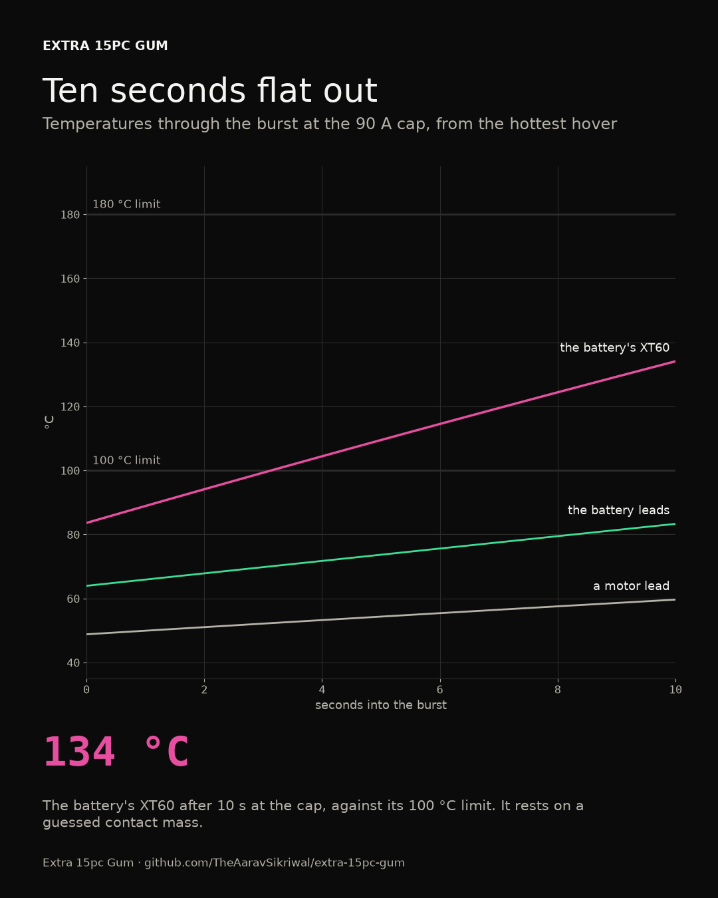

## How hard every wire works

Each route at its hardest working wire, as a share of that wire's heating limit (its rise over the air, against the rise to its limit), in its hardest combination.

| Route | Hover | Cruise | Burst | Worst case |
|---|---|---|---|---|
| battery leads | 17% | 11% | 31% | 17% |
| battery taps | 1% | 1% | 1% | 1% |
| bec feed | 0% | 0% | 0% | 1% |
| fc battery feed | 2% | 2% | 2% | 2% |
| module connector | 1% | 1% | 1% | 2% |
| module power to C | 1% | 1% | 1% | 3% |
| module power to V | 1% | 1% | 1% | 1% |
| motor leads back left | 6% | 4% | 14% | 6% |
| motor leads back right | 6% | 4% | 14% | 6% |
| motor leads front left | 6% | 4% | 14% | 6% |
| motor leads front right | 6% | 4% | 14% | 6% |

The other 17 routes never pass 1%.

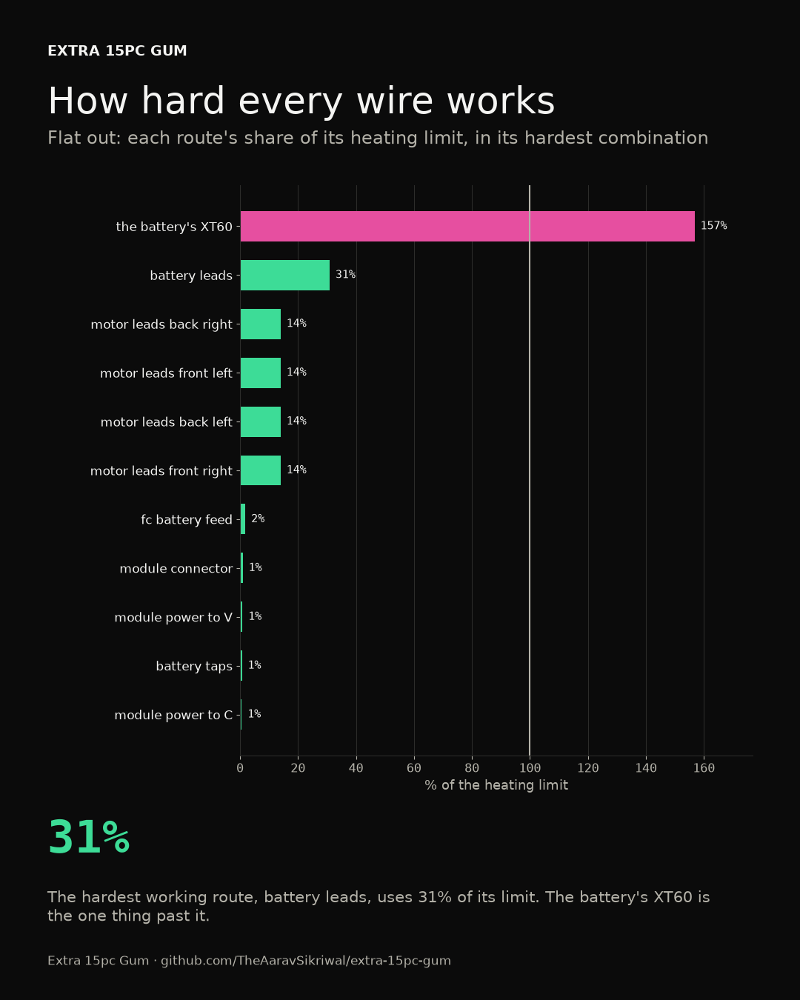

## The safety monitor's switch

One DShot channel in ngspice: the flight controller's pin, the wires at their real lengths, the analog switch, the Teensy's listening buffer and the ESC, which answers with its RPM reply. Every case is decoded from the simulated voltages by the project's own DShot decoder.

| Case | What happens | The ESC got | The flight controller read | Meant to | Result |
|---|---|---|---|---|---|
| Teensy on | The flight controller drives the ESC through the switch, and the ESC's RPM reply comes back, with the Teensy powered and listening | 1046, 1046 | 1232, 1232 | pass | as meant |
| Teensy off | The same with the Teensy unpowered: its pins are dead diodes and its buffers leak their Ioff | 1046, 1046 | 1232, 1232 | pass | as meant |
| Cutting | The Teensy holds the switch over and sends stop frames; the flight controller's frames go nowhere | 0, 0 | nothing | pass | as meant |
| Takeover | The Teensy takes over in the middle of a frame, then sends stop frames | 1046, broken, 0, 0 | nothing | pass | as meant |
| No buffers, Teensy off | What happens without the buffers: the dead Teensy's pins sit straight on the flight controller's line. Meant to fail | broken, broken | broken, broken | fail | as meant |
| Receiver, Teensy off | The receiver's CRSF line into the flight controller, with the Teensy's buffer unpowered on it |  |  | pass | as meant |

What each run measured

- **Teensy on:** frames decode: the ESC decoded [1046, 1046], expecting [1046, 1046]; reply decodes: the flight controller read [1232, 1232], expecting [1232, 1232]; signal edges: the slowest edge at the ESC takes 2.4 ns, against 10% of a bit; signal levels: lows settle at 0.01 V or under (limit 0.66), highs at 3.30 V or over (limit 2.64)
- **Teensy off:** frames decode: the ESC decoded [1046, 1046], expecting [1046, 1046]; reply decodes: the flight controller read [1232, 1232], expecting [1232, 1232]; signal edges: the slowest edge at the ESC takes 2.4 ns, against 10% of a bit; signal levels: lows settle at 0.01 V or under (limit 0.66), highs at 3.30 V or over (limit 2.64)
- **Cutting:** frames decode: the ESC decoded [0, 0], expecting [0, 0]; signal edges: the slowest edge at the ESC takes 2.0 ns, against 10% of a bit; signal levels: lows settle at 0.00 V or under (limit 0.66), highs at 3.30 V or over (limit 2.64)
- **Takeover:** frames decode: the ESC saw [1046, None, 0, 0]: at most one broken frame, ending on stop; signal edges: the slowest edge at the ESC takes 2.4 ns, against 10% of a bit; signal levels: lows settle at 0.01 V or under (limit 0.66), highs at 3.30 V or over (limit 2.64)
- **No buffers, Teensy off:** frames decode: the ESC decoded [None, None], expecting [1046, 1046]; reply decodes: the flight controller read [None, None], expecting [1232, 1232]
- **Receiver, Teensy off:** signal levels: lows at 0.00 V or under, highs at 3.30 V or over; signal edges: the slowest edge takes 1.7 ns, against 10% of a CRSF bit

## Where the power goes

From the pack down, with every module in (max): typical while hovering, and the worst case.

- pack (the battery, through its XT60)
  - esc.BAT.VBAT: the ESC and its motors, 24.0 A hovering
  - fuses.F1, a 3 A fuse: 0.81 A typical, 1.87 A worst
    - bec.pads.IN: 0.01 A typical, 0.01 A worst
    - bec.5V, a switching 5.2 V supply rated 5 A: 2.57 A typical, 5.93 A worst
      - claws.servo1.V+: 0.20 A typical, 1.40 A worst
      - claws.servo2.V+: 0.20 A typical, 1.40 A worst
      - fan.FAN.5V: 0.06 A typical, 0.18 A worst
      - halow.HAT.5V: 0.21 A typical, 0.25 A worst
      - p_diodes.D_MODULE, a diode: 0.04 A typical, 0.45 A worst
        - chute.servo.V+: 0.04 A typical, 0.45 A worst
        - p_3v3.J1.VIN: 0.00 A typical, 0.00 A worst
        - p_3v3.3V3, a switching 3.3 V supply rated 0.6 A: 0.00 A typical, 0.00 A worst
          - p_switch.U1.VCC: 0.00 A typical, 0.00 A worst
      - pi.GPIO.5V: 1.57 A typical, 1.92 A worst
      - pi.CAM3V3, a switching 3.3 V supply rated 0.5 A: 0.25 A typical, 0.30 A worst
        - camera.CSI.3V3: 0.25 A typical, 0.30 A worst
      - teensy_feed.D_MODULE, a diode: 0.11 A typical, 0.12 A worst
        - teensy.3V3, a linear 3.3 V supply rated 0.35 A: 0.11 A typical, 0.12 A worst
          - imu.J1.VIN: 0.01 A typical, 0.01 A worst
          - taps.B1.VCC: 0.00 A typical, 0.00 A worst
          - taps.B2.VCC: 0.00 A typical, 0.00 A worst
          - taps.B3.VCC: 0.00 A typical, 0.00 A worst
          - taps.B4.VCC: 0.00 A typical, 0.00 A worst
          - taps.B5.VCC: 0.00 A typical, 0.00 A worst
          - taps.B6.VCC: 0.00 A typical, 0.00 A worst
  - fuses.F2, a 2 A fuse: 0.26 A typical, 0.32 A worst
    - fc.5V, a switching 5 V supply rated 2 A: 0.84 A typical, 1.02 A worst
      - c_node.CAN1.5V: 0.04 A typical, 0.08 A worst
      - cut_3v3.J1.VIN: 0.00 A typical, 0.00 A worst
      - cut_3v3.3V3, a switching 3.3 V supply rated 0.6 A: 0.00 A typical, 0.00 A worst
        - cut.J1.VCC: 0.00 A typical, 0.00 A worst
      - gps.CAN1.5V: 0.11 A typical, 0.12 A worst
      - lidar.J1.5V: 0.07 A typical, 0.15 A worst
      - p_diodes.D_CAN, a diode: 0.00 A typical, 0.00 A worst
      - p_node.CAN1.5V: 0.04 A typical, 0.08 A worst
      - rx.pads.5V: 0.07 A typical, 0.10 A worst
      - teensy_feed.D_FC, a diode: 0.00 A typical, 0.00 A worst
    - fc.12V, a switching 12 V supply rated 2 A: 0.00 A typical, 0.00 A worst

## Pin maps

### fc (ark-fpv)

| Pin | What it is | Called | Goes to |
|---|---|---|---|
| ESC.VBAT | power |  | fuses.F2.B |
| ESC.CURR | in | CURR_IN_EXT, analog current sense | esc.FC.CURRENT |
| ESC.UART4_RX | in | TELEM4, ttyS3, ESC telemetry | esc.FC.TLM |
| ESC.CH1 | both | FMU_CH1, bidirectional DShot | cut.J1.NC1, taps.B2.A |
| ESC.CH2 | both | FMU_CH2, bidirectional DShot | cut.J1.NC2, taps.B3.A |
| ESC.CH3 | both | FMU_CH3, bidirectional DShot | cut.J1.NC3, taps.B4.A |
| ESC.CH4 | both | FMU_CH4, bidirectional DShot | cut.J1.NC4, taps.B5.A |
| ESC.GND | ground |  | ground |
| PWM_EXTRA.GND | ground |  | ground |
| RC.5V | power |  | c_node.CAN1.5V, c_node.CAN2.5V, c_node.I2C.5V, c_node.UART.5V, cplug.SIGNAL.CAN_5V, and 17 more |
| RC.USART6_RX | in | RC, ttyS5 | rx.pads.TX, taps.B1.A |
| RC.USART6_TX | out | RC, ttyS5 | rx.pads.RX |
| RC.GND | ground |  | ground |
| POWER_AUX.GND | ground |  | ground |
| POWER_AUX.VBAT | power |  | fuses.F2.B |
| CAN.5V | power |  | c_node.CAN1.5V, c_node.CAN2.5V, c_node.I2C.5V, c_node.UART.5V, cplug.SIGNAL.CAN_5V, and 17 more |
| CAN.CAN_P | bus | CAN1 high | c_node.CAN1.CAN_P, c_node.CAN2.CAN_P, cplug.SIGNAL.CAN_P, gps.CAN1.CAN_P, gps.CAN2.CAN_P, and 8 more |
| CAN.CAN_N | bus | CAN1 low | c_node.CAN1.CAN_N, c_node.CAN2.CAN_N, cplug.SIGNAL.CAN_N, gps.CAN1.CAN_N, gps.CAN2.CAN_N, and 8 more |
| CAN.GND | ground |  | ground |
| GPS.5V | power |  | c_node.CAN1.5V, c_node.CAN2.5V, c_node.I2C.5V, c_node.UART.5V, cplug.SIGNAL.CAN_5V, and 17 more |
| GPS.USART1_TX | out | GPS1, ttyS0 | lidar.J1.RXD |
| GPS.USART1_RX | in | GPS1, ttyS0 | lidar.J1.TXD |
| GPS.GND | ground |  | ground |
| TELEM.5V | power |  | c_node.CAN1.5V, c_node.CAN2.5V, c_node.I2C.5V, c_node.UART.5V, cplug.SIGNAL.CAN_5V, and 17 more |
| TELEM.UART7_TX | out | TELEM1, ttyS6 | pi.GPIO.GPIO15, sockets.V_SIGNAL.TX, vplug.SIGNAL.TX |
| TELEM.UART7_RX | in | TELEM1, ttyS6 | pi.GPIO.GPIO14, sockets.V_SIGNAL.RX, vplug.SIGNAL.RX |
| TELEM.GND | ground |  | ground |
| VTX.GND | ground |  | ground |
| VTX.UART5_TX | out | TELEM2, ttyS4 | taps.B6.A |
| VTX.UART5_RX | in | TELEM2, ttyS4 | teensy.pins.14 |
| VTX.GND2 | ground |  | ground |
| SPI.5V | power |  | c_node.CAN1.5V, c_node.CAN2.5V, c_node.I2C.5V, c_node.UART.5V, cplug.SIGNAL.CAN_5V, and 17 more |
| SPI.GND | ground |  | ground |
| DEBUG.GND | ground |  | ground |

### teensy (pjrc-teensy-41)

| Pin | What it is | Called | Goes to |
|---|---|---|---|
| pins.VIN | power |  | teensy_feed.D1.K |
| pins.GND | ground |  | ground |
| pins.3V3 | power |  | imu.J1.VIN, taps.B1.VCC, taps.B2.VCC, taps.B3.VCC, taps.B4.VCC, and 2 more |
| pins.2 | both | FlexPWM4.2 | cut.J1.NO3 |
| pins.4 | both | FlexPWM2.0 | cut.J1.NO4 |
| pins.5 | in | FlexPWM2.1 | taps.B2.Y |
| pins.6 | in | FlexPWM2.2 | taps.B3.Y |
| pins.7 | in | FlexPWM1.3, RX2 | taps.B1.Y |
| pins.10 | out | QuadTimer1.0, CS | imu.J1.CS |
| pins.11 | out | QuadTimer1.2, MOSI, CTX1 | imu.J1.MOSI |
| pins.12 | in | QuadTimer1.1, MISO | imu.J1.MISO |
| pins.13 | out | QuadTimer2.0, SCK, LED | imu.J1.SCK |
| pins.14 | out | QuadTimer3.2, TX3 | fc.VTX.UART5_RX |
| pins.15 | in | QuadTimer3.3, RX3 | taps.B6.Y |
| pins.22 | both | FlexPWM4.0, CTX1 | cut.J1.NO1 |
| pins.23 | both | FlexPWM4.1, CRX1 | cut.J1.NO2 |
| pins.24 | in | FlexPWM1.2, TX6, SCL2 | taps.B4.Y |
| pins.28 | in | FlexPWM3.1, RX7 | taps.B5.Y |
| pins.30 | out | CRX3 | cut.J1.IN |
| pins.31 | out | CTX3 | p_switch.U1.S, pplug.SIGNAL.TAKEOVER, sockets.P_SIGNAL.TAKEOVER |
| pins.37 | out | FlexPWM2.3, CS | p_switch.U1.I1, pplug.SIGNAL.CHUTE, sockets.P_SIGNAL.CHUTE |
| pins.40 | in |  | imu.J1.INT1 |

## Harness diagrams

### main power

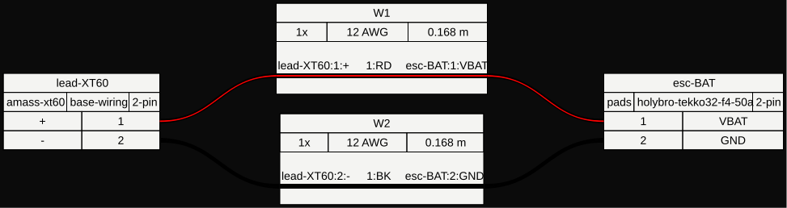

### motors

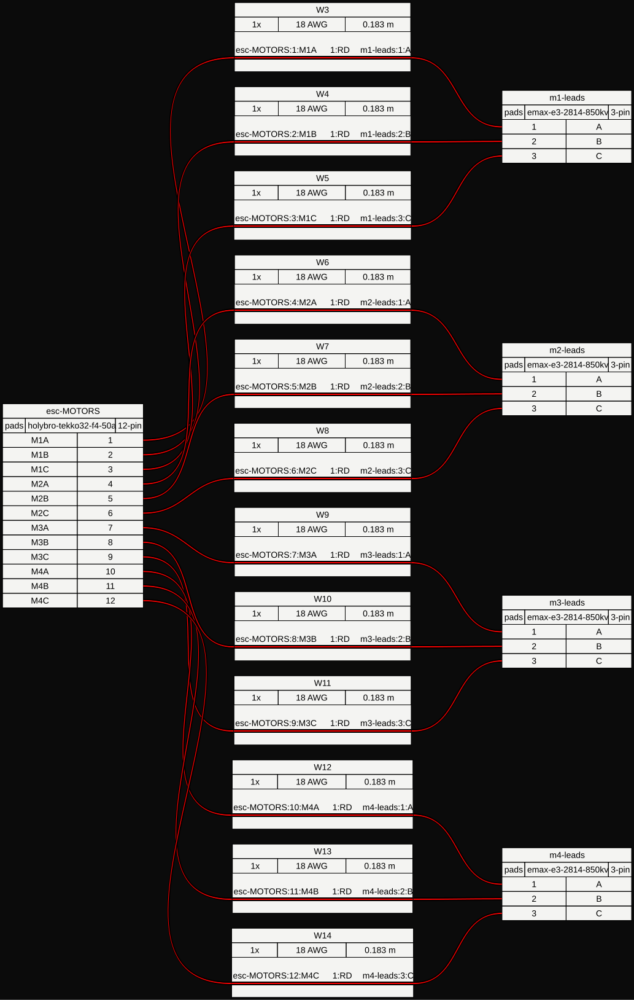

### battery taps

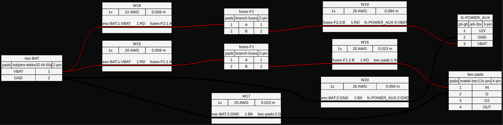

### module power

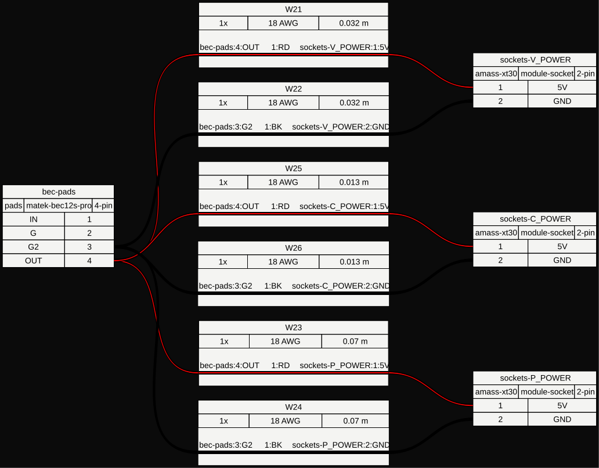

### esc cable

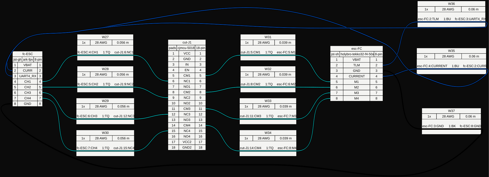

### receiver

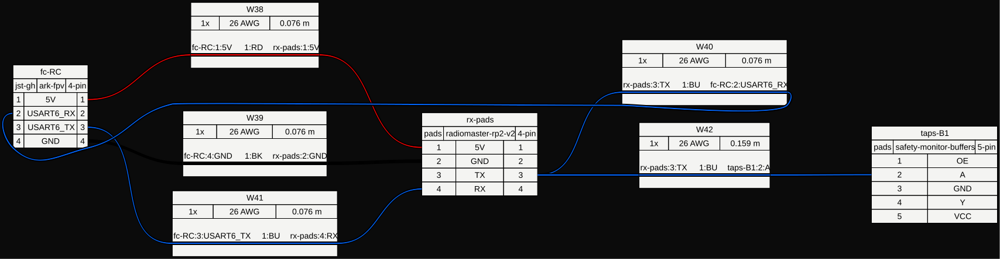

### lidar

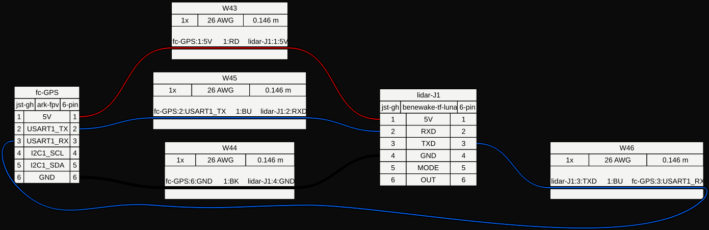

### safety monitor

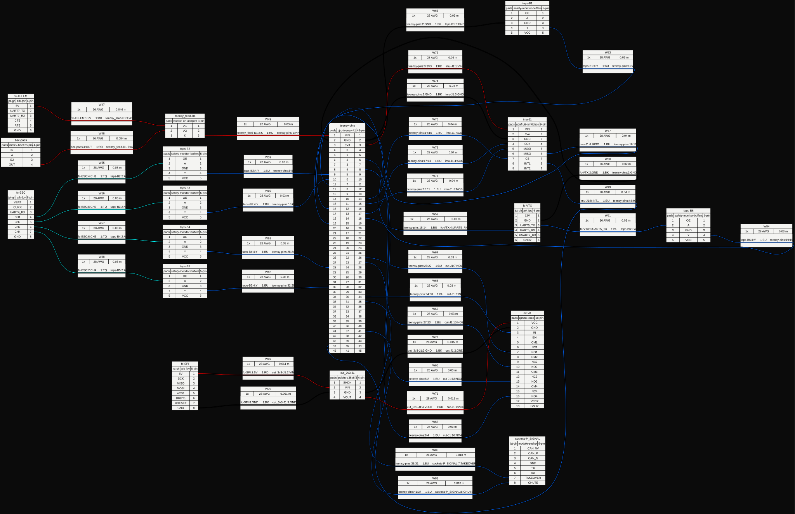

### module bus

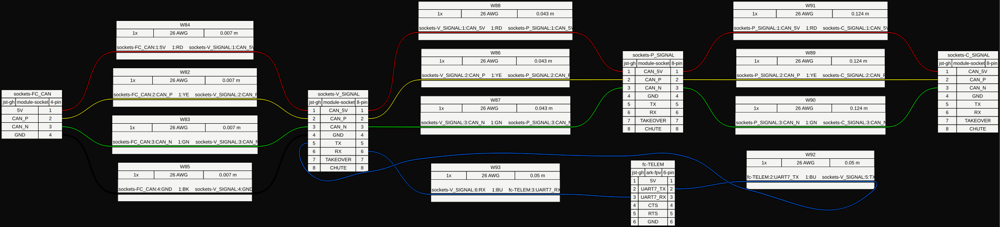

### v

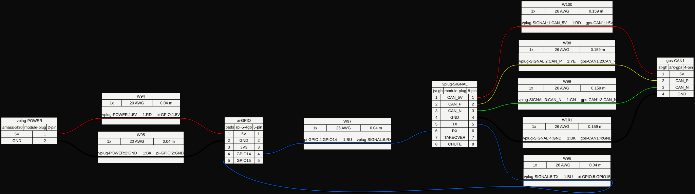

### p

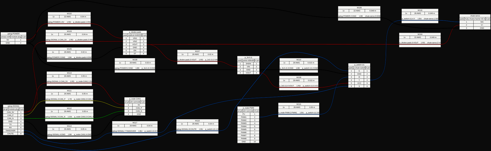

### c

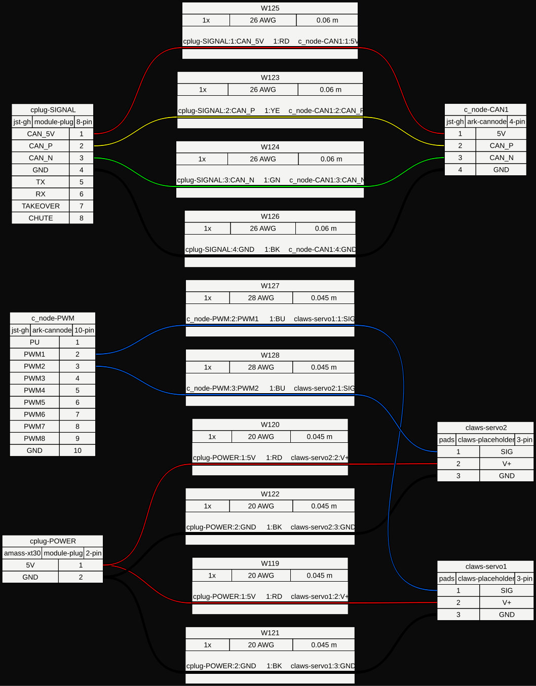

## The schematic

Every board a block with its pins, joined by net labels, in [`kicad/electrical.kicad_sch`](kicad/electrical.kicad_sch). It opens in KiCad 8 or later. KiCad's electrical rules check finds 0 violations.

An SVG of it, too big to commit, is at `outputs/electrical/electrical.svg` after a run.

## What it rests on

Every number comes from a maker's datasheet or a measurement, except these estimates.

- **holybro-tekko32-f4-50a** (esc): connectors[FC], draws[BAT.VBAT]. Holybro's pin map doesn't number the pins, so the battery end is taken as pin 1: check one with a meter. The ESC's own idle draw isn't published, so 50 mA is a guess, and 12 V (4S at 3.0 V a cell) is taken as the bottom of its range
- **ark-fpv** (fc): outputs[5V].efficiency, outputs[12V].efficiency. ARK doesn't publish its supplies' efficiencies; 85% is a guess for small buck converters at these currents. ARK also doesn't say whether the CAN port is terminated
- **radiomaster-rp2-v2** (rx): connectors[pads], draws[pads.5V]. The draw is Matek's figure for its ELRS-R24, which has the same ESP8285 and SX128x chips: 40 to 45 mA before binding, 70 to 75 mA bound, 90 to 95 mA in WiFi mode (https://www.mateksys.com/?portfolio=elrs-r24). 4.5 to 5.5 V is an assumed range around RadioMaster's 5 V. The 3.3 V logic level is inferred from the ESP8285, which runs on 2.7 to 3.6 V
- **benewake-tf-luna** (lidar): connectors[J1]. The plug is 6-pin on a 1.25 mm pitch per a retailer's cable listing. Benewake doesn't name the family, so it's taken as GH-compatible
- **module-socket** (sockets): elements[R_FC]. ARK doesn't say whether the ARK FPV terminates its CAN port. If it does, R_FC comes off, or the bus has three terminators
- **adafruit-lsm6dsox** (imu): connectors[J1], draws[J1.VIN]. The pin list follows Adafruit's usual breakout layout (VIN, 3Vo, GND, SCL/SCK, SDA/MOSI, DO/MISO, CS, INT1, INT2); the product page only names some of them. The draw and its 3 to 5.5 V range are guesses
- **cjmcu-5018** (cut): connectors[J1], draws[J1.VCC]. The board's pin order isn't published, so the pins are listed by function. It has two 1 kOhm resistors near the chip whose job isn't documented: if they pull IN or EN up rather than down, the board would hand the motors to the Teensy by default, so the build package says to check them with a meter and the design adds its own pull-downs. The supply draw is a guess that allows for a power LED
- **pololu-d36v6f3** (cut_3v3, p_3v3): outputs[3V3].efficiency. Pololu shows efficiency as curves; 80% is a round figure, and at the microamps these switches take, the quiescent current is what really counts
- **ark-gps** (gps): draws[CAN1.5V], outputs[CAN_THROUGH]. ARK gives 5 V and no range, so 4.75 to 5.25 V is assumed. The second CAN plug passes the 5 V straight on to the next node; its limit is taken as the JST-GH contact's 1 A
- **rpi-5-4gb** (pi): draws[GPIO.5V], outputs[CAM3V3], connectors[FAN]. Typical is the 8 W the sizing model assumes (software video encoding keeps the CPU busy) and worst is Jeff Geerling's 9.8 W under stress-ng on the 4 GB board (https://www.jeffgeerling.com/blog/2024/new-2gb-pi-5-has-33-smaller-die-30-idle-power-savings/), both at 5.1 V. The 4.63 V floor is the undervoltage warning and 5.25 V is USB's ceiling: Raspberry Pi doesn't publish a range for the GPIO 5 V pins, or describe powering through them. The camera supply's rating and efficiency are guesses, and so is the fan header's pin order
- **rpi-active-cooler** (fan): draws[FAN.5V], connectors[FAN]. Raspberry Pi's figure for its case fan, about 60 mA at 5 V, stands in for typical, and the Pi 4 case fan's 0.18 A rating for the worst case. The pin order is a guess, and 4.5 to 5.5 V an assumed range
- **rpi-camera-module-3** (camera): draws[CSI.3V3]. 250 mA is taken as the draw at 3.3 V on the camera connector, 300 mA as the worst case, and 3.1 to 3.5 V as its range: all guesses, since Raspberry Pi publishes nothing specific to the Camera Module 3
- **heltec-ht-hc01p** (halow): draws[HAT.5V]. Typical is 212 mA (2 MHz at 21 dBm, transmitting nonstop, the conservative case for video) and 4.5 to 5.5 V is an assumed range. These are the V1 card's numbers. The V2 card transmits at 27 dBm with a boost converter for its front end, and Heltec publishes no current for it
- **ark-cannode** (p_node, c_node): draws[CAN1.5V], outputs[CAN_THROUGH]. The draw is a guess (40 mA typical, 80 mA worst) and so is the 4.75 to 5.25 V range. The second CAN plug passes 5 V on to the next node, limited here to the JST-GH contact's 1 A
- **fruity-chutes-harrier-40-42** (chute): its whole electrical block. Fruity Chutes doesn't name the Harrier's trigger servo or its draw. Hitec's HS-55 micro servo stands in: 4.8 to 6.0 V, 5.5 mA idle, 150 mA running, 450 mA stalled (https://hitecrcd.com/hs-55-economy-feather-servo/). Typical is the 0.2 W the sizing model already counts for holding position
- **claws-placeholder** (claws): its whole electrical block. No claw design yet. Two servos like Savox's SH-0255MG+ stand in: 180 mA running and 1200 mA stalled at 4.8 V, 240 mA and 1400 mA at 6.0 V (Lindinger's listing of Savox's figures, https://www.lindinger.at/en/RC-ELECTRONICS/Servos-Accessories/Servos-Digital-Low-Voltage/SAVOEX-SH-0255MG-6V-3-9KG-0-13s-Digital-Micro-Servo/9795255). Typical is the 2 W the sizing model counts for holding a grip, split between the two

## What it can't prove

- A dead short in the battery leads. Nothing electrical stops it; only the leads' routing and sleeving protect against it.
- The motor cut board's two undocumented 1 kOhm resistors. Check them with a meter; pull-ups would make the board fail the wrong way, which the added pull-down only partly covers.
- Powering the Pi 5 through its GPIO 5 V pins, which Raspberry Pi's docs don't describe.
- The ESC cable's re-pinning: Holybro doesn't say which end of its plug is pin 1.
- Whether the ARK FPV terminates its CAN port. If it does, the harness's terminator at that end comes off.
- The switch sims use generic models built from datasheet numbers, with no ground bounce or noise from the motor current. A clean sim isn't a scope on the real thing.

## Files

Generated on every run, next to this report:

- `harnesses/battery-taps.svg`
- `harnesses/c.svg`
- `harnesses/esc-cable.svg`
- `harnesses/lidar.svg`
- `harnesses/main-power.svg`
- `harnesses/module-bus.svg`
- `harnesses/module-power.svg`
- `harnesses/motors.svg`
- `harnesses/p.svg`
- `harnesses/receiver.svg`
- `harnesses/safety-monitor.svg`
- `harnesses/v.svg`
- `kicad/electrical.kicad_pro`
- `kicad/electrical.kicad_sch`
- `kicad/pcs14.kicad_sym`
- `kicad/sym-lib-table`
- `stills/burst-heat.png`
- `stills/takeover-portrait.png`
- `stills/takeover-square.png`
- `stills/takeover-vertical.png`
- `stills/takeover-wide.png`
- `stills/wire-work.png`

And outside it, not committed (they're build outputs):

- `outputs/electrical/electrical.svg`
