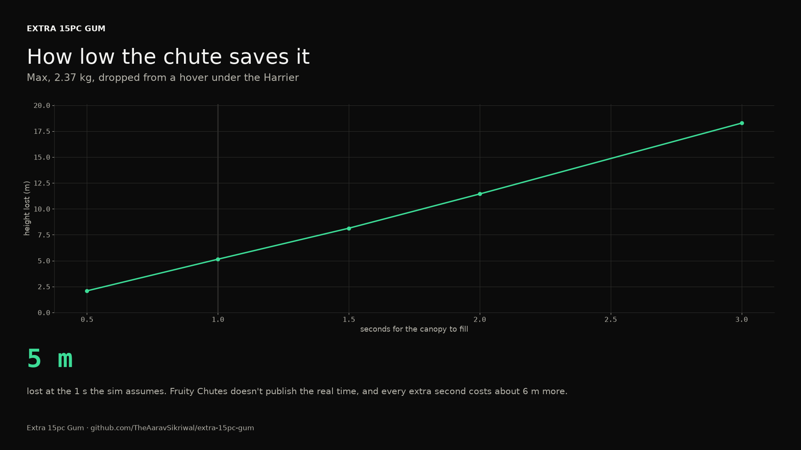
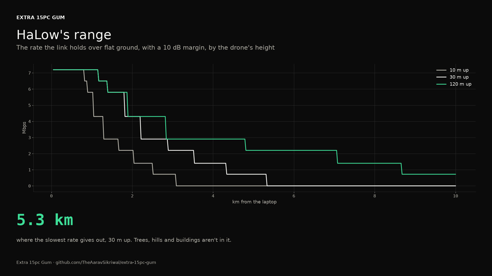

# Modules in sim (step 6)

*Generated 2026-10-20 by `pcs14 modules`, from the flight sim's runs of step 6's scenarios on my firmware. The spec is [docs/specs/2026-10-20-modules-in-sim.md](../../specs/2026-10-20-modules-in-sim.md).*

## The verdict

**pass.** 12 of 12 runs pass.

## P: the parachute

The safety monitor can fire the chute now, as the flight controller can: on the pilot's chute switch, only with P fitted, and always cutting the motors first. Its automatic triggers stay in shadow mode, logging only. Its host tests cover the order, nothing on the ground, nothing without P, the release latching like the cut, and the chute still going with the flight controller hung.

### A hung flight controller

40 m up, my firmware's process frozen the way a hung processor would be. The monitor sees its heartbeat stop and cuts the motors; a second after the hang the pilot flips the chute switch, which reaches the chute through the monitor.

| Combination | The cut | The order | Under the canopy | The monitor's own trigger |
|---|---|---|---|---|
| P | cut 0.29 s after the hang | the motors stopped 0.98 s before the canopy left | lost 9.7 m, then came down at 4.1 m/s with 27.2 m to spare | its free-fall trigger fired 0.61 s after the hang (shadow mode: logged only) |
| mission | cut 0.28 s after the hang | the motors stopped 1.21 s before the canopy left | lost 11.1 m, then came down at 4.3 m/s with 24.0 m to spare | its free-fall trigger fired 0.60 s after the hang (shadow mode: logged only) |
| P+C | cut 0.28 s after the hang | the motors stopped 1.01 s before the canopy left | lost 9.7 m, then came down at 4.3 m/s with 27.1 m to spare | its free-fall trigger fired 0.60 s after the hang (shadow mode: logged only) |
| max | cut 0.28 s after the hang | the motors stopped 1.02 s before the canopy left | lost 10.3 m, then came down at 4.4 m/s with 26.2 m to spare | its free-fall trigger fired 0.60 s after the hang (shadow mode: logged only) |

### How low the chute saves it

Flight termination in Max, the heaviest, from each height (40 m is step 4's parachute drop).

| From | The order | Under the canopy |
|---|---|---|
| 10 m | the motors stopped 0.19 s before the canopy left | lost 4.4 m, then came down at 4.5 m/s with 5.7 m to spare |
| 15 m | the motors stopped 0.19 s before the canopy left | lost 4.6 m, then came down at 4.4 m/s with 10.3 m to spare |
| 20 m | the motors stopped 0.19 s before the canopy left | lost 4.6 m, then came down at 4.4 m/s with 15.3 m to spare |
| 30 m | the motors stopped 0.19 s before the canopy left | lost 4.5 m, then came down at 4.4 m/s with 25.6 m to spare |

The height it takes rests on how fast the canopy fills, which Fruity Chutes doesn't publish. The same canopy in one dimension (the sim's model, the drone's own drag left out), Max at 2.37 kg, falling from still air:

| Opening time | Height lost | Falling as it opens |
|---|---|---|
| 0.5 s | 2.1 m | 4.6 m/s |
| 1 s | 5.1 m | 5.0 m/s |
| 1.5 s | 8.1 m | 4.9 m/s |
| 2 s | 11.4 m | 4.8 m/s |
| 3 s | 18.3 m | 4.7 m/s |

The sim uses 1.0 s. The "about 10 m to open" in decisions.md is a canopy that takes nearly 2 s.

### The opening jolt

The canopy's peak pull on the drone, for the structure track: the sim's, from Gazebo's ground truth during the opening, and the textbook bound at the speed the drone fell as the canopy began to fill (Cx q CdS, Cx 1.7, Knacke). The structure track designs to the bound.

| Combination | Falling at | The sim's peak | The bound |
|---|---|---|---|
| P | 9.5 m/s | 38 N (1.9 g) | 178 N (8.9 g) |
| mission | 11.4 m/s | 46 N (2.1 g) | 254 N (11.7 g) |
| P+C | 9.3 m/s | 40 N (1.8 g) | 171 N (7.9 g) |
| max | 9.7 m/s | 43 N (1.9 g) | 186 N (8.0 g) |

### The parachute rule

Without P, my firmware won't go above 30 m. A take-off asked for 40 m:

| Combination | Found |
|---|---|
| base | asked for 40 m without P, it went to 30.3 m |
| V | asked for 40 m without P, it went to 30.3 m |
| C | asked for 40 m without P, it went to 30.4 m |
| V+C | asked for 40 m without P, it went to 30.3 m |

## V: vision and nav

### HaLow's range

The rate the link holds, by distance and the drone's height, over flat ground with the laptop's antenna 1.5 m up and a 10 dB fade margin (pcs14.modules.halow, from Morse Micro's numbers for the MM6108):

| Distance | 10 m up | 30 m up | 120 m up |
|---|---|---|---|
| 0.1 km | 7.20 Mbps | 7.20 Mbps | 7.20 Mbps |
| 0.5 km | 7.20 Mbps | 7.20 Mbps | 7.20 Mbps |
| 1 km | 5.80 Mbps | 7.20 Mbps | 7.20 Mbps |
| 2 km | 2.20 Mbps | 4.30 Mbps | 4.30 Mbps |
| 3 km | 0.72 Mbps | 2.20 Mbps | 2.90 Mbps |
| 5 km | none | 0.72 Mbps | 2.20 Mbps |
| 8 km | none | none | 1.40 Mbps |

### The camera and the video

Live video at the rate HaLow holds: about 2 Mbps carries 720p at 30 frames a second, so the live view holds to the distance where the table drops under that, and full-resolution stills go when the link allows.

### The companion computer

The jobs that need a GPU (the LLM, the object detector) run on the laptop, and neither board has a hardware video encoder, so the encode costs CPU on both. What stays on board is a CPU job plus visual-inertial odometry, which runs on older ARM boards than the Pi 5. The Orin Nano would add watts the battery pays for without a job to spend its GPU on.

| Board | What | Found | Source |
|---|---|---|---|
| Raspberry Pi 5 (4 GB) | video encode | no hardware H.264 encoder; libx264 on the CPU does 1080p30 in real time on as little as 60% of one core | [link](https://pip-assets.raspberrypi.com/categories/685-app-notes-guides-whitepapers/documents/RP-010033-WP-1-H.264%20encoding%20performance%20on%20Raspberry%20Pi%205_series%20computers.pdf) |
| Raspberry Pi 5 (4 GB) | mass | 46 g, a reseller's figure (Raspberry Pi publishes none) | [link](https://www.ldlc.com/en/product/PB00574323.html) |
| Raspberry Pi 5 (4 GB) | power | 3.3 W idle, 9.8 W flat out; 8 W budgeted for a CPU kept busy encoding | [link](https://www.jeffgeerling.com/blog/2024/new-2gb-pi-5-has-33-smaller-die-30-idle-power-savings/) |
| Jetson Orin Nano (8 GB) | video encode | no NVENC engine; NVIDIA's own answer is libx264 on the CPU | [link](https://docs.nvidia.com/jetson/archives/r36.3/DeveloperGuide/SD/Multimedia/SoftwareEncodeInOrinNano.html) |
| Jetson Orin Nano (8 GB) | power | 7 to 25 W by power mode, the 25 W mode since JetPack 6.2 | [link](https://developer.nvidia.com/blog/nvidia-jetpack-6-2-brings-super-mode-to-nvidia-jetson-orin-nano-and-jetson-orin-nx-modules) |
| Jetson Orin Nano (8 GB) | mass | not published for the module; it needs a carrier board and a heatsink besides | [link](https://developer.nvidia.com/blog/nvidia-jetpack-6-2-brings-super-mode-to-nvidia-jetson-orin-nano-and-jetson-orin-nx-modules) |

## C: the claws

The claws are still a placeholder: the roadmap holds C until a unique claw on an actual arm comes up, and that's my conversation to have. The payload grab (step 4) keeps flying in every C combination, and passes on both firmwares.

## What it can't prove

- The canopy's timing. Fruity Chutes publishes no ejection or opening time, so the 0.2 s and 1.0 s the sim uses are my guesses, and the lowest height the chute saves the drone from rests on them (the table under the drop heights).
- The opening jolt. The sim's canopy grows in a straight line and never overshoots, which real canopies do as they fill, so its number is low. The bound uses Knacke's infinite-mass opening coefficient, which is high for a drone this light under a canopy this big. The real number is between them.
- A hung flight controller here is a frozen process. A real one could hang with its DShot outputs in any state, which the safety monitor's takeover of the lines has to win against; that's tested on the host, not on a board.
- HaLow's range: line of sight over flat ground, with a 10 dB margin standing in for the drone's body, multipath and a laptop held low. No trees, hills or buildings. And the radio's numbers are Morse Micro's for its own module, not Heltec's for its card.
- The companion computer's comparison is from published numbers, not measured on a board.
