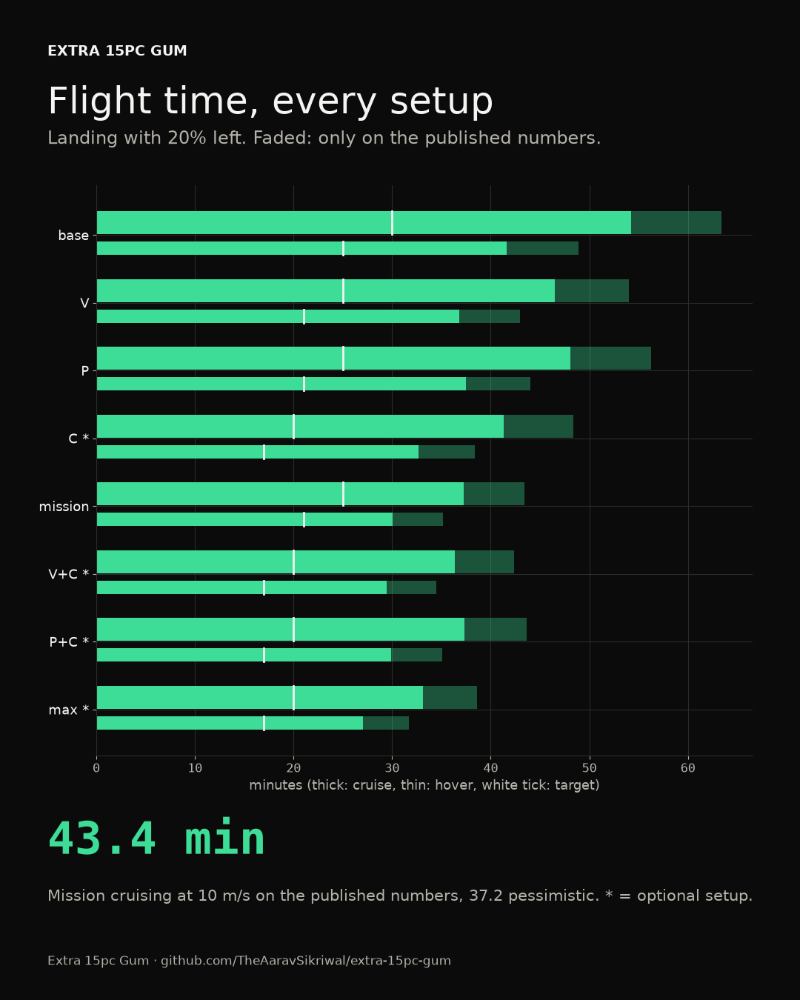
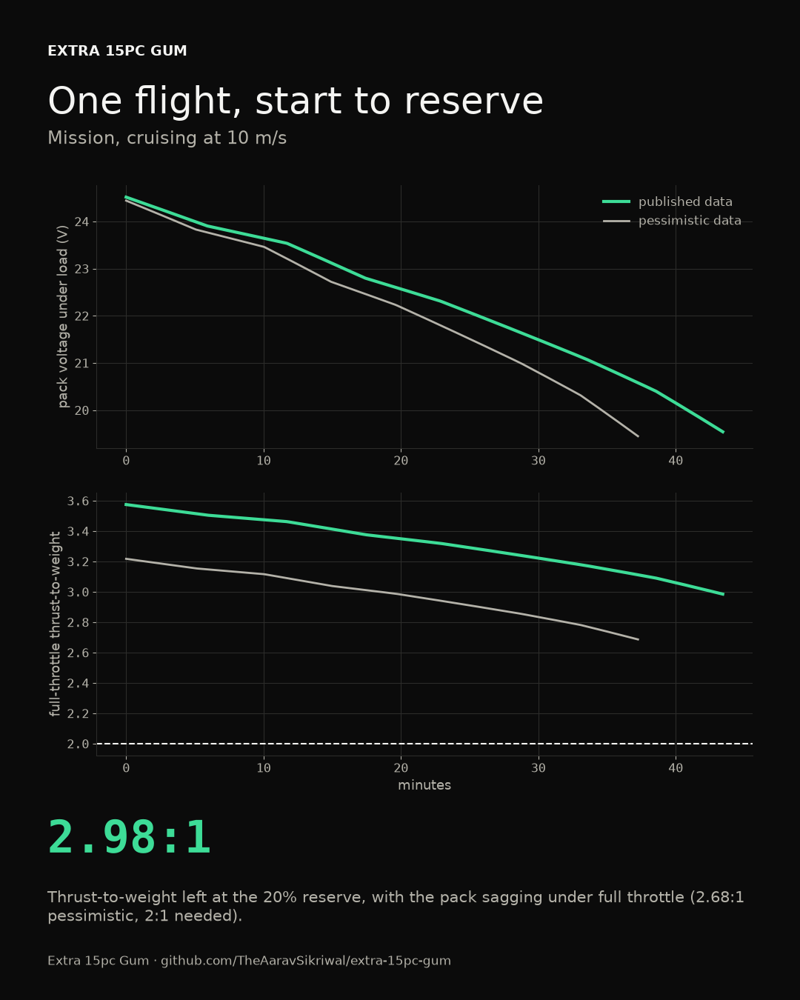
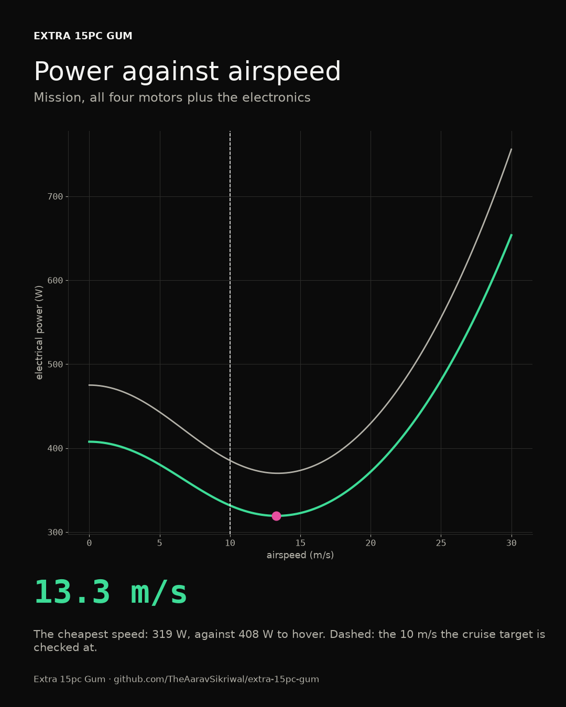
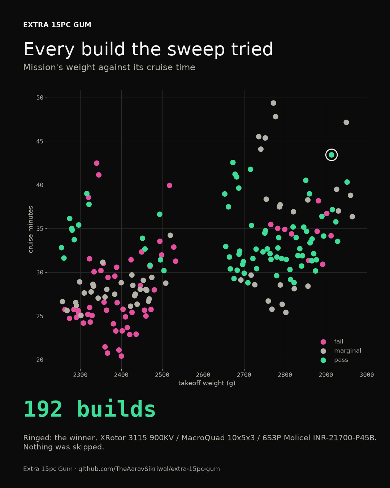
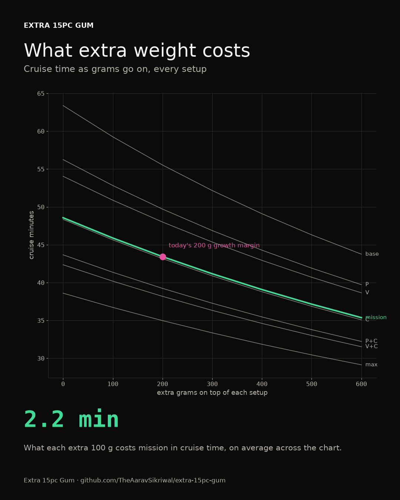

# Sizing report

*Generated on 2026-10-17 by pcs14 0.1.0, the sizing model in `src/pcs14/sizing/`. Numbers shown as A / B are the published data / the pessimistic version. Rounding always goes toward failing.*

## The verdict

**Pass.** Every required setup (base, V, P, mission) meets every target, even with pessimistic data.

The motors and battery are sized for **mission**, carrying an extra 200 g of growth margin. Setups marked optional get checked and reported, but don't have to pass.

## The build

| Part | Pick | Mass | Numbers from |
|---|---|---|---|
| Motors (4) | Hobbywing XRotor 3115 900KV | 125 g each | [manufacturer](https://www.hobbywing.com/en/uploads/file/20250207/b3367f67ec54b0ac2556316c345a9168.pdf) |
| Props (4) | HQProp MacroQuad 10x5x3 (10 x 5 in, 3 blades) | 23 g each | [manufacturer](https://www.hqprop.com/hq-macroquad-prop-10x5x32ccw2cw-black-glass-fiber-reinforced-nylon-p0299.html) |
| Thrust table | 24 V, 7 rows | | [manufacturer](https://www.hobbywing.com/en/uploads/file/20250207/b3367f67ec54b0ac2556316c345a9168.pdf) |
| Pack | 6S3P Molicel INR-21700-P45B: 13500 mAh, 33 milliohms, 135 A continuous | 1320 g | [manufacturer](https://www.molicel.com/wp-content/uploads/INR21700P45B_1.4_Product-Data-Sheet-of-INR-21700-P45B-80109.pdf) |
| ESC | Holybro Tekko32 F4 4in1 50A (AM32) | 14 g | [manufacturer](https://holybro.com/products/tekko32-f4-4in1-50a-esc) |
| Frame | iFlight Nazgul XL10 V6 10-inch frame | 343 g | [manufacturer](https://shop.iflight.com/xl10-v6-10-inch-fpv-frame-Pro1967) |
| Current cap | 135 A, set in my firmware (100% of the pack's rating) | | |

## Every setup

| Setup | Modules | Required | Weight | Hover | Cruise at 10 m/s | Thrust-to-weight at the reserve | Verdict |
|---|---|---|---|---|---|---|---|
| base | none | yes | 2392 g | 48.8 / 41.6 min | 63.3 / 54.2 min | 3.63 / 3.27:1 | pass |
| V | V | yes | 2545 g | 42.9 / 36.7 min | 54.0 / 46.4 min | 3.41 / 3.07:1 | pass |
| P | P | yes | 2561 g | 44.0 / 37.5 min | 56.2 / 48.0 min | 3.39 / 3.05:1 | pass |
| C | C | optional | 2792 g | 38.4 / 32.7 min | 48.3 / 41.3 min | 3.11 / 2.80:1 | fail |
| mission | V+P | yes | 2914 g (with 200 g margin) | 35.1 / 30.0 min | 43.4 / 37.2 min | 2.98 / 2.68:1 | pass |
| V+C | V+C | optional | 2945 g | 34.4 / 29.4 min | 42.3 / 36.3 min | 2.95 / 2.65:1 | fail |
| P+C | P+C | optional | 2961 g | 35.1 / 29.8 min | 43.6 / 37.3 min | 2.93 / 2.64:1 | fail |
| max | V+P+C | optional | 3114 g | 31.6 / 27.0 min | 38.5 / 33.0 min | 2.79 / 2.51:1 | fail |

Every check, setup by setup:

base: pass

| Check | Published / pessimistic | Target | Margin | Verdict |
|---|---|---|---|---|
| Hover time | 48.8 / 41.6 min | at least 25.0 min | +96% | pass |
| Cruise time at 10 m/s | 63.3 / 54.2 min | at least 30.0 min | +111% | pass |
| Thrust-to-weight at the reserve | 3.63 / 3.27:1 | at least 2.00:1 | +82% | pass |
| Full-throttle current | 135.0 A | at most 135.0 A | +0% | pass |

- Thrust-to-weight at the reserve: Full throttle at 20% charge, with the pack sagging under the load
- Full-throttle current: All four motors flat out on a full pack. The firmware caps it at 135 A; without the cap it would pull 194 A
- Cheapest speed: 13.7 m/s, for 66.7 min of cruise.
- Top speed: 138 km/h on a full pack, 133 at half charge, 130 at the reserve.

V: pass

| Check | Published / pessimistic | Target | Margin | Verdict |
|---|---|---|---|---|
| Hover time | 42.9 / 36.7 min | at least 21.0 min | +105% | pass |
| Cruise time at 10 m/s | 54.0 / 46.4 min | at least 25.0 min | +116% | pass |
| Thrust-to-weight at the reserve | 3.41 / 3.07:1 | at least 2.00:1 | +71% | pass |
| Full-throttle current | 135.0 A | at most 135.0 A | +0% | pass |
| Top speed at half charge | 119 / 117 km/h | at least 80 km/h | +49% | pass |
| Holds position in 10 m/s wind | 3.33 / 3.00x | at least 1.30x | +157% | pass |

- Thrust-to-weight at the reserve: Full throttle at 20% charge, with the pack sagging under the load
- Full-throttle current: All four motors flat out on a full pack. The firmware caps it at 135 A; without the cap it would pull 194 A
- Holds position in 10 m/s wind: Thrust available over thrust needed, at 10 m/s of airspeed and 20% charge
- Cheapest speed: 12.9 m/s, for 55.8 min of cruise.
- Top speed: 123 km/h on a full pack, 119 at half charge, 116 at the reserve.

P: pass

| Check | Published / pessimistic | Target | Margin | Verdict |
|---|---|---|---|---|
| Hover time | 44.0 / 37.5 min | at least 21.0 min | +110% | pass |
| Cruise time at 10 m/s | 56.2 / 48.0 min | at least 25.0 min | +125% | pass |
| Thrust-to-weight at the reserve | 3.39 / 3.05:1 | at least 2.00:1 | +70% | pass |
| Full-throttle current | 135.0 A | at most 135.0 A | +0% | pass |
| Top speed at half charge | 127 / 124 km/h | at least 80 km/h | +59% | pass |
| Holds position in 10 m/s wind | 3.33 / 2.99x | at least 1.30x | +156% | pass |

- Thrust-to-weight at the reserve: Full throttle at 20% charge, with the pack sagging under the load
- Full-throttle current: All four motors flat out on a full pack. The firmware caps it at 135 A; without the cap it would pull 194 A
- Holds position in 10 m/s wind: Thrust available over thrust needed, at 10 m/s of airspeed and 20% charge
- Cheapest speed: 13.6 m/s, for 58.9 min of cruise.
- Top speed: 131 km/h on a full pack, 127 at half charge, 123 at the reserve.

C: fail

| Check | Published / pessimistic | Target | Margin | Verdict |
|---|---|---|---|---|
| Hover time | 38.4 / 32.7 min | at least 17.0 min | +126% | pass |
| Cruise time at 10 m/s | 48.3 / 41.3 min | at least 20.0 min | +142% | pass |
| Thrust-to-weight at the reserve | 3.11 / 2.80:1 | at least 2.00:1 | +56% | pass |
| Full-throttle current | 135.0 A | at most 135.0 A | +0% | pass |
| Takeoff weight | 2793 g | at most 2500 g | -12% | fail |

- Thrust-to-weight at the reserve: Full throttle at 20% charge, with the pack sagging under the load
- Full-throttle current: All four motors flat out on a full pack. The firmware caps it at 135 A; without the cap it would pull 194 A
- Cheapest speed: 13.8 m/s, for 50.9 min of cruise.
- Top speed: 129 km/h on a full pack, 125 at half charge, 121 at the reserve.

mission: pass

| Check | Published / pessimistic | Target | Margin | Verdict |
|---|---|---|---|---|
| Hover time | 35.1 / 30.0 min | at least 21.0 min | +67% | pass |
| Cruise time at 10 m/s | 43.4 / 37.2 min | at least 25.0 min | +74% | pass |
| Thrust-to-weight at the reserve | 2.98 / 2.68:1 | at least 2.00:1 | +49% | pass |
| Full-throttle current | 135.0 A | at most 135.0 A | +0% | pass |
| Top speed at half charge | 116 / 114 km/h | at least 80 km/h | +46% | pass |
| Holds position in 10 m/s wind | 2.91 / 2.62x | at least 1.30x | +124% | pass |

- Thrust-to-weight at the reserve: Full throttle at 20% charge, with the pack sagging under the load
- Full-throttle current: All four motors flat out on a full pack. The firmware caps it at 135 A; without the cap it would pull 194 A
- Holds position in 10 m/s wind: Thrust available over thrust needed, at 10 m/s of airspeed and 20% charge
- Cheapest speed: 13.3 m/s, for 45.1 min of cruise.
- Top speed: 121 km/h on a full pack, 117 at half charge, 113 at the reserve.

V+C: fail

| Check | Published / pessimistic | Target | Margin | Verdict |
|---|---|---|---|---|
| Hover time | 34.4 / 29.4 min | at least 17.0 min | +103% | pass |
| Cruise time at 10 m/s | 42.3 / 36.3 min | at least 20.0 min | +112% | pass |
| Thrust-to-weight at the reserve | 2.95 / 2.65:1 | at least 2.00:1 | +48% | pass |
| Full-throttle current | 135.0 A | at most 135.0 A | +0% | pass |
| Takeoff weight | 2946 g | at most 2500 g | -18% | fail |

- Thrust-to-weight at the reserve: Full throttle at 20% charge, with the pack sagging under the load
- Full-throttle current: All four motors flat out on a full pack. The firmware caps it at 135 A; without the cap it would pull 194 A
- Cheapest speed: 13.1 m/s, for 43.8 min of cruise.
- Top speed: 118 km/h on a full pack, 114 at half charge, 111 at the reserve.

P+C: fail

| Check | Published / pessimistic | Target | Margin | Verdict |
|---|---|---|---|---|
| Hover time | 35.1 / 29.8 min | at least 17.0 min | +107% | pass |
| Cruise time at 10 m/s | 43.6 / 37.3 min | at least 20.0 min | +118% | pass |
| Thrust-to-weight at the reserve | 2.93 / 2.64:1 | at least 2.00:1 | +47% | pass |
| Full-throttle current | 135.0 A | at most 135.0 A | +0% | pass |
| Takeoff weight | 2962 g | at most 2500 g | -18% | fail |

- Thrust-to-weight at the reserve: Full throttle at 20% charge, with the pack sagging under the load
- Full-throttle current: All four motors flat out on a full pack. The firmware caps it at 135 A; without the cap it would pull 194 A
- Cheapest speed: 13.7 m/s, for 45.8 min of cruise.
- Top speed: 124 km/h on a full pack, 120 at half charge, 117 at the reserve.

max: fail

| Check | Published / pessimistic | Target | Margin | Verdict |
|---|---|---|---|---|
| Hover time | 31.6 / 27.0 min | at least 17.0 min | +86% | pass |
| Cruise time at 10 m/s | 38.5 / 33.0 min | at least 20.0 min | +93% | pass |
| Thrust-to-weight at the reserve | 2.79 / 2.51:1 | at least 2.00:1 | +40% | pass |
| Full-throttle current | 135.0 A | at most 135.0 A | +0% | pass |
| Takeoff weight | 3115 g | at most 2500 g | -25% | fail |

- Thrust-to-weight at the reserve: Full throttle at 20% charge, with the pack sagging under the load
- Full-throttle current: All four motors flat out on a full pack. The firmware caps it at 135 A; without the cap it would pull 194 A
- Cheapest speed: 13.1 m/s, for 39.9 min of cruise.
- Top speed: 115 km/h on a full pack, 111 at half charge, 107 at the reserve.

## Mass budget: mission

| Line | Mass |
|---|---|
| Frame: iFlight Nazgul XL10 V6 10-inch frame | 343 g |
| 4 motors: Hobbywing XRotor 3115 900KV | 500 g |
| 4 props: HQProp MacroQuad 10x5x3 | 93 g |
| ESC: Holybro Tekko32 F4 4in1 50A (AM32) | 14 g |
| Pack: 6S3P Molicel INR-21700-P45B | 1320 g |
| Kakute H7 V1.5 flight controller | 8 g |
| RP2 V2 ExpressLRS 2.4 GHz receiver | 1 g |
| TF-Luna lidar | 5 g |
| Teensy 4.1 (safety monitor) | 15 g |
| Safety monitor IMU breakout and signal switch | 5 g |
| R111 Remote ID broadcast module | 14 g |
| Wiring, XT60 lead, battery strap and hardware | 45 g |
| Module mount and connector | 30 g |
| M10Q-5883 GPS and compass | 8 g |
| Folding GPS mast | 10 g |
| Camera Module 3 | 4 g |
| Raspberry Pi 5 (4 GB) companion computer | 46 g |
| Active cooler for the Pi 5 | 15 g |
| HT-HC01P Wi-Fi HaLow card with Pi HAT | 15 g |
| BEC12S-PRO 5 V 5 A supply for the Pi | 5 g |
| Module V housing and mounts | 50 g |
| Harrier 40-42 parachute bundle | 154 g |
| Module P mount | 15 g |
| Growth margin | 200 g |
| **Total** | **2914 g** |

## One flight, start to reserve

## Power and speed

The cruise targets are checked at 10 m/s for now. The speed that actually costs mission the least is 13.3 m/s, where it cruises for 45.1 min.

## The sweep

192 builds tried, ranked by verdict, then by how far their tightest required check clears its limit.

| Rank | Build | Frame | Verdict | Tightest margin | mission cruise |
|---|---|---|---|---|---|
| 1 | XRotor 3115 900KV / MacroQuad 10x5x3 / 6S3P Molicel INR-21700-P45B | Nazgul XL10 V6 10-inch frame | pass | +46% | 43.4 min |
| 2 | XRotor 3115 900KV / MacroQuad 10x5x3 / 6S3P Molicel INR-21700-P42A | Nazgul XL10 V6 10-inch frame | pass | +45% | 40.5 min |
| 3 | XRotor 3115 900KV / MacroQuad 10x4.5x3 / 6S3P Molicel INR-21700-P45B | Nazgul XL10 V6 10-inch frame | pass | +42% | 37.1 min |
| 4 | XRotor 3115 900KV / MacroQuad 10x5x3 / 6S3P Samsung SDI INR21700-40T | Nazgul XL10 V6 10-inch frame | pass | +37% | 38.9 min |
| 5 | E3 2814 850KV / 1050 3-blade / 6S3P Molicel INR-21700-P42A | Nazgul XL10 V6 10-inch frame | pass | +36% | 38.9 min |
| 6 | E3 2814 850KV / 1050 3-blade / 6S3P Samsung SDI INR21700-40T | Nazgul XL10 V6 10-inch frame | pass | +36% | 37.4 min |
| 7 | XRotor 3115 900KV / MacroQuad 9x5x3 / 6S3P Molicel INR-21700-P45B | Nazgul XL10 V6 10-inch frame | pass | +36% | 36.3 min |
| 8 | XRotor 3115 900KV / MacroQuad 9x5x3 / 6S3P Molicel INR-21700-P42A | Nazgul XL10 V6 10-inch frame | pass | +35% | 33.9 min |
| 9 | E3 3115 900KV / 1050 3-blade / 6S3P Molicel INR-21700-P45B | Nazgul XL10 V6 10-inch frame | pass | +34% | 35.1 min |
| 10 | XRotor 3115 900KV / MacroQuad 9x5x3 / 6S3P Molicel INR-21700-P45B | Chimera9 ECO 9-inch frame | pass | +34% | 35.7 min |

## What extra weight costs

Cruise minutes as extra grams go on:

| Setup | +0 g | +100 g | +200 g | +300 g | +400 g | +500 g | +600 g |
|---|---|---|---|---|---|---|---|
| base | 63.3 | 59.2 | 55.5 | 52.1 | 49.0 | 46.3 | 43.7 |
| V | 54.0 | 50.8 | 47.9 | 45.3 | 42.9 | 40.7 | 38.6 |
| P | 56.2 | 52.8 | 49.7 | 46.8 | 44.2 | 41.9 | 39.7 |
| mission | 48.5 | 45.8 | 43.4 | 41.1 | 39.0 | 37.1 | 35.3 |

## How the numbers are made

- **Hover** power comes straight from the thrust table (volts x amps at the table's voltage). The battery model turns it into current with the pack's sag included.
- **Forward flight** splits each prop's power into lifting power, blade drag and the power to push the drone through the air, fitted to the hover table. Real rotors need 15% more lifting power than ideal theory, and blade drag takes 25% of a small prop's hover power.
- **The battery** is each cell's resting-voltage curve plus its internal resistance, scaled to the pack plus the wiring, stepped through the flight a few seconds at a time.
- **Pessimistic data** cuts every thrust in the table: thrust stand 2%, independent test 5%, manufacturer 10%, estimate 15%, made up 10%.
- **Holding position in wind** means flying at that airspeed at the 20% reserve with 30% more thrust available than needed. **Top speed** is checked at 50% charge, and the drone won't lean past 45 degrees.

## What this can't tell you

- Manufacturer thrust data runs optimistic. The pessimistic numbers allow for that, but only a thrust stand can say by how much.
- mission hovers at 729 g per motor, below the thrust table's first row (1089 g at 40% throttle). Down there the hover power is scaled from that row with momentum theory instead of read from a measured point, and that tends to come out a little low on power, so a little long on flight time.
- Cruise is the shakiest number here. The honesty check ([validation.md](validation.md)) flew a published long-range build through the model, and its cruise time came out much longer than the measured one, most likely because the drag of the props at speed isn't modeled yet. Trust the hover numbers more than the cruise ones for now.
- Drag is a guess from frontal area until the wind tunnel side track has real numbers.
- Coming straight down fast (the vortex ring state), cold weather and aging cells aren't modeled.
- The ESC's limits, wiring losses and heat get checked in the electrical step.
