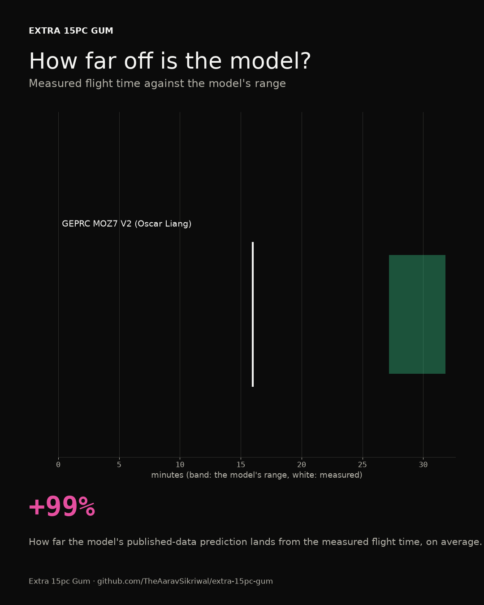

# How far off is the model?

*Generated on 2026-10-17 by pcs14 0.1.0. Each published build gets flown by the model with its own parts, weight and stopping point, and the model's flight time goes next to the measured one. The model gives a range: the published thrust data at the top, the pessimistic version at the bottom.*

## Published builds

| Build | What was measured | Measured | Model (published / pessimistic) | Off by | Inside the range? | Drag area it would take to match | Measured by |
|---|---|---|---|---|---|---|---|
| GEPRC MOZ7 V2 (Oscar Liang) | cruising at 15.6 m/s, down to 3.00 V per cell under load | 16.0 min | 31.9 / 27.2 min | +99% | no | 540 cm2 (estimated 100) | independent measurement, [independent test](https://oscarliang.com/geprc-moz7-v2/) |

On average the model's published-data prediction is 99% long, and 0 of 1 measurements land inside its range.

What had to be estimated, build by build:

- GEPRC MOZ7 V2 (Oscar Liang): Not published, so estimated: drag area 100 cm2 (a 7.5 inch frame with a camera cage and a 6S2P 18650 pack, at a drag coefficient of 1.0), and 8 W for the DJI O4 Pro video system, flight controller, receiver and GPS. Cruise speed 15.6 m/s is the 15 km over about 16 minutes, and the landing point (3.0 V per cell under load) is a typical Li-ion landing, since the review doesn't give one. The 15-20 mph wind isn't modeled, and the motor's table starts at 50% throttle, above this drone's hover

## The battery model against real discharge curves

The model's voltage under a steady current is the cell's resting curve minus current times internal resistance. Here it is against measured discharges. A negative mean means the real cell sags more than the model says.

| Cell | Current | RMS error | Mean error | Measured by |
|---|---|---|---|---|
| Molicel INR-21700-P42A | 10 A | 0.017 V | -0.007 V | [independent test](https://lygte-info.dk/pic/Batteries2012/Molicel%20INR21700-P42A%204200mAh%20(Gray)/Molicel%20INR21700-P42A%204200mAh%20(Gray)-Capacity.png) |
| Molicel INR-21700-P45B | 10 A | 0.025 V | -0.004 V | [independent test](https://i.imgur.com/5TmcfPp.jpg) |
| Samsung SDI INR21700-40T | 10 A | 0.034 V | -0.027 V | [independent test](https://lygte-info.dk/pic/Batteries2012/Samsung%20INR21700-40T%204000mAh%20(Cyan)/Samsung%20INR21700-40T%204000mAh%20(Cyan)-Capacity.png) |
| Samsung SDI INR21700-50S | 10 A | 0.059 V | -0.026 V | [manufacturer](https://cdn03.plentymarkets.com/i9a0e0hd8l6w/frontend/Datenblaeter/Samsung/INR21700-50S/INR21700-50S_Introduction_of_INR21700-50S_2022_v1_20220301_.pdf) |
