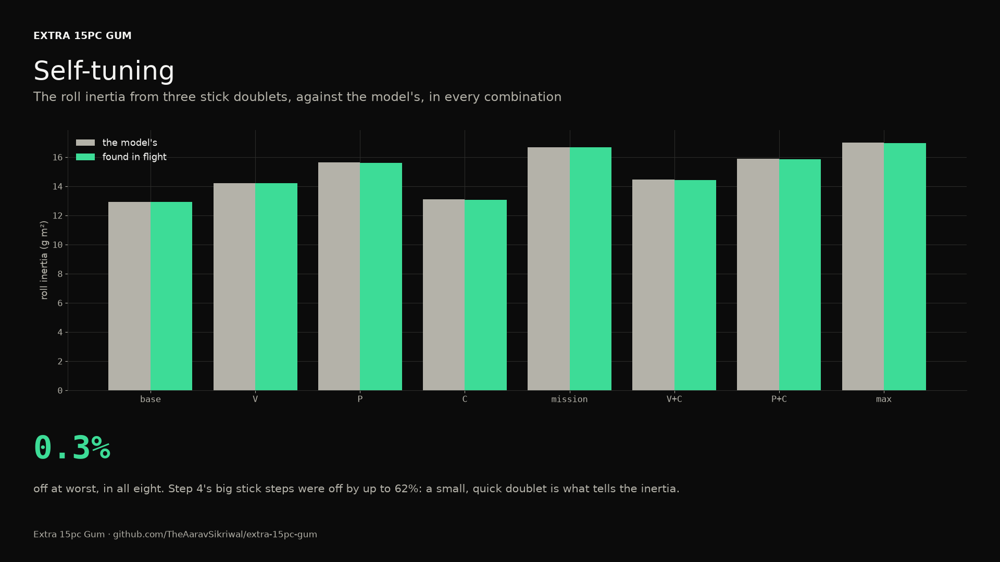
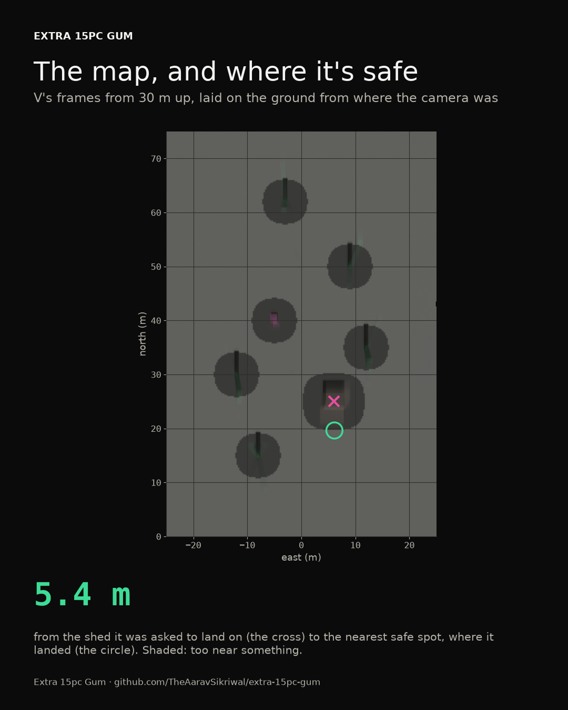
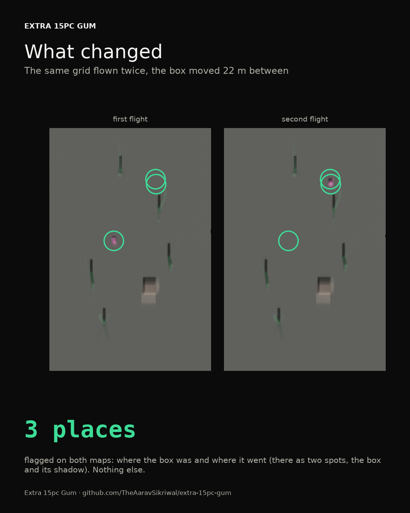
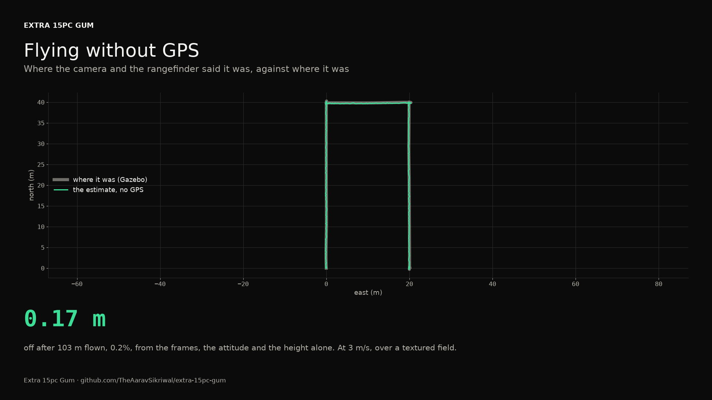
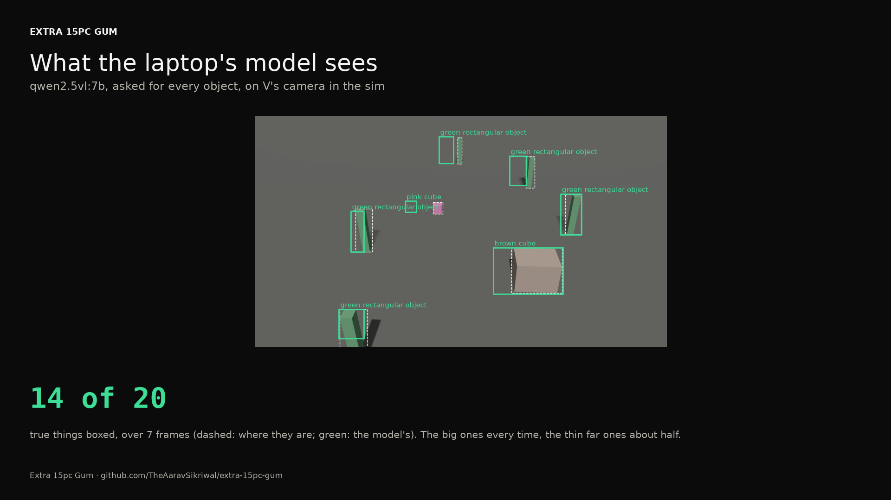

# Smart features in sim (step 7)

*Generated 2026-10-21 by `pcs14 smart`, from the flight sim's runs of step 7's scenarios on my firmware, and the local vision model on step 6's camera frames. The spec is [docs/specs/2026-10-20-smart-features.md](../../specs/2026-10-20-smart-features.md).*

## The verdict

**pass.** 22 of 22 runs pass, and the object detection passes its grade.

Every feature here works in the sim, and every one has limits the sim can't show. Those are at the end, and on the site's unproven list.

## Landing modes

Base, 15 m up and 30 m north, then each of the three ways down.

| Mode | Where it came down | Touchdown |
|---|---|---|
| land now | down 0.1 m from where it was asked to land | came down at 0.7 m/s at the end, a controlled landing |
| back to start | down 0.0 m from where it was asked to land | came down at 0.7 m/s at the end, a controlled landing |
| land here | down 0.1 m from where it was asked to land | came down at 0.8 m/s at the end, a controlled landing |

## Wind and the turn-back warning

Hovering in a 6 m/s wind, the drone leans until its thrust's sideways part matches the drag, and the lean gives the wind back. Then 600 m out with the wind behind it and home into it. The warning predicts the energy home at the turn; the grade holds it against what the flight used. The warning never counts on forward flight being cheaper than a hover, because Gazebo's rotors don't make it so, and the first prediction, which did, came out 39% short.

| Combination | Wind sensed | Energy home: predicted against used | My firmware's gauge |
|---|---|---|---|
| V | 6.0 m/s from 180 degrees, against the sim's 6 from 180 | predicted 5.5 Wh at the turn, the flight used 5.9 Wh: -8% | my firmware's own gauge counted 6.4 Wh on the way home |
| mission | 6.0 m/s from 180 degrees, against the sim's 6 from 180 | predicted 6.1 Wh at the turn, the flight used 6.7 Wh: -8% | my firmware's own gauge counted 7.2 Wh on the way home |
| V+C | 6.0 m/s from 180 degrees, against the sim's 6 from 180 | predicted 7.0 Wh at the turn, the flight used 6.7 Wh: +5% | my firmware's own gauge counted 7.2 Wh on the way home |
| max | 6.0 m/s from 180 degrees, against the sim's 6 from 180 | predicted 7.7 Wh at the turn, the flight used 7.4 Wh: +4% | my firmware's own gauge counted 7.9 Wh on the way home |

## Self-tuning

Three roll doublets on the stick in every combination, 10 m up: a quarter stick one way for a quarter second, then the other. The inertia comes from the gyro's roll rate against the torque the motors' commanded speeds make, fitted over each doublet's own window with the motors' lags (faster up than down) and the dead time between a command and the motors, found along with it. My rate loops multiply by the inertia, so the found one is the combination's profile, and the gains stay as they are.

| Combination | Found | The model's | Off | Fit | Dead time |
|---|---|---|---|---|---|
| base | 0.01292 kg m² | 0.01293 kg m² | -0.1% | 1.000 | 8 ms |
| V | 0.01421 kg m² | 0.01422 kg m² | -0.1% | 1.000 | 8 ms |
| P | 0.01559 kg m² | 0.01563 kg m² | -0.3% | 1.000 | 8 ms |
| C | 0.01306 kg m² | 0.01310 kg m² | -0.3% | 1.000 | 8 ms |
| mission | 0.01667 kg m² | 0.01668 kg m² | -0.1% | 1.000 | 8 ms |
| V+C | 0.01444 kg m² | 0.01445 kg m² | -0.1% | 1.000 | 8 ms |
| P+C | 0.01585 kg m² | 0.01589 kg m² | -0.3% | 1.000 | 8 ms |
| max | 0.01697 kg m² | 0.01700 kg m² | -0.2% | 1.000 | 8 ms |

Getting here took three tries. Step 4's 15 degree stick steps came out 9 to 62% high. Held for 2 s, a step like that has the drone sliding sideways at several m/s, and most likely the rotors' drag, 4.7 cm above the center of gravity, makes a roll moment the fit doesn't know about. The first doublets read 12% low in base, fitted over stretches picked out by how busy the torque was, with one trim for the whole flight; fitting each doublet on its own window fixed that. And Max and mission still read 13% low until the grade used the motors' commands at their own 250 Hz instead of the ground truth's 50, which smoothed away the fast changes the fit needs. Gazebo's own answer was checked in zero gravity, with a known torque on the body: 0.01292 kg m² in base's roll against the model's 0.01293.

## A plain-English mission

- the plan: "Take off and go to the point 80 m north and 40 m east of home, 30 m up, and wait there 15 seconds. Then go to the point 0 m north and 60 m west of home, still 30 m up. Then come home.", approved by the test script, in the sim (on the drone, the approving is mine)
- waypoint 1: came within 0.0 m of 80 m north, 40 m east, 30 m up
- waypoint 2: came within 0.0 m of 0 m north, -60 m east, 30 m up
- no fly-away: ended on the ground, 0 m from where it started

The local model (Qwen2.5 7B through Ollama) writes the plan, the checker checks it against the limits profile and the drone, and it's saved unapproved. In the sim the test script approves it and says so; on the drone that's me. The finding worth more than the pass: asked to fly 60 m west of home, the model wrote a point north and east, and the checker passed it, since it was safe. So the plan gets drawn on a map before I approve it.

## The spiral descent and soar mode

- spiral descent, the helix: at most 0.3 m off the circle
- spiral descent, the sink rate: sank at 1.48 m/s, asked for 1.5
- lift, lift found: 0.13 N less thrust in the column, 4.7 standard errors past zero
- lift, the updraft: 4.2 m/s rising, by the push on the body (the sim's 4); a real rotor would save about 76 W in it

## Mapping, change detection and safe spots

V's camera pointed straight down, a three-line grid 30 m up over step 6's scenery, and the orthomosaic from the frames and the log's poses. Then the same grid with the box moved 22 m, the two maps differenced. Then, asked to land on the shed, the nearest safe spot.

- mapping run, the map: 100% of the area seen
- mapping run: 7 of 7 things on the map within a meter of where they stand
- mapping run, box moved, where it was: flagged where the box was
- mapping run, box moved, where it went: flagged where the box went
- mapping run, box moved, nothing else: nothing else flagged
- safe landing, landed on the spot: 0.0 m from the spot it chose, 6.1 m east and 19.6 m north, 5.4 m from the shed it was asked to land on
- safe landing, clear where it landed: clear of everything by the clearance
- safe landing, the map's choice: the orthomosaic would have picked -0.6 m east, 25.5 m north, which is clear in truth; it calls 74% of the area safe, the true map 88%

## GPS-free flight's estimate

V's camera pointed down, 6 m up over a textured field (Gazebo's ground is one flat color, which gives the correlation nothing), around three sides of a 40 by 20 m rectangle at 3 m/s. The position comes from the frames alone: how far the ground slides between frames (phase correlation, refined to a hundredth of a pixel), turned into meters with the attitude and the TF-Luna's height. The attitude is the sim's truth tilted by half a degree of noise, the height the truth with the TF-Luna's 2%.

- drift at the end: 0.17 m off after 103 m flown (0.2%)
- worst drift: at worst 2.0% of the distance flown, past the first 10 m

The first try flew the legs at my firmware's own pace, about 15 m/s: 1.5 m between frames at 6 m up, a fifth of the frame, with the drone tilted 30 degrees, and the frames stopped matching. It drifted 12.6%. Flow-only flight is slow flight.

## Object detection

qwen2.5vl:7b through Ollama, on 7 of step 6's camera frames: a hover looking ahead, five along the dash north, one past everything. Each true box is worked out from where Gazebo put each thing and where the camera was. The prompt, chosen from three tried on one frame: "Locate every object in this image, however small, and output their bbox coordinates in JSON format with a label for each."

- found: 14 of 20 true things with a box near them (median overlap 0.76)
- the shed: in 4 of the 4 frames it's in
- false alarms: 3 boxes on nothing, over 7 frames

What it called them: the box: pink cube; the shed: beige cube, brown and black object, brown cube, brown object; the tree: green and black object, green object, green rectangular object.

So it's a describer and a coarse detector: the big things every time, about two thirds of everything, with boxes good enough to point at but not to land by. Safe spots stay on the map's heights.

## The Meshtastic relay

How far a node reaches: one on the ground (1.5 m up, in someone's hand) to another on the ground, and one riding on the drone at 100 m to one on the ground. Flat ground, a 10 dB margin (pcs14.smart.relay):

| Preset | Ground to ground | Drone to ground |
|---|---|---|
| ShortFast | 3.2 km | 25.9 km |
| MediumFast | 4.2 km | 34.5 km |
| LongFast | 5.6 km | 46.0 km |

## What it can't prove

- Gazebo's rotors don't feel the air: no cheaper forward flight, no lift from rising air on the rotors, no vortex ring state. So the turn-back warning was checked against the sim's power, not a real pack's; soar mode's real saving (about 76 W in a 4 m/s column, by momentum theory) is a number, not a measurement; and the spiral descent's whole reason for being, keeping out of its own downwash, can't be shown here. *First to measure:* The forward-flight power from a GPS-logged cruise with the current logged; a hover in a known updraft (a slope on a windy day) for soar mode; careful descent tests for the vortex ring state.
- Wind sensing reads the sim's wind exactly because the estimate and Gazebo use the same drag formula. A real drone's drag area and its lean in gusts will make it worse. *First to measure:* A hover beside an anemometer on a mast, the two compared.
- Self-tuning's 0.3% is a clean sim: motors that follow a first-order lag exactly, a gyro with little noise, no blade flapping or rotor damping. A real drone will do worse, and the fit runs on the ground from the log for now, not on board. *First to measure:* Three stick doublets, tethered and logged, the fit's inertia against the CAD's and against a swing test of the frame on a bifilar pendulum.
- GPS-free flight's estimate flew over a made-up textured field at 3 m/s and 6 m up, with the sim's true attitude plus noise. No motion blur, no rolling shutter, no light changing, no grass moving. At 15 m/s the frames stopped matching (12.6% drift). The TF-Luna it needs for its height reads to 8 m at best, less in sunlight. And it isn't in the loop yet: my firmware doesn't fly on it. *First to measure:* The same rectangle at 3 m/s over grass, GPS logged but not used, the estimate against it.
- The maps are orthomosaics from known poses over flat ground: no heights (OpenDroneMap isn't installed), tall things lean on the map, and V's camera had to point straight down, which its bracket can't do (it's tipped 30 degrees for the live video). *First to measure:* A mapping run over a field with markers whose spacing is measured with a tape.
- Change detection and the safe spots ran on a world of flat colors. Real ground has texture, shadows that move with the sun, and grass that changes between flights. *First to measure:* The same mapping run on two days over the same field, with one thing moved.
- Object detection ran on colored boxes, not real things: the model calls them cubes and green rectangular objects. It drew a box around the whole frame on an empty one. And it ran on the PC's RTX 3060; how fast the laptop's integrated graphics runs it is unknown. *First to measure:* The model on the real camera's recorded video, scored against boxes drawn by hand, and its speed on the laptop.
- The plain-English missions' local model, asked for a point 60 m west of home, wrote one north and east. The checker passed it because it was safe. Only my approval, on a map, can catch a plan that's safe but wrong. *First to measure:* A log of what the model gets wrong over many requests; every plan drawn on the map before it's approved.
- The Meshtastic relay is a link budget over flat ground with a 10 dB margin: no trees, no hills, no other radios. Where the node lives (V, Base or its own module) is still open. *First to measure:* A walk-out range test with two nodes, one on a 10 m mast, then one on the drone.
