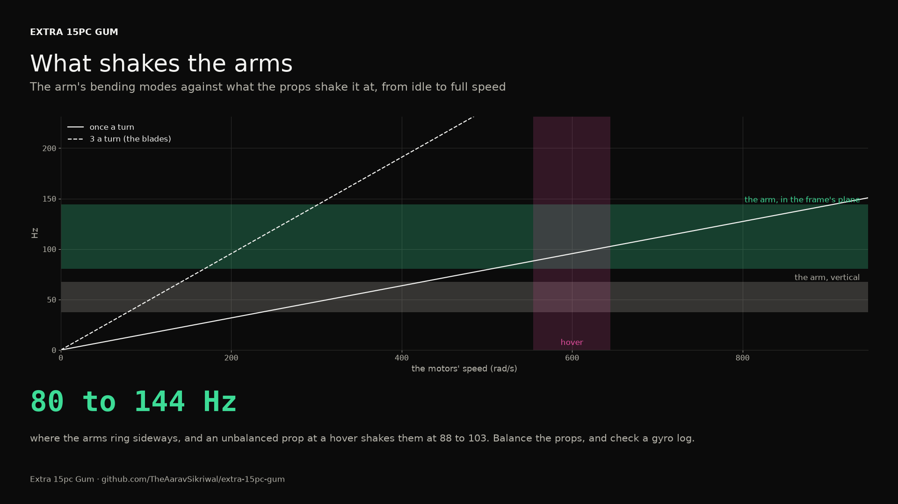

# Structure, first pass: beam math

*Generated 2026-10-21 by `pcs14 structure`: textbook beams and joints in Python, since FreeCAD and CalculiX aren't installed here. The spec is [docs/specs/2026-10-21-structure-beams.md](../../specs/2026-10-21-structure-beams.md). iFlight publishes nothing about the Nazgul's carbon, so its stiffness is swept from 40 to 70 GPa and the arm's free length 10% either way.*

## The verdict

**open.** The arms are strong enough by a wide margin. One of their bending modes sits near what the props shake them at in a hover, and the chute's mount rests on joints whose strength is a guess. Both go to the test plans.

## The arms under full thrust

Each arm is a 15 by 7 mm carbon cantilever, 185 mm from where it leaves the plates to the motor, carrying 103 g of motor and prop. At the top of the thrust table, 38.6 N a motor (more than my firmware's 90 A current cap lets it make):

| | Found | Against |
|---|---|---|
| Bending stress at the root | 58 MPa | at least 400 MPa: 6.9 times |
| The tip's sag | 2.7 to 4.7 mm | a degree or two of the motor's tilt |

## The arms' vibration

A spinning prop shakes its arm once a turn (any imbalance in the prop or the motor) and once a blade (3 a turn). The arm's first two bending modes, across the laminate's and the clamp's ranges:

| Mode | Frequency | The motors' speed that turns once a turn on it |
|---|---|---|
| vertical | 37 to 67 Hz | 235 to 424 rad/s |
| in the frame's plane | 80 to 144 Hz | 504 to 908 rad/s |

The hover's motor speed runs 554 to 645 rad/s across the combinations, 88 to 103 turns a second. Excitations within 15% of a mode at the hover:

| Mode | Combination | Excitation | At |
|---|---|---|---|
| in the frame's plane | base | once a turn | 88 Hz |
| in the frame's plane | C | once a turn | 96 Hz |
| in the frame's plane | max | once a turn | 103 Hz |
| in the frame's plane | mission | once a turn | 95 Hz |
| in the frame's plane | P | once a turn | 92 Hz |
| in the frame's plane | P+C | once a turn | 100 Hz |
| in the frame's plane | V | once a turn | 92 Hz |
| in the frame's plane | V+C | once a turn | 99 Hz |

The in-plane mode is the one that matters: an unbalanced prop at a hover shakes the arm sideways close to where it rings, so the gyro sees it. The vertical mode only gets passed through on the way up and down. The fix, if a gyro log shows it, is balancing the props first, then the flight controller's notch filter on that frequency; stiffer arms would move the mode up and away.

## The chute's mount

Step 6's textbook bound on the canopy's opening jolt: 254 N, the most of any combination. Each joint between the riser and the frame, with only half of its fasteners carrying it (prying and uneven fits):

| Joint | What one holds | Margin over the bound | Note |
|---|---|---|---|
| the Harrier's base: three 4-40 steel screws | 3120 to 4680 N | 24.5 to 36.8 | the screws themselves; their threads in the Harrier's base are unknown |
| the cradle's rail locks: two M3 steel screws in heat-set inserts | 300 to 800 N | 1.2 to 3.1 | an insert's pull-out in printed PETG, a guess |
| the rail on the top plate: four M3 nylon screws | 302 to 402 N | 2.4 to 3.2 | nylon 6/6 in tension |

The screws into the Harrier are far stronger than they need to be. The rail locks' heat-set inserts are the weak link, on numbers that are guesses, and the rail's four nylon screws are thin margin for something that carries the chute. Two changes suggest themselves: steel for those four (about 3 g more), and a hang test before P ever flies, which the test plans carry.

## A hard landing

Dropped 1 m (the motors cut at 1 m), the heaviest combination, 2.37 kg, lands with 23 J for the TPU legs to take. The firmware's own landings touch down at 0.7 to 0.8 m/s, under 1 J. Without an FE model the legs' strength is a test, not a number.

## What it can't prove

- The laminate: iFlight publishes nothing about the Nazgul's carbon, so its stiffness runs 40 to 70 GPa and its strength from 400 MPa, typical woven plate. *First to measure:* A tap test on a spare arm, clamped as on the frame, with a phone's accelerometer or a microphone: its ring frequency gives the stiffness.
- The clamp: where the arm's free length starts depends on how tightly the plates hold it, swept 10% either way here. *First to measure:* The same tap test on the built frame.
- The heat-set inserts' pull-out and the printed cradle and rail: guesses, and the weakest links between the chute's riser and the frame. *First to measure:* A hang test before P flies: 26 kg (the jolt's bound) from the riser's point on the mounted cradle for a minute, then 39 kg (one and a half times); nothing cracks, creeps or pulls out.
- Crashes, and the legs' TPU under a hard landing: no FE model without CalculiX. *First to measure:* Drop tests of the legs with a dummy weight, from 0.25 m up to 1 m.
